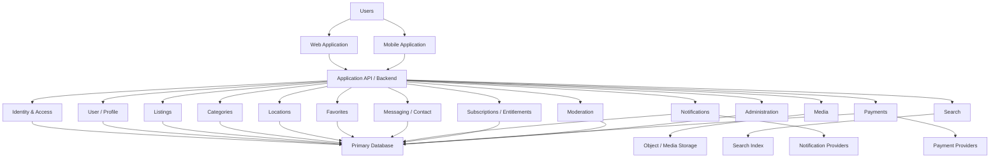
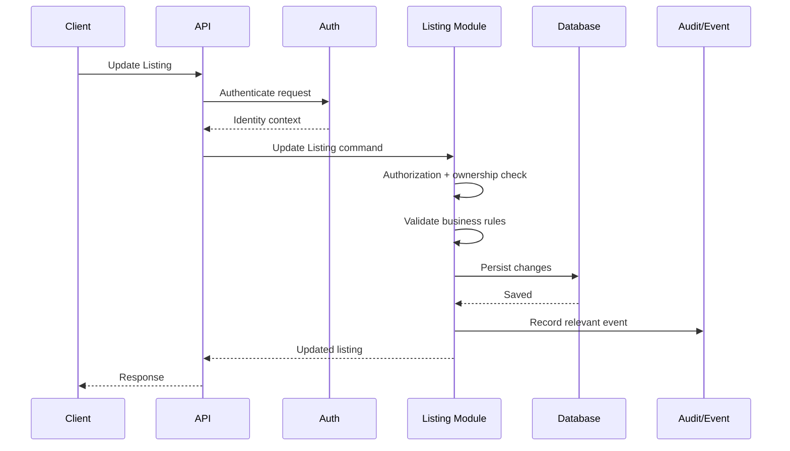
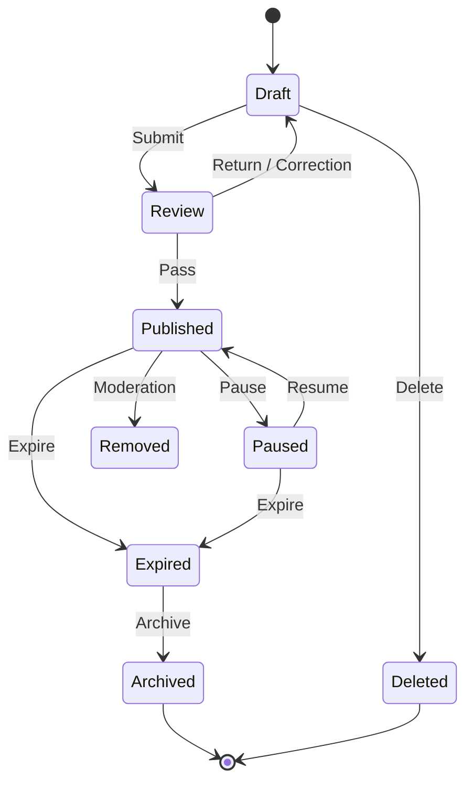
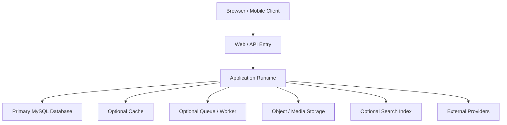
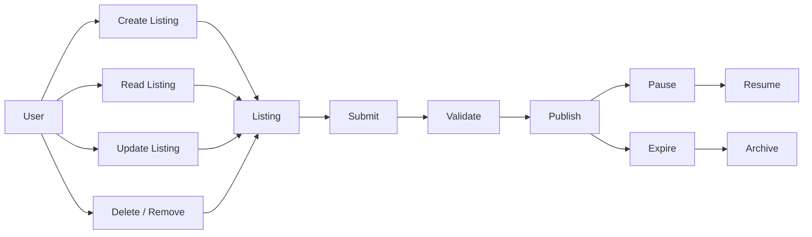

# 09. Software Architecture

> ## Current Baseline Reconciliation — 2026-10-09
> 

> The following V1 decisions are closed and must not be presented as unresolved choices in this document: PHP 8.5.x / Laravel 13 / FilamentPHP 5 and MySQL 9.7.x LTS-compatible baseline (Document 10); MySQL-first V1 search (ADR-004/ADR-008); local application/server media storage behind a provider-agnostic abstraction (ADR-005); Redis for queue/cache/locks with transactional outbox for durable event publication; manual payment submission plus admin review only; FCM native device tokens for V1; and Hostinger VPS as initial hosting. Future object-storage/CDN, dedicated search-engine migration, payment gateways, and later hosting/scaling topology remain future-phase decisions. Older proposal/open-decision inventories below are historical unless they explicitly concern one of those future-phase choices.
> 

**Project:** KHOJ BHET  

**Document:** Software Architecture  

**Document ID:** KB-TECH-009  

**Status:** Active  

**Version:** 1.0  

**Owner:** KHOJ BHET Engineering  

**Last Reviewed:** 2026-09-24  

**Parent:** 02. TECHNICAL DEFINITION  

**Previous:** 08. Product & Business Rules  

**Next:** 10. Technology Stack  

**Related:** 00.3 Decision / ADR Register, 03. Requirements Specification, 04. Users, Roles & Permissions, 05. User Stories & Use Cases, 06. User Flows, 07. UX/UI Specification, 08. Product & Business Rules, 13. Database Architecture, 14. API Specification, 15. Frontend Architecture, 16. Backend Architecture, 17. Mobile Application Architecture, 18. Authentication & Authorization, 19. Security Architecture, 20. Media & File Storage, 21. Search Architecture, 22. Notification System, 23. SEO Architecture

---

# 1. Document Purpose

This document defines the **system-level software architecture** of KHOJ BHET.

It explains how major parts of the platform are organized, how they communicate, where business responsibilities belong, how data and requests move through the system, and how the architecture can evolve as the marketplace grows.

This document intentionally separates:

- **Architecture** — structural boundaries and interaction patterns.
- **Technology Stack** — concrete frameworks, libraries, providers, and infrastructure choices.
- **Database Architecture** — persistent data model and database structures.
- **API Specification** — externally observable API contracts.
- **Frontend / Backend / Mobile Architecture** — implementation details for each application surface.

> **Core principle:** Choose the simplest architecture that preserves clear domain boundaries, security, maintainability, testability, and a credible path for future scale.
> 

# 2. Architectural Status and Decision Boundary

The architecture described here is the **current approved baseline** under ADR-001, while concrete technology choices remain governed by 10. Technology Stack and the relevant ADRs.

It must not be interpreted as approval of every technology currently being considered.

Current technology directions are:

- Web application: React / Next.js direction.
- Backend: Laravel 13 module-first modular monolith; FilamentPHP 5 for admin.
- Database: MySQL 9.7.x LTS-compatible baseline as pinned in Document 10 and Document 13.
- Authentication: Firebase Authentication Bearer ID tokens for marketplace users; separate Laravel/Filament admin identity and guard.
- Mobile: React Native + Expo — Accepted (ADR-003).
- Search: MySQL-first V1; dedicated search engine deferred under the applicable search ADR gate. Document 12 generic examples of Meilisearch or any legacy search-engine wording are superseded by ADR-004/ADR-008 and Documents 10, 13, 14 and 21.
- Storage: local application/server storage for V1 behind a provider-agnostic abstraction (ADR-005); CDN/object-storage migration deferred.
- Payments: manual submission + admin review only in V1; gateway adapters are future-phase candidates.
- Notifications: central notification module; FCM native device tokens for V1; SMS/email adapters for approved use cases; WhatsApp deferred (ADR-007).
- Background work: Laravel queues with Redis as queue/cache/lock infrastructure; transactional outbox is required for durable post-commit event publication.

Concrete technology choices belong primarily in **10. Technology Stack** and major choices must be accepted through the appropriate ADR.

# 3. Architectural Goals

The architecture should support:

1. Clear domain boundaries.
2. Low unnecessary operational complexity.
3. Fast initial development.
4. Maintainable long-term code.
5. Secure access to sensitive marketplace information.
6. Consistent business rules across clients.
7. Reliable listing lifecycle management.
8. SEO-friendly public marketplace discovery.
9. Web and future mobile clients.
10. Testability at module and system boundaries.
11. Controlled asynchronous processing.
12. Future extraction of selected modules when justified.
13. Cost-conscious initial operation.
14. Observability and recoverability.
15. Evolution without rewriting the whole platform.

# 4. Architectural Principles

### SA-PR-001 — Server-Side Authority

Business rules, authorization, entitlement, privacy, visibility, and lifecycle transitions must be enforced on trusted server-side components. The frontend is never the final security boundary.

### SA-PR-002 — Domain Ownership

Each business capability has a clearly identified owning module. A module owns its rules and exposes controlled interfaces to other modules.

### SA-PR-003 — Explicit Boundaries

Modules communicate through defined application interfaces rather than unrestricted access to each other's internal implementation.

### SA-PR-004 — Technology Independence

Core domain logic should avoid unnecessary coupling to UI frameworks, external providers, and infrastructure-specific APIs.

### SA-PR-005 — API-Centered Integration

Web, mobile, and future clients consume consistent application capabilities through defined APIs rather than implementing business rules independently.

### SA-PR-006 — Secure by Default

Sensitive information remains unavailable unless the requesting context satisfies authentication, authorization, entitlement, consent, privacy, and other applicable checks.

### SA-PR-007 — Asynchronous Where Appropriate

Slow or non-critical work should be separated from latency-sensitive request processing where appropriate, including media processing, search indexing, notifications, analytics, scheduled expiration, and some moderation work.

### SA-PR-008 — Observable Operations

Important requests, state transitions, failures, background jobs, and security-sensitive actions should produce sufficient logs or audit records.

### SA-PR-009 — Idempotent Critical Operations

Retryable operations must avoid unintended duplicate effects. This is particularly important for payments, notifications, publication, media processing, webhooks, and background jobs.

### SA-PR-010 — Evolution Before Extraction

A module should not become a separate service merely because it is logically distinct. Extraction requires concrete justification and a new ADR.

# 5. High-Level Architecture

The initial system follows a **modular application architecture** with separation between clients, application/API boundaries, business modules, infrastructure integrations, and persistence.



This is a conceptual system view. Detailed implementation is defined by the later technical documents.

# 6. Architectural Style

## 6.1 Initial Style — Modular Monolith

The initial backend should follow a **modular monolith** architectural style, consistent with the proposed direction in ADR-001.

A modular monolith means:

- one primary backend application;
- explicit business modules;
- controlled module interfaces;
- shared deployment initially;
- shared operational environment initially;
- no requirement for independent service deployment at the beginning.

This establishes strong internal boundaries without immediately introducing distributed-system complexity.

## 6.2 Why Not an Unstructured Monolith?

A traditional monolith with unrestricted internal dependencies can become difficult to evolve as KHOJ BHET expands across marketplace categories and capabilities.

The architecture therefore establishes boundaries early.

## 6.3 Why Not Microservices Initially?

Microservices add distributed deployment, network failures, service discovery, distributed tracing, cross-service authentication, data-consistency concerns, independent versioning, and additional infrastructure.

These may become justified later, but they are not assumed initially.

# 7. Major Architectural Domains

| Domain | Responsibility |
| --- | --- |
| Identity & Access | Identity, sessions, authentication integration, authorization context |
| User / Profile | Account-facing marketplace profile information |
| Listings | Listing lifecycle, ownership, representation, listing data |
| Categories | Category hierarchy and category-specific configuration |
| Locations | Nepal administrative hierarchy, local places, landmarks, coordinates |
| Media | Upload lifecycle, media metadata, processing coordination |
| Search | Queries, filtering, indexing, ranking integration |
| Favorites | Saved listings and user saved-state |
| Messaging / Contact | Contact workflows and permitted communication context |
| Notifications | Events, templates, preferences, delivery channels |
| Subscriptions / Entitlements | Plans and capability evaluation |
| Payments | Payment intents/transactions and provider integration |
| Moderation | Reports, moderation decisions, restrictions, enforcement |
| Administration | Administrative workflows and platform configuration |
| Audit | Security/business audit events and traceability |

These are logical domains, not mandatory deployable services.

# 8. Module Boundary Model

Each module should conceptually contain:

1. Domain logic.
2. Application/use-case logic.
3. Input/output contracts.
4. Persistence access.
5. External integration adapters where owned by the module.
6. Tests.

Conceptual structure:

```
Module
├── Domain
├── Application
├── Contracts
├── Infrastructure
├── Persistence
└── Tests
```

The exact framework-specific structure belongs in **16. Backend Architecture**.

# 9. Request Processing Model

A typical authenticated operation follows:

**Client → API Entry → Authentication → Authorization → Resource Scope → Entitlement → Validation → Use Case → Domain Rules → Persistence / External Integration → Result → Audit / Event**

Example: updating a listing.



# 10. Public Read Architecture

Public marketplace browsing should support:

- unauthenticated discovery where permitted;
- SEO-friendly pages;
- fast listing reads;
- category navigation;
- location navigation;
- search and filtering;
- controlled exposure of restricted information.

A public listing response must contain only information the requesting context is permitted to see.

Conceptual flow:

**Browser → Web Application → Public Read/API → Visibility Policy → Listing Read Model → Response**

Read-oriented representations may be optimized independently from write models where justified.

# 11. Listing Architecture

Listings are the central marketplace resource.

The architecture should support a **universal listing engine** rather than unrelated implementations for every category.

The conceptual listing model contains:

- common listing identity;
- owner/poster/representation context;
- category;
- listing type;
- title and description;
- price information;
- location reference;
- media references;
- visibility configuration;
- lifecycle state;
- moderation state;
- timestamps;
- category-specific attributes.

Category-specific data should use a controlled attribute/configuration approach rather than creating a completely independent listing architecture for each category.

Possible categories include property, mobile/electronics, furniture, vehicles, clothing, land, jobs, services, tickets, and future categories.

The exact persistent representation belongs in **13. Database Architecture**.

# 12. Listing Lifecycle Architecture

Baseline lifecycle:

**Draft → Review/Validation → Published → Paused → Expired/Archived**

Additional administrative states may include:

- Deleted
- Removed
- Rejected
- Restricted

Lifecycle transitions must be centralized in the listing domain rather than implemented independently in clients.



Invalid transitions must be rejected server-side.

# 13. Permission, Visibility and Entitlement Architecture

These concepts must remain distinct.

### Authentication

Who is this user?

### Authorization

What is this user allowed to do?

### Ownership / Resource Scope

Does this resource fall within the user's permitted management scope?

### Entitlement

Does the user or account have the capability required for this feature?

### Visibility / Privacy

Is this particular information permitted to be disclosed to this viewer?

The conceptual evaluation chain is:

**Authentication → Authorization → Resource Scope → Entitlement → Consent/Privacy → Information Visibility**

Payment or subscription status must not automatically bypass seller consent or privacy restrictions.

# 14. Nepal Location Architecture

Location is a first-class domain.

The architecture supports:

**Country → Province → District → Municipality → Ward**

and separately:

**Locality / Tole → Chowk / Landmark / Bazaar / Market**

with:

- postal code;
- latitude;
- longitude;
- named places / points of interest;
- approximate location representation.

Administrative units and named geographical places remain distinct concepts.

This supports Nepal-oriented address discovery without forcing users to depend exclusively on coordinates.

Exact residential coordinates are protected through the visibility architecture.

# 15. Media Architecture Boundary

Media is a separate capability from listing business logic.

The listing module references media rather than directly owning storage-provider implementation details.

Conceptual flow:

**Client → Upload Authorization → Media Storage → Media Processing → Media Metadata → Listing Association**

Potential asynchronous work includes:

- image validation;
- resizing;
- thumbnail generation;
- format conversion;
- video processing;
- moderation scanning;
- metadata extraction.

Final storage and processing choices belong in **20. Media & File Storage**.

# 16. Search Architecture Boundary

Search is a dedicated architectural capability.

The listing module owns listing truth.

The search system owns searchable/indexed representations.

Therefore:

**Primary Database = source of record**

**Search Index = derived representation**

A listing change may generate:

**Listing Changed → Domain Event → Search Index Update**

Search must respect:

- lifecycle;
- visibility;
- moderation;
- category;
- location;
- entitlement-sensitive information.

The final search engine remains open and belongs in **21. Search Architecture**.

# 17. Asynchronous Processing Architecture

Background processing should be used where synchronous processing would create unnecessary latency or reliability risk.

Candidate workloads:

| Workload | Reason |
| --- | --- |
| Media processing | CPU/time intensive |
| Search indexing | Derived asynchronous state |
| Notifications | External provider latency |
| Email/SMS | External delivery |
| Listing expiration | Scheduled processing |
| Moderation processing | Potentially long-running |
| Analytics/events | Non-critical request path |
| Payment webhook processing | Reliable retry handling |

Background jobs should be retryable where appropriate, idempotent where required, observable, failure-aware, and safe against duplicate execution.

Queue technology is a Technology Stack decision.

# 18. Event-Driven Internal Communication

The architecture may use internal domain/application events to reduce coupling.

Examples:

- ListingPublished
- ListingUpdated
- ListingPaused
- ListingExpired
- ListingRemoved
- UserRegistered
- MediaProcessed
- ReportSubmitted
- PaymentCompleted
- SubscriptionChanged

Events should represent meaningful business occurrences, not arbitrary database mutations.

Consumers must be safe against duplicate delivery unless exactly-once semantics are explicitly guaranteed.

# 19. Data Ownership

The primary database remains the authoritative source for transactional marketplace state.

Logical ownership should follow domain boundaries:

- Listings owns listing lifecycle data.
- Users owns profile/account-facing data.
- Locations owns structured location data.
- Subscriptions owns entitlement state.
- Payments owns payment transaction state.
- Moderation owns report and moderation state.

Other systems may contain derived or replicated data, but should not silently become competing sources of truth.

# 20. External Integration Boundary

External providers should be isolated behind adapters/interfaces.

Examples:

- authentication provider;
- payment provider;
- object storage provider;
- search provider;
- email provider;
- SMS provider;
- push notification provider;
- map/geocoding provider.

Conceptual pattern:

**Domain/Application → Internal Interface → Provider Adapter → External Service**

Provider-specific SDK calls should not be spread throughout domain logic.

# 21. Frontend Architecture Boundary

The web frontend is responsible for:

- routing;
- rendering;
- interaction;
- client-side state where needed;
- form handling;
- accessibility;
- SEO presentation;
- API consumption.

It must not own authoritative business rules.

React/Next.js server rendering, client components, data fetching, caching, and UI composition belong in **15. Frontend Architecture**.

# 22. Backend Architecture Boundary

The backend is the authoritative application layer for marketplace behavior.

It should contain:

- authentication integration;
- authorization;
- business rules;
- domain logic;
- use cases;
- validation;
- lifecycle transitions;
- persistence orchestration;
- external integration orchestration;
- events;
- background jobs;
- audit behavior.

Framework-specific implementation belongs in **16. Backend Architecture**.

# 23. Mobile Architecture Boundary

The mobile application consumes the same authoritative backend capabilities as the web application.

It must not create a second implementation of:

- listing lifecycle rules;
- entitlement rules;
- privacy rules;
- authorization;
- moderation rules.

The mobile framework is **React Native + Expo** for the current project baseline, as accepted in **ADR-003 — Mobile Application Framework**.

Detailed mobile architecture belongs in **17. Mobile Application Architecture**.

Detailed mobile architecture belongs in **17. Mobile Application Architecture**.

# 24. Authentication and Authorization Boundary

Authentication establishes identity.

Authorization determines permitted actions.

The authentication provider should not become the owner of marketplace authorization rules.

Conceptually:

**Authentication Provider → User Identity**

while:

**KHOJ BHET Backend → Roles, Ownership, Permissions, Entitlements, Visibility**

The exact implementation belongs in **18. Authentication & Authorization**.

# 25. Security Architecture Boundary

Security applies across all layers.

Core principles include:

- least privilege;
- server-side authorization;
- secure secret management;
- input validation;
- output filtering;
- protection of sensitive information;
- auditability;
- rate limiting where appropriate;
- secure file handling;
- webhook verification;
- safe error handling;
- dependency/security updates.

Detailed controls belong in **19. Security Architecture**.

# 26. SEO Architecture Boundary

Public marketplace pages should support SEO without making search-engine behavior part of domain logic.

The architecture should allow:

- crawlable public listing pages;
- appropriately rendered public content;
- stable canonical URLs;
- structured metadata;
- category/location discovery;
- controlled indexability;
- correct handling of unavailable listings.

Detailed implementation belongs in **23. SEO Architecture**.

# 27. Caching Architecture

Caching is an optimization, not an authoritative business-data store.

Potential candidates:

- public category metadata;
- public location metadata;
- frequently accessed public listing representations;
- search results where appropriate;
- infrequently changing configuration.

Sensitive authorization-dependent responses require particular care.

The initial architecture should avoid complex distributed caching before measurement demonstrates a need.

# 28. Observability Architecture

The system should provide visibility into:

### Application

- request latency;
- response status;
- application errors;
- background jobs.

### Business

- listing publication failures;
- moderation actions;
- payment state failures;
- notification failures.

### Security

- authentication failures;
- authorization failures;
- suspicious activity;
- sensitive administrative actions.

### Infrastructure

- CPU;
- memory;
- storage;
- database health;
- queue health;
- external-provider failures.

The monitoring stack belongs in **27. Monitoring, Logging & Backup**.

# 29. Failure and Recovery Principles

The architecture must assume failures will occur.

Important failure categories include:

- database failure;
- external-provider timeout;
- queue failure;
- media-processing failure;
- search-index failure;
- notification delivery failure;
- payment webhook duplication;
- network interruption;
- client retry.

The system should distinguish:

**Transaction failed**

from:

**Transaction completed but the response was lost**

This distinction is especially important for payments and other non-idempotent operations.

Critical workflows should define retry behavior, idempotency, timeout behavior, compensating actions where needed, user-visible state, and operational recovery.

# 30. Transaction Boundary

Transactions primarily protect atomic changes within the primary transactional data store.

However:

**Database transaction ≠ external-service transaction**

Operations involving external systems should use appropriate patterns such as:

- transactional outbox;
- idempotency keys;
- retry processing;
- webhook reconciliation;
- explicit state machines.

Exact implementation belongs in the relevant technical documents.

# 31. Consistency Model

The architecture distinguishes:

### Strongly consistent transactional state

Examples:

- listing ownership;
- listing lifecycle;
- payment transaction state;
- subscription entitlement state;
- moderation decisions.

### Eventually consistent derived state

Examples:

- search index;
- notification delivery status;
- analytics;
- generated media derivatives;
- cached representations.

User-facing interfaces should communicate meaningful intermediate states where eventual consistency is expected.

# 32. Scalability Strategy

Initial scaling should be **vertical and modular before distributed**.

### Stage 1

Single application + primary database + object storage + optional queue/search infrastructure.

### Stage 2

Increase application instances and introduce shared infrastructure where measured load requires it.

### Stage 3

Separate high-load or operationally independent capabilities.

### Stage 4

Extract specific modules into independently deployable services only when justified.

Potential future extraction candidates include search, media processing, notifications, messaging, and payment processing.

These are possibilities, not current service boundaries. Any extraction requires a new ADR.

# 33. Deployment Topology

The initial deployment should minimize unnecessary infrastructure.



Exact hosting, runtime, containers, networking, CI/CD, and scaling topology belong in:

1. Technology Stack
2. DevOps & CI/CD
3. Infrastructure & Deployment

# 34. CRUD and Domain Operations

CRUD provides basic data operations:

**Create → Read → Update → Delete**

For KHOJ BHET, CRUD is not sufficient to describe application behavior.

Listing operations include domain actions such as:

- Create Draft
- Update Draft
- Submit
- Validate
- Publish
- Pause
- Resume
- Expire
- Archive
- Remove
- Report
- Moderate

Therefore, the architecture should prefer **domain commands/use cases** over treating every meaningful operation as unrestricted CRUD.



The connected Figma CRUD representation is a visual UX reference. Authoritative technical behavior remains defined by this document and the related product documents.

# 35. Architecture Traceability

Recommended chain:

**Requirement → User Story → Use Case → User Flow → UX/UI → Business Rule → Architecture → API/Database → Implementation → Test**

Examples:

**Create Listing**

KB-FR → UC-004 → UF-004 → UX listing screens → BR-LIST → Listing Module → API/DB → Tests

**Search**

KB-FR → Search Use Case → UF-009 → Search UX → Search Rules → Search Module → API/Index → Tests

**Contact Poster**

KB-FR → Contact Use Case → UF-013 → Contact UX → Permission/Visibility Rules → Contact Module → API → Tests

Exact identifiers should be linked as the project documents are finalized.

# 36. Architecture Diagram Set

The architecture documentation should maintain diagrams for:

1. System Context
2. Container / Major Component Architecture
3. Module Boundaries
4. Request Processing
5. Listing Lifecycle
6. Permission / Visibility / Entitlement
7. Nepal Location Architecture
8. Media Processing
9. Search Indexing
10. Notification/Event Flow
11. Payment Flow
12. Deployment Topology

### Diagram ownership

**Notion:** authoritative written architectural definition.

**Whimsical:** visual architecture and process diagrams.

**Figma:** UI, interaction, component, and design representations.

**Code:** implementation.

A diagram must not silently override an approved requirement or ADR.

# 37. Architectural Constraints

The architecture must respect:

- Nepal-focused marketplace;
- public browsing where permitted;
- secure restricted information;
- approximate location support;
- structured Nepal administrative location;
- local geographical names such as chowks and landmarks;
- universal listing model;
- category-specific attributes;
- listing representation relationships;
- lifecycle-based listing management;
- subscription/entitlement capability;
- future payment capability;
- future messaging/contact capability;
- moderation and reporting;
- web-first SEO requirements;
- future mobile client support;
- cost-conscious initial operation.

# 38. Open Architectural Decisions

| Decision | Current Status |
| --- | --- |
| Modular monolith vs other backend deployment style | Proposed in ADR-001 |
| Exact backend framework/version | Laravel 13, PHP 8.5.x, FilamentPHP 5 (Document 10 baseline) |
| Exact frontend framework/version | Next.js 16.2.x / React baseline as pinned by Document 10; verify lockfile compatibility during implementation |
| Mobile framework | React Native + Expo — Accepted (ADR-003) |
| Authentication provider | Firebase Authentication accepted for marketplace users; separate Laravel admin guard (ADR-002) |
| Search engine | MySQL-first V1; dedicated search engine deferred by the accepted search ADR baseline |
| Media/object storage provider | Local application/server storage behind provider abstraction for V1 (ADR-005); CDN/object storage deferred |
| Queue/background-job technology | Laravel queues with Redis infrastructure; durable event publication through transactional outbox |
| Payment provider | Manual submission + admin review in V1; automated gateway providers deferred |
| Notification providers | FCM native device tokens for V1; SMS/email adapters as approved; WhatsApp deferred (ADR-007) |
| Map/geocoding provider | Pending |
| Caching technology | Pending / need-driven |
| Hosting/infrastructure topology | Pending |
| Service extraction criteria | To be finalized as system scales |

Open decisions must not be accidentally converted into implementation commitments.

# 39. Architecture Decision Rules

Create a new ADR when a decision materially affects:

- system boundaries;
- deployment architecture;
- data ownership;
- security model;
- external-provider dependency;
- scalability strategy;
- consistency model;
- authentication architecture;
- payment architecture;
- search architecture;
- mobile framework;
- major infrastructure choices.

Minor implementation choices do not require an ADR unless they create significant long-term architectural consequences.

The master ADR index remains **00.3 Decision / ADR Register**.

# 40. Architecture Review Checklist

- [ ]  Major modules are clearly defined.
- [ ]  Module ownership is understood.
- [ ]  Cross-module access rules are defined.
- [ ]  Listing lifecycle boundaries are defined.
- [ ]  Permission/visibility/entitlement boundaries are defined.
- [ ]  Nepal location responsibilities are defined.
- [ ]  Primary data ownership is defined.
- [ ]  API boundary is defined.
- [ ]  Asynchronous workloads are identified.
- [ ]  Event boundaries are identified.
- [ ]  External provider boundaries are defined.
- [ ]  Failure and retry principles are defined.
- [ ]  Security responsibilities are defined.
- [ ]  SEO boundary is defined.
- [ ]  Deployment assumptions are documented.
- [ ]  Scaling strategy is documented.
- [ ]  Open technology decisions are not prematurely fixed.
- [ ]  Relevant ADRs are linked.
- [ ]  Whimsical architecture diagrams are aligned.
- [ ]  Figma CRUD/UI references are aligned.
- [ ]  Traceability to product documents is established.

# 41. Relationship to Other Documents

| Document | Relationship |
| --- | --- |
| 00.3 Decision / ADR Register | Records major architecture decisions |
| 03. Requirements Specification | Defines required product capabilities |
| 04. Users, Roles & Permissions | Defines actors and permission concepts |
| 05. User Stories & Use Cases | Defines user goals and interactions |
| 06. User Flows | Defines process paths |
| 07. UX/UI Specification | Defines interface behavior |
| 08. Product & Business Rules | Defines authoritative product rules |
| 10. Technology Stack | Defines concrete technologies |
| 11. Development Methodology | Defines development process |
| 12. Engineering Standards | Defines engineering standards |
| 13. Database Architecture | Defines persistent data architecture |
| 14. API Specification | Defines API contracts |
| 15. Frontend Architecture | Defines web application architecture |
| 16. Backend Architecture | Defines backend implementation architecture |
| 17. Mobile Application Architecture | Defines mobile architecture |
| 18. Authentication & Authorization | Defines identity/access implementation |
| 19. Security Architecture | Defines security controls |
| 20. Media & File Storage | Defines media/storage implementation |
| 21. Search Architecture | Defines search/index architecture |
| 22. Notification System | Defines notification architecture |
| 23. SEO Architecture | Defines SEO implementation architecture |

# 42. Document Status

**Status:** Active

This document is the baseline system-level architecture and should be reviewed before implementation decisions are treated as final.

Architecture changes should be reflected here and, where materially significant, in the corresponding ADR.

**Version:** 1.0  

**Last Reviewed:** 2026-09-24  

**Next:** 10. Technology Stack