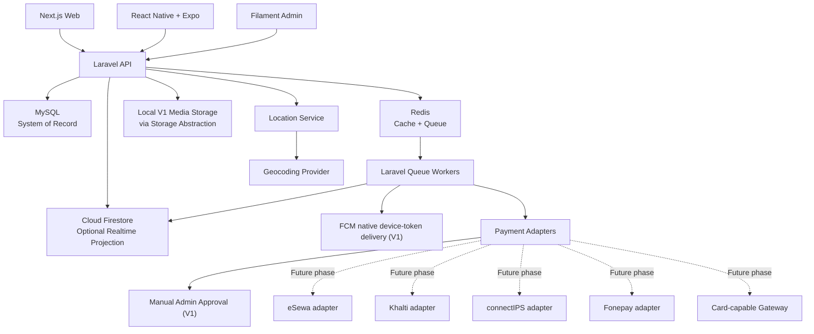

# 10. Technology Stack

**Document ID:** KB-TECH-010  

**Status:** Active  

**Version:** 1.1  

**Owner:** KHOJ BHET Engineering  

**Last Reviewed:** 2026-10-01  

**Parent:** 02. TECHNICAL DEFINITION  

**Previous:** 09. Software Architecture  

**Next:** 11. Development Methodology

# 1. Purpose

This document defines the technology choices for KHOJ BHET. It translates the architectural direction in **09. Software Architecture** into concrete technologies while deliberately leaving some provider choices replaceable.

Technology status means:

- **Selected:** currently intended for implementation.
- **Recommended:** proposed technical choice.
- **Deferred:** intentionally not fixed until a later phase.
- **Replaceable:** may change without changing the product/domain architecture.

# 2. Technology Decision Summary

| Area | Decision | Status |
| --- | --- | --- |
| Web | React + Next.js | Selected |
| Web rendering | SSR / ISR where appropriate | Selected |
| Backend | Laravel | Selected |
| Admin panel | Filament | Selected |
| Primary database | MySQL | Selected |
| Secondary Firebase database | Cloud Firestore for optional realtime/secondary state; never core business source of truth | Selected secondary capability |
| User authentication | Firebase Authentication | Selected |
| Admin authentication | Dedicated `admins` identity store + Laravel guard / Filament | Selected |
| Mobile | React Native + Expo | Selected |
| Search | MySQL-based search for V1; dedicated search engine only after a measured migration gate | Selected |
| Cache | Redis | Recommended |
| Queue / background jobs | Laravel Queue + Redis | Recommended |
| Push notifications | Firebase Cloud Messaging (FCM) native device tokens for V1; Expo Notifications may be used as a client library, but Expo push-service tokens are not accepted by the V1 `/me/push-devices` API. | Recommended |
| Maps | MapLibre-compatible map stack | Recommended |
| Geocoding | Provider abstraction; OSM-compatible provider initially | Recommended |
| Hosting | Hostinger VPS initially | Selected |
| Future hosting | Portable deployment; provider not locked | Deferred |
| Payments | Manual payment submission + admin review for V1; provider adapters reserved for later phases | Selected V1 behavior; gateway integrations deferred |
| eSewa | Payment adapter | Candidate |
| Khalti | Payment adapter | Candidate |
| connectIPS | Payment adapter | Candidate |
| Fonepay | Payment adapter | Candidate |
| Nepali debit/credit cards | Through supported gateway/acquirer | Candidate |
| Manual/admin-approved payment | Supported | Selected |
| Cloud storage | Deferred | Deferred |
| CDN | Deferred | Deferred |

## 2.1 Version Baseline (Locked for Development)

The versions below are the **latest stable releases verified on 2026-10-01** and are the baseline for the development phase. Use the stated major/minor line and pin the exact patch version in the lockfile at project initialization (`composer.lock`, `package-lock.json`, `.nvmrc`, `.php-version`).

| Technology | Locked Version | Notes |
| --- | --- | --- |
| PHP | 8.5.x | Required by Laravel 13 (supports PHP 8.3 to 8.5). PHP 8.6 is still in beta, do not use. |
| Laravel | 13.x | Current major release (released 2026-03-17). Laravel 12 is already past its bug-fix window, so start on 13. |
| Filament | 5.x | Supports Laravel 12 and 13 on PHP 8.2 to 8.5. Livewire version is dictated by Filament. |
| MySQL | 9.7.x LTS | New LTS line (GA 2026-04-21). Pin the 9.7 repository explicitly on the VPS so package updates cannot switch major versions. |
| Redis | 8.6.x (Redis Open Source) | Cache, queue backend, locks, rate limiting. |
| Node.js | 24.x LTS | Runtime for Next.js, Expo tooling, and CI. Node 26 becomes LTS on 2026-10-28; re-evaluate after that date. |
| Next.js | 16.2.x | Current stable major (16.x). Turbopack default, React 19.2. |
| React (web) | 19.2.x | Matches the Next.js 16 line. |
| Expo SDK | 57 | Mobile baseline. Requires Node 22.13+ (Node 24 satisfies this). |
| React Native | 0.86 | Version is dictated by Expo SDK 57. Do not upgrade independently. |
| React (mobile) | 19.2.3 | Version is dictated by Expo SDK 57. |
| Axios | 1.20.x | Pin the exact version and commit the lockfile. Older 1.x versions have known CVEs. |
| MapLibre GL JS | 6.x | ESM-only distribution (no UMD script tag). Use `import * as maplibregl from 'maplibre-gl'`. |
| kreait/laravel-firebase | Latest stable (7.1.0 or newer) | Firebase Admin integration for Laravel. Must support Laravel 13 and PHP 8.5. |
| Firebase Authentication / Cloud Firestore | Managed services | Client SDK versions are resolved at install time and pinned in the lockfile. |
| Node.js (future candidate) | 24.x LTS now; 26.x LTS after 2026-10-28 | Not part of the current implementation. |
| Express.js (future candidate) | 5.x | Not part of the current implementation. |
| MongoDB (future candidate) | 8.3.x | Not part of the current implementation. |

**Version rules:**

1. Do not upgrade a locked major version during development without an ADR.
2. Patch and minor updates within the locked line are allowed after tests pass.
3. Security patches take priority and may be applied immediately.
4. React Native and the mobile React version always follow the Expo SDK, never the other way around.
5. Re-verify this table at the start of each major development phase and update the **Last Reviewed** date.

# 3. Core Technology Stack

## 3.1 Web

**React + Next.js** will provide the public web application and SEO-oriented rendering.

- Server-side rendering for dynamic SEO-critical pages where required.
- Static generation / ISR for relatively stable public content.
- Client-side React components only where interactivity requires them.
- Server-side data fetching for public listing/category/location pages where useful.
- Metadata and structured-data generation at the application layer.

## 3.2 Backend

**Laravel** is the primary application backend and system-of-record API.

Responsibilities include business rules, authentication integration, authorization, listing lifecycle, users, categories, locations, entitlements, payments, moderation, notifications, search indexing, queues, audit logging, and external integrations.

## 3.3 Administration

**Filament** will be used for the KHOJ BHET administrative/back-office interface.

Admin authentication is separate from Firebase user authentication:

**Admin → Laravel authentication → Filament**

Admin authorization must use Laravel roles/permissions and server-side policy checks.

## 3.4 Mobile

**React Native + Expo** will be used for the mobile application.

Expo is suitable for the initial development phase because the Expo SDK is open source/free, while EAS is optional and has a free tier with usage limits. citeturn0search14turn0search2

# 4. Database Architecture

## 4.1 Primary Database — MySQL

MySQL is the **system of record** for users/profile references, listings, categories, locations, listing attributes, media metadata, favorites, reports, moderation, entitlements, subscriptions, payments, admin data, audit records, and search-indexing state.

## 4.2 Secondary Firebase Database — Cloud Firestore

Cloud Firestore remains an optional secondary/realtime capability. It must **not** become a second authoritative copy of core business data.

For messaging, **MySQL is the authoritative persistence layer for `conversations`, `conversation_participants`, and `messages`**. Firestore may be used as a realtime projection/transport for delivery or presence-related UX, but it is not the message source of truth and must be rebuildable from MySQL where a projection is used.

Other permissible secondary uses include lightweight realtime user-facing state, presence/session-related ephemeral data where appropriate, and notification-related realtime state.

Core financial, listing, entitlement, moderation, authorization, conversation, and message state remains in MySQL.

## 4.3 Database Rule

**MySQL = source of truth**  

**Firestore = optional secondary/realtime projection**  

**Search projection = derived/rebuildable read model**  

**Redis = transient/cache/queue state**

# 5. Authentication

## 5.1 User Authentication

**Firebase Authentication** will authenticate normal KHOJ BHET users.

The backend should validate Firebase-issued identity tokens and map the Firebase user identity to the application's MySQL user record.

Recommended identity model: **Firebase UID ↔ MySQL users.firebase_uid**.

Firebase currently provides no-cost quotas for many authentication services, while phone authentication is billed per SMS sent. citeturn0search1

Therefore phone OTP cost must be treated as an operational cost rather than assuming authentication is completely free.

## 5.2 Admin Authentication

Admin users will use a **separate Laravel authentication guard and dedicated `admins` identity store** → Filament.

Admin identities are not required to have a Firebase UID and are not represented by the marketplace `users` table. Admin authorization uses Laravel roles/permissions and server-side policy checks.

Required controls include strong passwords, **required MFA**, session expiration, login throttling, audit logging, and admin action logging.

Administrative domain records that can be created by either a marketplace user or platform staff must explicitly support the corresponding actor identity; the final physical actor-FK model is reconciled in Document 13.

# 6. Search

## 6.1 V1 Search Strategy

**MySQL-based search is the V1 baseline.**

Use normal relational indexes plus MySQL full-text search where appropriate. Search access must remain behind a Laravel search abstraction so a dedicated engine can be introduced later without changing the client contract.

Search requests: **Next.js / Mobile → Laravel API → MySQL** for V1.

A dedicated engine such as Meilisearch is **not part of the V1 source-of-truth architecture**. It may be introduced only after measured search requirements justify it and the migration gate in ADR-004/ADR-008 is satisfied.

MySQL remains the source of truth. Any future search index must be derived and rebuildable from MySQL.

Public search must not expose private fields such as seller phone number, exact private address, payment information, or moderation notes.

# 7. Cache

**Redis** is recommended for application cache, short-lived lookup cache, rate limiting where appropriate, queue backend, temporary locks, and idempotency helpers.

Redis data must be treated as disposable unless a specific design explicitly requires persistence.

# 8. Queue and Background Jobs

**Laravel Queue + Redis** is recommended.

Laravel provides a unified queue abstraction supporting Redis and database-backed queues among other drivers. citeturn0search10

Candidate jobs: search indexing, media processing, notifications, email, payment reconciliation, expiry processing, listing lifecycle automation, cleanup, analytics aggregation, Firestore synchronization, and external API retries.

Queue jobs should be idempotent where possible, retryable, observable, time-bounded, and safe against duplicate execution.

# 9. Notifications

## 9.1 V1 Push Stack

**Firebase Cloud Messaging (FCM) native device tokens** are the V1 push-provider contract. Expo Notifications may be used for client-side permission handling and notification receipt, but the V1 backend does not send through Expo's push service and does not accept Expo push-service tokens.

The mobile implementation must register the native token that matches the FCM provider contract. On iOS, use the Firebase Messaging SDK/native Firebase registration-token path; an APNs token returned directly by a generic device-token API is not itself an FCM registration token. Verify Android and iOS token registration, refresh, revoke, and delivery in real-device builds.

Recommended flow: **Laravel → Transactional Outbox → Notification Queue/Worker → FCM → Mobile Device**.

The notification provider must remain replaceable.

# 10. Maps

## 10.1 Recommended Architecture

Do not hard-code the application to one map vendor. Use a **KHOJ BHET Location Service** with replaceable adapters for map display, forward geocoding, reverse geocoding, and place search.

## 10.2 Initial Map Technology

**MapLibre-compatible map rendering** is recommended to avoid making the frontend dependent on one commercial map SDK.

## 10.3 Initial Geocoding Direction

Use an OpenStreetMap-compatible geocoding provider initially, behind a provider abstraction.

The public Nominatim service is not appropriate as an unrestricted production backend. Its policy limits usage to a maximum of 1 request/second, requires identification, prohibits client-side autocomplete, and recommends caching/proxying. citeturn0search0

Therefore do not call public Nominatim directly from every client. Put geocoding behind Laravel, cache repeated results, keep provider switching possible, and avoid bulk/systematic geocoding through the public service.

## 10.4 Nepal Location Model

The location service must support: **Country → Province → District → Municipality → Ward → Locality/Tole → Chowk/Landmark**.

Optional fields include postal code, latitude, longitude, approximate location, and exact location restricted by entitlement/privacy rules.

# 11. Hosting

## 11.1 Initial Hosting

**Hostinger VPS** is the initial hosting provider.

The application should be deployed in a provider-portable manner so migration later does not require architectural redesign.

Recommended boundary: **Internet → Reverse Proxy → Next.js / Laravel → MySQL / Redis**. Dedicated search infrastructure is not part of the V1 baseline.

Containerization is recommended where practical.

## 11.2 Future Hosting

Future migration may move to another VPS/cloud provider. Provider-specific application logic must therefore be isolated behind environment variables, infrastructure configuration, deployment scripts, and service adapters.

# 12. Payments

## 12.1 Payment Architecture Decision

KHOJ BHET should retain a provider-agnostic extension point, but **V1 payment processing is manual-submission and admin-review only**, consistent with Document 14. Automated eSewa, Khalti, connectIPS, Fonepay, and card-gateway integrations are candidate future-phase adapters, not active V1 payment flows. Any later gateway requires merchant onboarding, an accepted rollout decision, callback/webhook verification, reconciliation, and confirmed commercial terms before implementation.

## 12.2 eSewa

eSewa provides merchant payment APIs for eligible businesses/organizations. Current documentation describes merchant integration and transaction validation requirements. citeturn0search8turn1search8

Integration is therefore a merchant onboarding/commercial decision, not simply a free public API.

## 12.3 Khalti

Khalti supports multiple payment methods including wallet, eBanking, mobile banking, SCT cards, and connectIPS through its payment gateway. citeturn1search3turn1search6

Khalti's current merchant information states that business integration has a one-time API charge and transaction service charge; exact commercials are negotiated with the merchant team. Testing is free. citeturn1search1turn1search2

Therefore the architecture should integrate Khalti through an adapter rather than assuming zero integration cost.

## 12.4 connectIPS

connectIPS is a candidate payment rail/provider. Its published transaction fee schedule includes merchant/creditor payment charges, and actual commercial arrangements can vary according to the participating institution/use case. citeturn1search58

## 12.5 Fonepay

**Fonepay** is the correct product name rather than “PhonePay”. Fonepay publishes separate fee schedules for its services; merchant/payment arrangements must be evaluated according to the specific integration model. citeturn1search0

## 12.6 Nepali Debit/Credit Cards

Card support should not be implemented as a standalone card-processing system.

Use: **KHOJ BHET → Supported Payment Gateway/Acquirer → Card Network/Bank**.

The gateway abstraction should allow supported Nepali card types such as Visa/SCT and other cards offered by the selected provider.

The exact supported card types, MDR/transaction charges, settlement terms, and merchant eligibility must be confirmed with the selected gateway.

## 12.7 Manual Payment

**Manual payment is explicitly supported.**

Flow: **User selects Manual Payment → submits payment reference/proof → Payment = Pending Manual Review → Admin verifies externally → Admin approves/rejects → Entitlement/Order updated**.

Manual approval must create an audit record. Admins must not silently rewrite successful automated payment states without an auditable reason.

## 12.8 Payment Abstraction

The backend should expose a common internal contract for **create payment, verify payment, callback handling, refund, status, and reconciliation**.

Each gateway adapter implements provider-specific details.

This allows KHOJ BHET to launch with manual payment first and add gateways incrementally.

# 13. Recommended Initial Cost-Conscious Stack

| Capability | Initial choice |
| --- | --- |
| Web | Next.js |
| Backend | Laravel |
| Admin | Filament |
| Primary DB | MySQL |
| Secondary realtime DB | Firestore |
| User Auth | Firebase Authentication |
| Admin Auth | Laravel / Filament |
| Mobile | React Native + Expo |
| Search | MySQL-based V1 search; dedicated engine only after measured migration gate |
| Cache | Redis |
| Queue | Laravel Queue + Redis |
| Push | FCM native device tokens (V1); Expo Notifications client library only |
| Maps | MapLibre-compatible |
| Geocoding | Provider abstraction + controlled OSM-compatible service |
| Hosting | Hostinger VPS |
| Payments | Manual approval first + gateway adapters |
| File storage | Local application/server storage for V1 behind storage abstraction |
| CDN | Decide when traffic requires it |

# 14. Future Technology & Migration Strategy

## 14.1 Purpose

The current implementation is intentionally based on:

**Laravel + Filament + MySQL**

However, the architecture should not make future backend evolution unnecessarily difficult.

Future technology candidates are documented here for **migration readiness**, not as current implementation requirements.

## 14.2 Future Backend Candidate

**Node.js** is a future backend runtime candidate.

**Express.js** is a future API framework candidate within the Node.js ecosystem.

Possible future backend:

**Node.js + Express.js → REST API → database layer**

The current Laravel backend remains the implementation baseline.

## 14.3 Future Database Candidate

**MongoDB** is a future database candidate.

MongoDB must not be treated as an automatic replacement for MySQL.

The current marketplace contains strongly relational and transactional areas such as:

- Users and ownership
- Listings and categories
- Locations
- Payments
- Subscriptions
- Entitlements
- Moderation
- Reports
- Administrative actions
- Audit records

Any future MongoDB adoption must therefore be justified by actual technical requirements rather than preference alone.

## 14.4 API Contract as Migration Boundary

The API contract should remain independent from the backend framework.

Current:

**Next.js / React + React Native / Expo → Axios → REST API → Laravel → MySQL**

Possible future:

**Next.js / React + React Native / Expo → Axios → REST API → Node.js + Express.js → database layer**

Clients should not need to know whether the API is implemented with Laravel or Node.js/Express.js.

## 14.5 Migration-Friendly Engineering Rules

To preserve future migration capability:

1. Keep REST API contracts stable and documented.
2. Keep domain/business rules separate from framework-specific controllers.
3. Avoid exposing Laravel-specific implementation details to clients.
4. Isolate persistence concerns from domain logic where practical.
5. Keep external integrations behind adapters.
6. Keep authentication and authorization contracts explicit.
7. Keep search as a derived/rebuildable representation.
8. Avoid designing the MySQL schema solely around a hypothetical MongoDB migration.
9. Document major technology changes through ADRs.
10. Migrate only when measurable requirements justify the change.

## 14.6 Possible Migration Sequence

If a future migration becomes justified, it should normally be incremental rather than a single rewrite.

Example:

**Laravel + MySQL**

↓

**Stable REST API + stronger domain/application boundaries**

↓

**Introduce Node.js/Express.js for selected API modules or services**

↓

**Run controlled compatibility/integration testing**

↓

**Migrate additional backend responsibilities if justified**

↓

**Evaluate MongoDB separately based on domain-specific requirements**

The project should not assume that changing the backend runtime automatically requires changing the database.

## 14.7 Migration Decision Gate

Before adopting Node.js, Express.js, or MongoDB for production, evaluate:

| Evaluation Area | Question |
| --- | --- |
| Current limitation | What concrete problem does the current stack have? |
| Evidence | Is the problem measured or demonstrated? |
| Performance | Does the proposed stack materially address it? |
| Development capability | Can the team operate the new stack effectively? |
| Migration effort | How much existing code/data must change? |
| API compatibility | Can existing clients continue using the same contracts? |
| Security | Does the migration introduce new security risks? |
| Operations | Does hosting/deployment become more complex? |
| Cost | What are the infrastructure and maintenance implications? |
| Data | Is a database migration actually required? |
| Rollback | Can the migration be reversed safely? |
| Long-term maintenance | Is the new architecture sustainable? |

A production migration requires an ADR and an explicit migration plan.

## 14.8 Technology Status

| Technology | Current Status | Future Role |
| --- | --- | --- |
| Laravel | Selected | Current backend |
| Filament | Selected | Current admin platform |
| MySQL | Selected | Current system of record |
| Node.js | Future Candidate | Possible future backend runtime |
| Express.js | Future Candidate | Possible future Node.js API framework |
| MongoDB | Future Candidate | Possible future database for justified use cases |
| Axios | Recommended/Selected client | Common HTTP client for web/mobile API communication |
| REST API | Selected architectural contract | Stable boundary across backend implementations |

This section does not commit the project to a future migration. It preserves architectural flexibility while keeping the current implementation clear.

# 15. Cost-Control Principles

For every external provider, document setup/integration fee, transaction fee, monthly/annual fee, free quota, usage limits, merchant/KYC requirements, settlement fees, refund/chargeback costs, lock-in risk, and migration path.

The project should prefer self-hosted/open-source infrastructure where the operational burden remains reasonable.

# 15. Technology Replacement Strategy

The following must remain replaceable: hosting provider, search provider, map provider, geocoding provider, payment gateway, push notification provider, and object storage provider.

Provider-specific SDK/API details must remain outside core domain logic.

# 16. Technology Boundary Diagram

# 17. Important Technology Rules

### Rule 1 — MySQL is authoritative

Do not allow Firestore, Redis, or any future search index to become the source of truth for core business entities. Conversations and messages are persisted authoritatively in MySQL.

### Rule 2 — External providers are adapters

Provider-specific SDK/API details must remain outside the core domain logic.

### Rule 3 — Payment providers are interchangeable

The payment domain must not contain eSewa/Khalti-specific business rules.

### Rule 4 — Search is rebuildable

The search index must be reconstructable from MySQL.

### Rule 5 — Cache is disposable

Application correctness must not depend on Redis cache contents.

### Rule 6 — Queue jobs are retry-safe

External calls must tolerate retries and duplicate delivery.

### Rule 7 — Location provider is replaceable

The application must not depend on one geocoding vendor.

### Rule 8 — Admin and user identity are separate

Firebase user authentication must not be reused as the administrative authentication mechanism.

# 18. Open Decisions for Later Documents

- ~~Exact MySQL version.~~ Resolved in section 2.1.
- ~~Exact Laravel version at implementation start.~~ Resolved in section 2.1.
- ~~Exact Next.js version.~~ Resolved in section 2.1.
- ~~Exact React Native/Expo SDK version.~~ Resolved in section 2.1.
- Firestore data model.
- Redis deployment topology.
- Future dedicated-search deployment topology, if the ADR-004 migration gate is later satisfied.
- Object storage provider.
- CDN.
- Image/video processing infrastructure.
- Exact map tile provider.
- Production geocoding provider.
- Payment gateway commercial agreements.
- Payment settlement architecture.
- Email provider.
- SMS provider.
- Production observability stack.
- CI/CD provider.

# 19. Relationship to Other Documents

| Technology decision | Detailed document |
| --- | --- |
| Overall architecture | 09. Software Architecture |
| Technology choices | 10. Technology Stack |
| Development process | 11. Development Methodology |
| Coding rules | 12. Engineering Standards |
| MySQL + Firestore data design | 13. Database Architecture |
| API contracts | 14. API Specification |
| Next.js architecture | 15. Frontend Architecture |
| Laravel architecture | 16. Backend Architecture |
| React Native/Expo architecture | 17. Mobile Application Architecture |
| Firebase/Laravel authentication | 18. Authentication & Authorization |
| Security controls | 19. Security Architecture |
| Media storage | 20. Media & File Storage |
| 21. Search Architecture (MySQL-first V1; external search engine deferred) | 21. Search Architecture |
| Notifications | 22. Notification System |
| SEO implementation | 23. SEO Architecture |

# 20. Status

**Proposed — ready for architectural traceability and detailed technical design.**

Technology selections in this document are the baseline for the following technical documents. Provider-specific commercial decisions remain subject to verification before production integration.