# 13. Database Architecture & Data Model

> ## Current Baseline Addendum — 2026-10-09
> 

> **This addendum supersedes any older statement in this document that presents the pre-Gate-11 52-table / 84-FK baseline (or the earlier 80-FK count) as the current schema. The later closed database decision gates establish** 55 tables / 89 declared foreign-key relationships after Gate #11 adds `user_push_devices`; Gates #12–#14 add no tables or FKs.
> 

> 
> 

> **Artifact status: STATIC RECONCILIATION PASS / runtime validation NOT PASSED (reviewed 2026-10-09).** The available Gate #14 artifact set was checked: DBML contains 55 tables / 89 declared references; the Laravel migration contains 55 table creations / 89 FK declarations; the clean-MySQL SQL expects 55 tables / 89 FKs and checks the current pricing/verification enums; the schema review reports static reconciliation PASS. The `user_push_devices.user_id` column is BIGINT UNSIGNED and its FK targets `users.id` in both DBML and migration. Execute the migration and validation SQL on a clean supported MySQL instance and record actual results before declaring implementation readiness. Regenerate only if runtime testing or further schema changes reveal a discrepancy. See the Architecture Cross-Document Audit & Closure Register.
> 

> 
> 

> Historical 49-table and pre-Gate-11 52-table/84-FK validation sections remain for audit history only; they are not the current artifact-generation baseline.
> 

> **Schema capability boundary — do not infer missing columns.** The current physical model does not define all generic media fields described in Document 20 (for example, classification, checksum, separately detected MIME, generic target resource, or dedicated quarantine state); businesses does not define logo/cover media-ID columns; notifications does not define dedicated locale/classification/expiry/dedupe-key columns or a templates table; admins does not define explicit MFA enrollment/recovery columns; and payment proof is stored as a VARCHAR reference rather than a declared media FK. Use only the current schema's supported guarantees. If a feature requires durable fields or relational integrity that are absent, approve a schema gate and regenerate the physical artifacts before implementation.
> 

**Project:** KHOJ BHET  

**Document:** Database Architecture & Data Model  

**Document ID:** KB-TECH-013  

**Status:** Active  

**Version:** 1.4  

**Owner:** KHOJ BHET Engineering  

**Last Reviewed:** 2026-10-04  

**Parent:** 02. TECHNICAL DEFINITION  

**Previous:** 12. Engineering Standards  

**Next:** 14. API Specification  

**Related:** 00.2 Terminology & Glossary, 00.3 Decision / ADR Register, 00.4 Requirements ↔ Use Cases ↔ User Flows Traceability Matrix, 03. Requirements Specification, 04. Users, Roles & Permissions, 05. User Stories & Use Cases, 06. User Flows, 07. UX/UI Specification, 08. Product & Business Rules, 09. Software Architecture, 10. Technology Stack, 14. API Specification, 16. Backend Architecture, 18. Authentication & Authorization, 19. Security Architecture, 20. Media & File Storage, 21. Search Architecture, 22. Notification System, 23. SEO Architecture, ADR-001, ADR-002, ADR-004, ADR-005, ADR-006, ADR-007, ADR-008

---

# 1. Document Purpose

This document defines the authoritative **database architecture and data-modeling principles** for KHOJ BHET.

It establishes:

- the role of the primary database;
- domain ownership of persistent data;
- entity and relationship boundaries;
- normalization and integrity rules;
- lifecycle and state persistence;
- location-data modeling;
- listing/category modeling;
- user, entitlement, payment, moderation, and audit data boundaries;
- search-index separation;
- indexing and performance principles;
- migration and evolution rules.

This document defines the **logical and physical database model**. The approved physical schema, ERD, table inventory, keys, relationships, constraints, and indexing baseline are part of this document. Laravel migrations and ORM models implement this approved model; they must not silently diverge from it.

> **Core principle:** MySQL is the authoritative transactional source of truth for core marketplace data. Derived systems such as search indexes, caches, analytics stores, and generated media metadata must remain rebuildable or reconcilable from authoritative data.
> 

# 2. Database Architecture Status

The current database baseline is:

| Area | Current Decision |
| --- | --- |
| Primary transactional database | MySQL |
| Primary data authority | MySQL |
| Database style | Relational |
| Initial application architecture | Modular monolith |
| Transactional consistency | Strong consistency where business correctness requires it |
| Search data | Derived from primary data |
| Search authority | Not authoritative |
| Cache authority | Not authoritative |
| Authentication identity | Firebase Authentication |
| Marketplace user record | MySQL |
| Admin identity / authorization | Dedicated `admins` identity store + Laravel/Filament guard + MySQL-backed authorization model |
| Future MongoDB | Migration possibility only; not current baseline |

Database-related architectural decisions must remain consistent with **ADR-001 — Application Architecture**, **ADR-002 — Authentication Architecture**, and **ADR-008 — Database Search Strategy**.

# 3. Database Responsibilities

The primary database is responsible for persistent transactional state including:

- users and marketplace profiles;
- roles, permissions, and account state;
- listings and listing ownership;
- listing lifecycle and moderation state;
- categories and category configuration;
- category-specific listing attributes;
- Nepal administrative and local location data;
- listing-location relationships;
- media metadata and listing-media associations;
- favorites;
- contact/messaging records where persistence is required;
- subscriptions and entitlements;
- payment transactions and reconciliation state;
- reports and moderation actions;
- notification preferences and relevant delivery records;
- audit records;
- configuration required for authoritative business behavior.

The database is **not** the authoritative store for:

- browser/mobile UI state;
- temporary client caches;
- external authentication-provider identity data;
- search-engine index copies;
- CDN/cache copies;
- analytics-only aggregates where the authoritative event/data source remains elsewhere;
- binary media objects when object storage is used.

# 4. Data Ownership Principle

Every persistent business concept must have an identified owning domain.

| Domain | Primary Data Ownership |
| --- | --- |
| Identity & Access | identity mapping, account access state, authorization relationships |
| User / Profile | marketplace profile and user-facing account data |
| Listings | listing identity, content, ownership, lifecycle |
| Categories | category hierarchy and attribute definitions |
| Locations | structured administrative and named-place data |
| Media | media metadata, processing state, associations |
| Search | search-specific derived representation |
| Favorites | saved-listing relationships |
| Messaging / Contact | contact conversations or contact events where persisted |
| Subscriptions / Entitlements | plans, subscriptions, capability state |
| Payments | payment intents, transactions, provider references, reconciliation |
| Moderation | reports, moderation cases, decisions, restrictions |
| Notifications | preferences, notification records, delivery state |
| Audit | immutable or append-oriented audit records |

A module may read another module's data through controlled application interfaces. Unrestricted cross-module writes should be avoided.

# 5. Core Modeling Principles

### DB-PR-001 — Relational Integrity

Use relational constraints to protect important business invariants whenever practical.

### DB-PR-002 — Normalized Authoritative Data

Core transactional data should be normalized to reduce duplication and update anomalies.

### DB-PR-003 — Explicit Relationships

Important relationships should be represented explicitly through foreign keys or dedicated relationship tables rather than encoded in opaque JSON whenever the relationship participates in querying, integrity, authorization, or lifecycle behavior.

### DB-PR-004 — Domain Ownership

Tables should have a clear owning domain. Shared reference data must have explicit ownership rather than becoming an uncontrolled common-data area.

### DB-PR-005 — Server-Side Authority

Database structure must support server-side enforcement of ownership, authorization, entitlement, visibility, and lifecycle rules.

### DB-PR-006 — Derived Data Is Rebuildable

Search indexes, denormalized read models, caches, and other derived representations must be reconstructible from authoritative data or reconciled through durable events.

### DB-PR-007 — Avoid Premature Polymorphism

Polymorphic database structures should be used only where they solve a documented domain problem. They must not replace explicit relational modeling merely for convenience.

### DB-PR-008 — Time and State Are Explicit

Business-critical state transitions and timestamps must be persistable and auditable.

### DB-PR-009 — Soft Deletion Requires Semantics

Soft deletion must not be used automatically for every table. Where used, its behavior, uniqueness implications, retention, and restoration rules must be defined.

### DB-PR-010 — Migration Safety

Schema changes must be versioned, reviewable, reversible where practical, and compatible with deployment sequencing.

# 6. Conceptual Entity Model

The core marketplace relationship is:

**User → Listing → Category / Location / Media**

with supporting domains:

**User → Favorites / Contact / Subscription / Payment / Notifications**

and:

**Listing → Reports / Moderation / Search Representation / Audit Events**

Conceptually:

```
User
 ├── Profile
 ├── Listings
 ├── Favorites
 ├── Subscriptions
 ├── Payments
 ├── Contacts / Messages
 └── Notification Preferences

Listing
 ├── Category
 ├── Location
 ├── Media
 ├── Attributes
 ├── Lifecycle State
 ├── Moderation State
 ├── Reports
 └── Search Representation

Location
 ├── Province
 ├── District
 ├── Municipality
 ├── Ward
 ├── Locality / Tole
 └── Chowk / Landmark / Named Place
```

This is a logical model, not a final physical ERD.

# 7. User and Identity Data Model

Firebase Authentication is the external identity provider for normal users.

The database must maintain the authoritative marketplace user record.

Conceptual separation:

**Firebase identity**

- provider identity;
- authentication state;
- provider-managed credentials/verification.

**MySQL user**

- internal user ID;
- Firebase identity reference;
- marketplace account state;
- profile relationship;
- roles/authorization;
- entitlements;
- moderation/restriction state;
- timestamps.

The database must not store Firebase credentials or secrets.

A stable internal user identifier should be used as the primary application reference across marketplace tables.

Conceptual relationship:

```
Firebase Identity
      │
      │ identity mapping
      ▼
MySQL User
 ├── Profile
 ├── Roles / Permissions
 ├── Listings
 ├── Favorites
 ├── Subscriptions
 └── Account Restrictions
```

This follows **ADR-002**.

# 8. Roles, Permissions and Account State

Authorization data must remain separate from authentication identity.

The marketplace user and platform-admin identity boundaries are intentionally separate:

- `users` stores marketplace accounts mapped to Firebase Authentication;
- `admins` stores platform-admin identities used by the Laravel `admin` session guard and Filament admin panel;
- `roles`, `permissions`, `user_roles`, and `role_permissions` provide the application authorization model;
- `account_restrictions` applies marketplace account restrictions to `users` and must not be used as the admin-authentication mechanism.

### 8.1 Admin Authentication Baseline — Laravel 13 + Filament 5

The approved V1 admin authentication design is a conventional Laravel Eloquent authentication model, not a Firebase identity and not a marketplace `users` record.

**Physical `admins` table baseline:**

- `id` — BIGINT primary key;
- `name` — admin display/name field;
- `email` — unique login identifier;
- `password` — hashed password; never plaintext;
- `remember_token` — nullable string for Laravel session remember-me support;
- `email_verified_at` — nullable timestamp;
- `is_active` — boolean administrative access switch;
- `last_login_at` — nullable timestamp for operational/security visibility;
- `password_changed_at` — nullable timestamp;
- `created_at`, `updated_at` — Laravel timestamps.

Optional MFA columns may be added only when the selected Laravel/Filament authentication implementation requires them; MFA implementation details must not be hard-coded into the core marketplace schema prematurely.

**Laravel implementation contract:**

- `App\\Models\\Admin` implements Laravel's `Authenticatable` contract, normally by extending `Illuminate\\Foundation\\Auth\\User`;
- `config/auth.php` defines an `admin` session guard using an Eloquent provider backed by `App\\Models\\Admin`;
- the normal marketplace guard/provider continues to resolve marketplace users independently;
- admin credentials are authenticated only through the `admin` guard;
- `Admin` is not assigned a Firebase UID and does not depend on `users.firebase_uid`.

**Filament implementation contract:**

- the Filament admin panel explicitly uses `authGuard('admin')`;
- panel access is additionally controlled by `Admin::canAccessPanel(Panel $panel): bool` and/or the application's authorization policies;
- admin registration is disabled unless explicitly required by a later product decision;
- roles/permissions remain application authorization data and are not implied merely by successful authentication.

This design is compatible with Laravel's separate guard/provider model and Filament 5's panel authentication model. It also keeps the platform-admin boundary independent from marketplace identity. citeturn0search0turn1search4

Potential authorization concepts include:

- roles;
- permissions;
- user-role assignments;
- role-permission assignments;
- account status;
- account restrictions;
- restriction history;
- admin-role assignments where platform-admin authorization is required.

The exact authorization package may change, but the database must support account restriction, administrative roles, resource ownership, controlled administrative access, and auditable authorization changes. A user's role must never be inferred from client-side state.

# 9. Listing Data Model

Listing is the central transactional entity.

A listing should have a stable internal identifier and should conceptually contain:

| Area | Examples |
| --- | --- |
| Identity | ID, public identifier/slug |
| Ownership | owner/poster user reference |
| Category | category reference |
| Content | title, description |
| Commercial data | price, currency, pricing mode |
| Location | location reference and visibility representation |
| Public API listing lifecycle enum | draft, review, published, paused, expired, archived, rejected. Internal deleted/removal states are not public lifecycle enum values. |
| Moderation | moderation state/reason/references |
| Visibility | public/restricted/sensitive fields |
| Timing | created, updated, published, expires |
| Metadata | source, flags, counters where justified |

The physical schema should avoid embedding unrelated category-specific columns directly into the core listing table.

# 10. Universal Listing + Category-Specific Attributes

KHOJ BHET supports multiple marketplace categories, including property, mobile/electronics, furniture, vehicles, clothing, land, and future categories.

The database should therefore use a **universal listing core** plus controlled category-specific data.

Conceptual model:

```
Category
   │
   ├── Category Attribute Definitions
   │          │
   │          ▼
   │    Listing Attribute Values
   │
   ▼
Listing
```

The category system may define:

- attribute name;
- data type;
- required/optional status;
- validation rules;
- unit;
- allowed values;
- search/filter behavior;
- display configuration;
- lifecycle/version metadata.

Possible attribute types:

- text;
- integer;
- decimal;
- boolean;
- date;
- enum;
- reference;
- structured value.

The database design must distinguish **attribute definition** from **attribute value**.

A flexible attribute model must not become an unvalidated key-value dumping ground. Frequently queried and business-critical attributes should be modeled explicitly where justified.

# 11. Listing Ownership and Representation

A listing must identify the account responsible for the listing.

Where product rules permit listings to be posted on behalf of another person or organization, representation should be modeled explicitly rather than overloading a generic user field.

Potential concepts:

- listing owner;
- listing poster;
- represented party;
- ownership/representation relationship;
- authorization to act.

This allows future support for:

- individual sellers;
- businesses;
- agents;
- organizations;
- delegated listing management.

The exact product rule must remain aligned with **04. Users, Roles & Permissions** and **08. Product & Business Rules**.

# 12. Listing Lifecycle Persistence

The database must persist the authoritative lifecycle state.

Baseline states:

**Draft → Review/Validation → Published → Paused → Expired → Archived**

Administrative states may include:

- rejected;
- removed;
- deleted;
- restricted.

Lifecycle state transitions must be enforced by application/domain logic.

For important transitions, the system should retain sufficient history to answer:

- what changed;
- when it changed;
- who initiated it;
- previous state;
- resulting state;
- relevant reason/reference.

A current-state column alone may be insufficient for audit-sensitive workflows.

# 13. Listing Moderation Data

Moderation state must be distinct from normal lifecycle state where both concepts are needed.

Example conceptual separation:

```
Listing Lifecycle:
Draft / Published / Paused / Expired / Archived

Moderation:
Pending / Approved / Rejected / Restricted / Removed
```

This prevents moderation decisions from being hidden inside generic listing status values.

Moderation records should support:

- report references;
- reviewer/admin;
- decision;
- reason;
- timestamps;
- evidence/reference where required;
- resulting restriction or state transition.

# 14. Nepal Location Data Model

Location is a first-class domain.

The database must support both **administrative geography** and **human-recognizable local places**.

Administrative hierarchy:

**Country → Province → District → Municipality → Ward**

Local geography:

**Locality / Tole → Chowk / Landmark / Bazaar / Market / Named Place**

Location records may also contain:

- postal code;
- latitude;
- longitude;
- approximate-location representation;
- standardized name;
- localized display name where required;
- status/validity.

Administrative units and named places must remain distinct concepts.

Example:

```
Province
 └── District
      └── Municipality
           └── Ward
                └── Locality / Tole
                     └── Chowk / Landmark
```

This supports Nepal-specific discovery without forcing the product to depend only on coordinates.

# 15. Exact vs Approximate Location

The database must distinguish the **stored location** from the **location representation exposed to a viewer**.

Possible concepts:

- exact coordinates;
- approximate coordinates;
- administrative location;
- named local place;
- public location representation;
- sensitive location data.

Exact residential coordinates must not automatically be exposed through the public listing API.

The database may retain more precise location data than the public response exposes.

Visibility decisions belong to application/security logic, not solely to database column naming.

# 16. Address and Location Normalization

Free-text addresses should not be the sole authoritative representation of structured Nepal location.

Where structured data exists, store references to:

- province;
- district;
- municipality;
- ward;
- locality/tole;
- named place.

A display address may be generated from these structured references plus user-provided address details.

Postal codes and chowk/landmark names should be modeled so they can participate in search and filtering where product requirements justify it.

# 17. Media Data Model

Binary media should normally live in object/media storage rather than inside MySQL.

The database stores metadata such as:

- media ID;
- owner/uploader;
- storage key/reference;
- media type;
- MIME type;
- dimensions;
- duration where relevant;
- file size;
- processing status;
- moderation status;
- created timestamp;
- derivative relationships.

Listing-media relationships should be explicit.

Conceptual model:

```
Media
  │
  ├── original
  ├── processed derivative(s)
  └── thumbnail(s)
       │
       ▼
Listing Media Association
       │
       ▼
Listing
```

The final storage provider is governed by **ADR-005** and Document 20.

# 18. Favorites Data Model

Favorites are a user-to-listing relationship.

Conceptually:

```
User ─────< Favorite >───── Listing
```

The relationship should normally enforce uniqueness so that one user cannot create duplicate active favorite records for the same listing.

Potential fields:

- user ID;
- listing ID;
- created timestamp;
- optional removal/archive timestamp only if product behavior requires history.

# 19. Contact and Messaging Data Model

The database model must distinguish:

- permission to contact;
- contact initiation;
- message/conversation persistence;
- moderation/reporting context.

**V1 source-of-truth rule:** `conversations`, `conversation_participants`, and `messages` are authoritative persistent data in MySQL. Firestore may provide an optional realtime projection/transport for messaging UX, but it is not a second source of truth and must not be required to reconstruct authoritative message history.

Contact access must be evaluated against:

- authentication;
- listing visibility;
- seller consent;
- account state;
- entitlement where applicable;
- listing state.

Sensitive seller contact data should not be duplicated unnecessarily into listing records.

If messaging is introduced, conversation and message entities should belong to the messaging/contact domain and reference the relevant listing/user context.

# 20. Subscription and Entitlement Data Model

Paid capabilities must not be represented only as a boolean on the user record.

Conceptual entities may include:

- plan;
- plan feature/capability;
- subscription;
- subscription status;
- entitlement;
- entitlement period;
- payment reference.

The entitlement layer should answer:

**Does this user/account currently have capability X?**

Examples:

- exact location visibility;
- seller contact visibility;
- enhanced listing facilities;
- premium listing capability;
- future paid marketplace features.

Entitlements should remain distinct from payment transactions.

# 21. Payment Data Model

Payment persistence must be provider-agnostic.

Conceptual entities:

- payment intent/order;
- payment transaction;
- provider;
- provider reference;
- amount/currency;
- transaction status;
- payment method metadata where appropriate;
- timestamps;
- reconciliation state;
- failure information;
- refund/adjustment records where required.

The database must support idempotency and reconciliation.

**V1 manual-payment rule:** manual/admin-approved payments require an auditable review lifecycle, including reviewer identity, review timestamp, decision, and decision reason, with submitted payment reference/proof retained or linked where applicable. Automated gateway fields remain provider-neutral.

A successful client response alone must not be treated as authoritative proof of payment.

Provider webhooks and server-side verification are authoritative inputs.

This follows **ADR-006**.

# 22. Search Data Boundary

Search is explicitly separated from the primary database authority.

**MySQL:**

- authoritative listing state;
- authoritative ownership;
- authoritative permissions;
- authoritative visibility;
- authoritative category/location relationships.

**Search index:**

- derived searchable representation;
- optimized filters;
- tokenized/searchable text;
- ranking fields;
- denormalized display/search fields where useful.

Conceptual flow:

```
MySQL
  │
  │ domain event / indexing job
  ▼
Search Projection
  │
  ▼
Search Index
```

A search-index record must never become the only copy of authoritative marketplace state.

If the search index is lost, it must be possible to rebuild it from MySQL.

This follows **ADR-008**.

# 23. Cache Data Boundary

Cache records are non-authoritative.

Cache keys should have:

- predictable ownership;
- explicit invalidation rules;
- TTL where appropriate;
- protection against leaking user-specific or sensitive data.

Authorization-dependent responses require particular care.

The system must continue to function correctly when a cache is empty or unavailable, subject to expected performance degradation.

# 24. Audit Data Model

Audit records should be append-oriented and designed for traceability.

Audit events may capture:

- actor;
- actor type;
- action;
- target entity;
- target ID;
- timestamp;
- request/correlation ID;
- relevant before/after values or summarized change;
- reason where required;
- source/client context where justified.

High-value audit areas include:

- authentication/security events;
- account restrictions;
- administrative actions;
- listing moderation;
- listing lifecycle transitions;
- entitlement changes;
- payment state changes;
- sensitive configuration changes.

Audit data must not become a generic replacement for proper domain history tables.

# 25. Notification Data

Notification persistence may include:

- notification event;
- recipient;
- notification type;
- template/version reference;
- channel;
- delivery status;
- provider reference;
- retry information;
- timestamps;
- user preferences.

Notification delivery is not the same as business truth.

For example, a listing being published remains true even if an email notification fails.

# 26. Referential Integrity

Foreign keys should be used for authoritative relational relationships where supported by the chosen MySQL storage design.

Important relationships include:

- listing → user;
- listing → category;
- listing → location;
- listing-media → listing/media;
- favorite → user/listing;
- subscription → user/plan;
- payment → user/subscription where applicable;
- moderation record → listing/user;
- report → reporter/listing;
- notification → recipient.

Foreign-key deletion behavior must be explicitly chosen.

Avoid cascading deletes across high-value business records when they could destroy auditability or transactional history.

# 27. Primary Keys and Identifiers

Use stable internal primary identifiers for database relationships.

Public identifiers may be separate from internal IDs where exposing sequential identifiers would create privacy, enumeration, or URL-design concerns.

Conceptual separation:

```
Internal ID  → relational integrity
Public ID    → external reference
Slug         → human-readable URL/discovery
```

A slug must not be treated as the immutable identity of a listing.

# 28. Timestamps and Temporal Data

Business entities should generally track:

- created_at;
- updated_at.

Entities with lifecycle behavior may also require:

- published_at;
- paused_at;
- expires_at;
- archived_at;
- deleted_at;
- reviewed_at.

Use UTC for persisted timestamps unless a specific domain requirement dictates otherwise. Nepal-local presentation should be handled at the application/presentation layer.

Temporal semantics must be explicit.

# 29. Status and Enumeration Modeling

Status fields must represent finite, documented state machines.

Avoid arbitrary free-text status values for core lifecycle fields.

Each status should have:

- documented meaning;
- valid transitions;
- permitted actors;
- terminal/non-terminal behavior where applicable.

Reference/lookup tables are appropriate when values require administration, localization, metadata, or independent lifecycle management.

# 30. Constraints and Business Invariants

Important invariants should be enforced at multiple levels where practical:

**Application/domain layer**

- complex business rules;
- authorization;
- lifecycle transitions;
- entitlement evaluation.

**Database layer**

- primary keys;
- foreign keys;
- uniqueness;
- nullability;
- basic range/check constraints where supported and appropriate.

Examples:

- one active favorite per user/listing;
- valid category reference;
- valid listing owner;
- valid subscription relationship;
- no orphaned relationship records.

Application validation must not be the only protection against integrity failures.

# 31. Indexing Strategy

Indexes should be driven by actual access patterns.

Initial likely indexes include combinations around:

- user ID;
- listing public ID;
- listing slug;
- listing status;
- category ID;
- location references;
- publication date;
- expiration date;
- price where filtering is common;
- favorite user/listing relationship;
- moderation state;
- subscription status;
- payment provider/reference identifiers.

Composite indexes should reflect actual query predicates and ordering rather than being added indiscriminately.

Every additional index has:

- storage cost;
- write amplification;
- migration cost;
- maintenance overhead.

Measure before adding large numbers of indexes.

# 32. Search and Filter Query Design

Search-heavy requirements should not force the transactional database into an unsuitable full-text architecture.

MySQL may support baseline filtering and relational queries, while the dedicated search system handles advanced:

- text search;
- typo tolerance;
- relevance;
- faceting;
- ranking;
- geo-search where selected;
- high-volume search workloads.

The authoritative visibility and lifecycle state must still be evaluated correctly.

# 33. Data Integrity Across Asynchronous Boundaries

When a database transaction triggers asynchronous work, the system must account for the possibility that:

- the transaction commits but the job fails;
- the job runs twice;
- the queue is delayed;
- the search index is unavailable;
- an external provider is unavailable.

For critical event publication, a transactional outbox or equivalent durable mechanism should be considered.

Conceptual flow:

```
DB Transaction
 ├── Business Data Change
 └── Outbox Event
        │
        ▼
Worker / Dispatcher
        │
        ├── Search
        ├── Notification
        ├── Analytics
        └── Other Derived Systems
```

The exact outbox implementation belongs in backend architecture and engineering standards.

# 34. Transactions and Concurrency

Use database transactions for atomic changes that must succeed or fail together.

Examples:

- creating a listing with required relational records;
- changing a lifecycle state and its required history;
- applying an entitlement change;
- recording a payment state transition and reconciliation record.

Concurrency controls should be applied where simultaneous actions could violate business rules.

Potential mechanisms:

- row locking;
- optimistic versioning;
- unique constraints;
- idempotency keys;
- state-transition conditions.

The selected mechanism should match the business operation.

# 35. Data Retention and Deletion

Deletion policy must distinguish:

- user-visible deletion;
- soft deletion;
- archival;
- legal/operational retention;
- irreversible physical deletion;
- anonymization.

Financial, moderation, security, and audit records may require retention even when a marketplace entity is no longer publicly visible.

Personal-data deletion requirements must be reconciled with:

- legal obligations;
- fraud/security needs;
- financial records;
- auditability;
- referential integrity.

Retention rules should be documented before implementing automated destructive deletion.

# 36. Database Security

Database access must follow least privilege.

Applications should not use unrestricted administrative database credentials.

Controls should include:

- separate credentials by environment;
- secret management;
- restricted network access;
- encrypted connections where supported;
- backups protected from unauthorized access;
- sensitive-field protection where required;
- migration permissions separated from normal runtime permissions where practical.

Database credentials must never be committed to source control.

# 37. Backup and Recovery Requirements

The database backup strategy must support the project's recovery objectives.

Required capabilities should include:

- scheduled backups;
- backup verification;
- retention policy;
- off-host or otherwise failure-independent copies where appropriate;
- restore testing;
- documented recovery procedure;
- monitoring of backup failures.

A backup that has never been successfully restored is not sufficient evidence of recoverability.

Detailed operational policy belongs in **27. Monitoring, Logging & Backup** and **26. Infrastructure & Deployment**.

# 38. Migration Strategy

All schema changes must be version-controlled.

Migration practices should include:

1. one logical schema change per migration where practical;
2. deterministic migration order;
3. safe production sequencing;
4. backward-compatible deployment where required;
5. data migration separated from schema migration when complexity warrants;
6. rollback strategy or forward-fix strategy;
7. migration testing;
8. indexing impact review.

Large data migrations should be designed to avoid long blocking transactions and unacceptable production downtime.

# 39. Database Evolution Strategy

The schema should evolve around stable domain concepts rather than temporary UI structures.

Examples of acceptable evolution:

- adding new listing categories;
- adding new category attributes;
- adding new notification channels;
- adding new payment providers;
- adding new search projections.

Examples requiring architectural review:

- replacing MySQL as the system of record;
- introducing a second authoritative transactional database;
- moving a core domain to an independent service;
- changing the universal listing model fundamentally;
- making search authoritative.

Such changes require appropriate ADR review.

# 40. Future MongoDB / Alternative Database Strategy

MongoDB is a possible future technology direction, not the current database baseline.

A future migration must be justified by measurable requirements such as:

- workload characteristics;
- data-access patterns;
- scaling constraints;
- operational requirements;
- document-oriented domain needs;
- demonstrated limitations of the current relational design.

The project must not migrate to MongoDB merely because category-specific attributes appear flexible.

The universal listing + controlled attribute model must first be evaluated within the current relational architecture.

Any change to the authoritative database requires a new ADR and an explicit migration strategy.

# 41. Environment Separation

Database environments should be logically separated:

- local development;
- automated test;
- staging;
- production.

Production data must not be copied into lower environments without appropriate authorization, minimization, and protection.

Environment-specific credentials, endpoints, and secrets must never be hard-coded into application source.

# 42. Database Naming Standards

Naming conventions should be consistent across:

- tables;
- columns;
- indexes;
- foreign keys;
- constraints;
- migrations;
- ORM models.

The project should select one naming convention and apply it consistently.

Recommended relational conventions:

- singular or plural table naming must be decided once and applied consistently;
- snake_case for SQL identifiers;
- explicit foreign-key names;
- timestamps using consistent names;
- boolean fields using clear semantic names.

The exact Laravel/ORM convention belongs in **16. Backend Architecture** and **12. Engineering Standards**.

# 43. Data Model Traceability

The database model must remain traceable to upstream product artifacts.

Authoritative chain:

**Requirement → User Story → Use Case → User Flow → UX/UI → Business Rule → Technical Architecture → Database Model → API → Implementation → Test**

Examples:

| Capability | Database responsibility |
| --- | --- |
| Create Listing | listing, category, location, media associations, lifecycle |
| Search & Discovery | searchable projection inputs and authoritative filter relationships |
| Contact Poster | user/listing relationship and contact authorization context |
| Manage Location Data | administrative and named-place entities |
| Account Restriction | account state and restriction records |
| Subscription / Paid Visibility | plans, subscriptions, entitlements |
| Report Listing | report and moderation records |
| Payments | payment transaction and reconciliation state |

The **00.4 Traceability Matrix** remains the cross-document traceability authority.

# 44. Database ↔ ADR Traceability

| Database Area | ADR |
| --- | --- |
| Overall application data boundary | ADR-001 |
| User identity mapping and authorization boundary | ADR-002 |
| Search index vs source of truth | ADR-008 |
| Search engine/provider | ADR-004 — Accepted; MySQL-based V1 search with migration gate for a dedicated engine |
| File/media storage | ADR-005 — Accepted; local application/server storage for V1 behind storage abstraction |
| Notification persistence/provider architecture | ADR-007 — Accepted; central notification module with channel adapters |
| Payment architecture | ADR-006 |

ADR status must be reflected here whenever a database decision depends on an architectural decision.

# 45. Initial Logical Domain-to-Entity Map

| Domain | Initial Logical Entities |
| --- | --- |
| Identity & Access | User, Admin, Account State, Role, Permission, User Role, Role Permission |
| User / Profile | Profile |
| Listings | Listing, Listing Lifecycle Event, Listing Attribute Value, Listing Representation |
| Categories | Category, Category Attribute Definition, Category Attribute Option |
| Locations | Country, Province, District, Municipality, Ward, Locality, Named Place |
| Media | Media, Media Variant, Listing Media |
| Favorites | Favorite |
| Contact / Messaging | Conversation, Message, Contact Event |
| Subscriptions | Plan, Plan Feature, Subscription, Entitlement |
| Payments | Payment Intent, Payment Transaction, Provider Reference, Refund/Adjustment |
| Moderation | Report, Moderation Case, Moderation Action, Restriction |
| Notifications | Notification, Notification Preference, Delivery Attempt |
| Audit | Audit Event |
| Search | Search Projection Metadata / Indexing State where needed |

This is the **logical entity inventory**, not permission to create every entity as a separate physical table without further analysis.

# 46. Physical Schema Design Rules

Document 13 is the authoritative architectural home for the approved physical database schema. Before implementation, each proposed table should document:

- purpose;
- owning domain;
- primary key;
- candidate/public identifiers;
- columns and data types;
- nullability;
- defaults;
- foreign keys;
- unique constraints;
- indexes;
- lifecycle semantics;
- deletion behavior;
- audit requirements;
- retention requirements;
- expected cardinality;
- expected query patterns.

A physical ERD should be derived from these rules and validated against the product flows.

# 47. Database Design Review Checklist

Before a schema is approved, verify:

- [ ]  Every table has a clear domain owner.
- [ ]  Every foreign-key relationship has an explicit reason.
- [ ]  Core entities have stable identifiers.
- [ ]  Uniqueness constraints are defined where required.
- [ ]  Lifecycle states are documented.
- [ ]  Sensitive data is identified.
- [ ]  Public vs restricted data exposure is understood.
- [ ]  Location hierarchy supports Nepal requirements.
- [ ]  Category-specific attributes are controlled.
- [ ]  Search data is explicitly derived.
- [ ]  Cache data is non-authoritative.
- [ ]  Audit requirements are identified.
- [ ]  Payment data supports reconciliation.
- [ ]  Subscription and entitlement are not conflated.
- [ ]  Moderation and lifecycle states are not incorrectly conflated.
- [ ]  Indexes match expected access patterns.
- [ ]  Migration and rollback/forward-fix strategy is understood.
- [ ]  Backup and recovery requirements are covered.
- [ ]  Upstream requirements and flows are traceable.
- [ ]  Relevant ADRs are linked.
- [ ]  API implications are identified.

# 48. Open Database Decisions

The following remain intentionally open where the physical schema depends on a separate architectural decision. The core physical schema defined in Section 53 is the current baseline and is not considered “pending” merely because implementation migrations have not yet been written.

| Decision | Status | Authority |
| --- | --- | --- |
| Core physical table schema | Baseline defined in Section 53; implementation validation pending | This document + Document 16 + migration review |
| Category-attribute storage strategy | Baseline defined in Section 53; refine only through documented schema review | This document + Document 08 + Document 16 |
| Exact dedicated-search provider/index schema | Not required for V1; MySQL search is the accepted baseline. Dedicated engine remains a measured migration option. | ADR-004 + ADR-008 + Document 21 |
| Exact media storage provider | V1 resolved: local application/server storage. Future object-storage provider remains unselected. | ADR-005 + Document 20 |
| Exact notification persistence/provider model | Architecture resolved; individual provider details remain replaceable/deferred. | ADR-007 + Document 22 |
| Exact payment provider schema/adapters | Architecture accepted; providers pending | ADR-006 |
| Exact ORM/migration conventions | Pending backend detail | Document 16 + Document 12 |
| Future MongoDB adoption | Not selected | Technology Stack + new ADR if proposed |

# 49. Non-Goals

This document does not contain executable implementation code. It does define the approved database structure that implementation must realize, including tables, columns, relationships, constraints, and indexes.

This document does not contain:

- final Laravel migration source files;
- ORM model code;
- API request/response schemas;
- frontend state management;
- Firebase configuration;
- payment-provider implementation;
- search-provider configuration;
- object-storage implementation;
- infrastructure topology in deployment detail.

Those concerns belong to their respective technical documents.

# 50. Authoritative Rules Summary

1. **MySQL is the authoritative transactional system of record.**
2. **Search indexes are derived and rebuildable.**
3. **Cache is never authoritative business state.**
4. **Firebase Authentication does not own marketplace authorization.**
5. **Users, listings, categories, locations, subscriptions, payments, moderation, and audit have explicit domain ownership.**
6. **Listings use a universal core with controlled category-specific attributes.**
7. **Nepal administrative geography and named local places are modeled separately.**
8. **Exact location is stored and protected separately from public location representation.**
9. **Lifecycle and moderation state are modeled explicitly.**
10. **Entitlement is distinct from payment and authorization.**
11. **External providers are integrated through adapters rather than leaking provider logic into domain code.**
12. **Important asynchronous work must be retryable, idempotent where necessary, and recoverable.**
13. **Schema changes are version-controlled migrations.**
14. **Replacing the authoritative database requires an explicit ADR and migration plan.**

# 51. Downstream Dependencies

This document is an input to:

- **14. API Specification** — API resources, relationships, filters, lifecycle operations, and response boundaries.
- **15. Frontend Architecture** — data-fetching and read-model assumptions.
- **16. Backend Architecture** — ORM models, repositories, transactions, domain services, migrations, and module boundaries.
- **17. Mobile Application Architecture** — shared backend data contracts.
- **18. Authentication & Authorization** — user identity and authorization persistence.
- **19. Security Architecture** — sensitive data and access controls.
- **20. Media & File Storage** — media metadata/storage boundary.
- **21. Search Architecture** — search projection and indexing.
- **22. Notification System** — notification persistence and delivery state.
- **23. SEO Architecture** — public listing/category/location data needed for crawlable representations.
- **24. Testing & QA** — database constraints, fixtures, lifecycle and integration tests.

# 52. Document Maintenance

Update this document when:

- a core entity is introduced or removed;
- domain ownership changes;
- the authoritative database changes;
- the listing/category model changes;
- location architecture changes;
- search authority boundaries change;
- payment/subscription persistence changes;
- major integrity or consistency rules change.

Minor implementation details should be documented in the appropriate downstream technical document rather than duplicated here. The physical schema must remain synchronized with approved Laravel migrations; schema changes must be reflected here before or as part of implementation review.

**Authority rule:** If a database decision conflicts with an approved ADR, the approved ADR takes precedence until this document is updated. If an implementation detail conflicts with this architectural model, the discrepancy must be resolved through the appropriate technical document or ADR rather than silently diverging.

# 53. Physical Database Schema Baseline

This section is part of the authoritative database model for KHOJ BHET. It defines the **baseline physical relational schema** for MySQL. The approved schema is the design source that Laravel migrations and ORM models must implement.

### 53.1 Physical Schema Authority

The authority chain is:

**Document 13 Physical Schema → Laravel Migrations / ORM → MySQL**

Supporting representations are derived from the same schema:

- **DBML / [dbdiagram.io](http://dbdiagram.io)** — primary visual physical ERD representation.
- **Mermaid ERD** — lightweight documentation representation.
- [**draw.io](http://draw.io) / [diagrams.net](http://diagrams.net)** — secondary detailed visual representation for technical reviews.
- **MySQL** — deployed runtime database.
- **Laravel migrations** — executable implementation of the approved schema.

No visual tool is independently authoritative. A relationship or column added only to Mermaid, [dbdiagram.io](http://dbdiagram.io), or [draw.io](http://draw.io) is not part of the approved schema until Document 13 is updated.

### 53.2 Physical Modeling Conventions

- MySQL 9.7.x LTS-compatible relational design, matching Document 10 Technology Stack.
- InnoDB storage engine.
- BIGINT UNSIGNED internal primary keys for high-volume transactional entities unless an exception is approved.
- CHAR(26) ULID public_id for externally exposed resources where a non-sequential public identifier is useful.
- VARCHAR for bounded names, labels, provider references, and identifiers.
- TEXT for long descriptions and free-form content.
- DECIMAL for monetary values; floating-point types are not used for currency.
- BOOLEAN / TINYINT(1) for boolean values.
- DATETIME persisted in UTC.
- JSON only for bounded structured data that is not a core relational relationship or frequently queried invariant.
- Foreign keys are used for authoritative relationships.
- Unique constraints are used for true business uniqueness.
- created_at and updated_at are standard where applicable.
- deleted_at is used only where soft deletion has documented semantics.
- Core status columns use documented finite values.

### 53.3 Core Physical Table Inventory

| Domain | Table | Purpose |
| --- | --- | --- |
| Identity | users | Authoritative marketplace user and Firebase identity mapping |
| Identity / Admin | admins | Dedicated Laravel/Filament platform-admin authentication identity |
| Identity | profiles | User marketplace profile |
| Identity | roles | Authorization roles |
| Identity | permissions | Authorization permissions |
| Identity | user_roles | User-to-role assignment |
| Identity / Admin | admin_role_assignments | Admin-to-role assignment for the dedicated admin guard |
| Identity | role_permissions | Role-to-permission assignment |
| Identity | account_restrictions | Current and historical account restrictions |
| Categories | categories | Hierarchical marketplace categories |
| Categories | category_attribute_definitions | Controlled category-specific attributes |
| Categories | category_attribute_options | Allowed options for enum/select attributes |
| Categories | category_attribute_applicability | Category/subcategory attribute applicability and overrides |
| Categories | category_listing_type_applicability | Explicit category-to-listing-type eligibility |
| Business | businesses | Business / organization marketplace profile |
| Business | business_members | User membership and role within a business |
| Trust / Verification | verifications | User or business verification lifecycle records |
| Locations | countries | Country reference data |
| Locations | provinces | Nepal province data |
| Locations | districts | District data |
| Locations | municipalities | Municipality/rural municipality data |
| Locations | wards | Ward data |
| Locations | localities | Locality / Tole data |
| Locations | named_places | Chowk, landmark, bazaar, market, and named local places |
| Listings | listings | Universal listing core |
| Listings | listing_representations | Listing owner/seller/agent/business representation records |
| Listings | listing_attributes | Category-specific listing attribute values |
| Listings | listing_locations | Structured and coordinate-based listing location |
| Listings | listing_media | Listing-to-media association and ordering |
| Listings | listing_lifecycle_events | Authoritative lifecycle transition history |
| Media | media | Media object metadata |
| Media | media_variants | Processed media derivatives |
| Favorites | favorites | User-to-listing saved relationship |
| Contact | conversations | Listing/user contact conversation |
| Contact | conversation_participants | Conversation participants |
| Contact | messages | Persisted conversation messages |
| Subscriptions | plans | Commercial plans |
| Subscriptions | plan_features | Capabilities included in plans |
| Subscriptions | subscriptions | User subscription lifecycle |
| Subscriptions | entitlements | Effective capability grants |
| Payments | payment_intents | Payment initiation and payment-specific idempotency boundary |
| Payments | payment_transactions | Provider transaction and reconciliation state |
| Moderation | reports | User/admin reports |
| Moderation | moderation_cases | Moderation work items |
| Moderation | moderation_actions | Moderation decisions/actions |
| Notifications | notification_preferences | User notification preferences |
| Notifications | notifications | Logical notification records |
| Notifications | notification_deliveries | Per-channel delivery attempts/state |
| Audit | audit_events | Security/business audit trail |
| Async/Search | outbox_events | Durable transactional events |
| API Infrastructure | api_idempotency_keys | Durable generic authenticated API idempotency state |
| Search | search_index_records | Derived indexing metadata; never authoritative |

### 53.4 Core Table Definitions

#### users

- id BIGINT UNSIGNED PK
- public_id CHAR(26) UNIQUE
- firebase_uid VARCHAR(128) UNIQUE NOT NULL
- email VARCHAR(320) NULL
- phone VARCHAR(32) NULL
- status VARCHAR(32) NOT NULL
- email_verified_at DATETIME NULL
- phone_verified_at DATETIME NULL
- last_login_at DATETIME NULL
- created_at
- updated_at

Firebase UID is an identity-mapping key, not the marketplace primary key. Firebase credentials and secrets are never stored.

#### admins

- id BIGINT UNSIGNED PK
- name VARCHAR(160)
- email VARCHAR(320) UNIQUE
- password VARCHAR(255)
- remember_token VARCHAR(100) NULL
- email_verified_at DATETIME NULL
- is_active BOOLEAN NOT NULL DEFAULT TRUE
- last_login_at DATETIME NULL
- password_changed_at DATETIME NULL
- created_at
- updated_at

Admin authentication uses Laravel's Eloquent `Admin` model with the dedicated `admin` session guard. Filament's admin panel uses that guard; admin identities never require a Firebase UID.

#### profiles

- id BIGINT UNSIGNED PK
- user_id BIGINT UNSIGNED UNIQUE FK [users.id](http://users.id)
- display_name VARCHAR(160)
- avatar_media_id BIGINT UNSIGNED NULL FK [media.id](http://media.id)
- bio TEXT NULL
- created_at
- updated_at

#### admins / roles / permissions / user_roles / admin_role_assignments / role_permissions

- admins: dedicated Laravel/Filament admin identity; id, name, email, password, remember_token, email_verified_at, is_active, last_login_at, password_changed_at, timestamps
- roles: id, name, scope, description, status, timestamps; role name is unique within its scope (user or admin)
- permissions: id, name, description, timestamps
- user_roles: user_id, role_id, created_at, composite PK
- admin_role_assignments: admin_id, role_id, created_at, composite PK
- role_permissions: role_id, permission_id, created_at, composite PK

Marketplace and admin roles share the permission vocabulary but are explicitly scoped. Authentication remains separate: users use Firebase mapping, while admins use the Laravel admin guard. Authorization is application-enforced; these tables provide persistence and integrity.

#### account_restrictions

- id
- user_id FK [users.id](http://users.id)
- restriction_type
- status
- reason
- starts_at
- ends_at NULL
- created_by_admin_id BIGINT UNSIGNED NULL FK [admins.id](http://admins.id)
- created_at
- updated_at

Restriction records are separate from authentication and role assignment.

#### categories

- id
- public_id
- parent_id NULL FK [categories.id](http://categories.id)
- name
- slug UNIQUE
- description NULL
- status
- sort_order
- created_at
- updated_at

#### category_attribute_definitions

- id
- category_id FK [categories.id](http://categories.id)
- code
- name
- data_type
- unit NULL
- is_required
- is_filterable
- is_searchable
- is_public
- is_multi_value BOOLEAN NOT NULL DEFAULT FALSE
- validation_rules JSON NULL
- sort_order
- status
- created_at
- updated_at

Recommended uniqueness: category_id + code.

#### category_attribute_options

- id
- attribute_definition_id FK category_attribute_[definitions.id](http://definitions.id)
- value
- label
- sort_order
- status
- created_at
- updated_at

Recommended uniqueness: attribute_definition_id + value.

#### category_attribute_applicability

- id BIGINT UNSIGNED PK
- category_id BIGINT UNSIGNED FK [categories.id](http://categories.id)
- attribute_definition_id BIGINT UNSIGNED FK [category_attribute_definitions.id](http://category_attribute_definitions.id)
- data_type NULL
- is_required BOOLEAN NULL
- is_filterable BOOLEAN NULL
- is_searchable BOOLEAN NULL
- is_public BOOLEAN NULL
- is_multi_value BOOLEAN NULL
- created_at
- updated_at

UNIQUE: category_id + attribute_definition_id. Nullable override columns inherit the base attribute-definition values. This table is the authoritative applicability/override layer for category/subcategory use.

#### category_listing_type_applicability

- category_id BIGINT UNSIGNED FK [categories.id](http://categories.id)
- listing_type ENUM(sale, rent, lease, free, exchange, offer, wanted, service, job) NOT NULL
- created_at
- updated_at

Primary key: category_id + listing_type. Listing-type eligibility is explicit; clients and server validation must not infer it from category names.

#### api_idempotency_keys

- id BIGINT UNSIGNED PK
- user_id BIGINT UNSIGNED NULL FK [users.id](http://users.id)
- scope VARCHAR(120) NOT NULL
- idempotency_key VARCHAR(160) NOT NULL
- request_hash CHAR(64) NOT NULL
- response_status SMALLINT NULL
- response_body JSON NULL
- expires_at DATETIME NOT NULL
- completed_at DATETIME NULL
- created_at
- updated_at

UNIQUE: user_id + scope + idempotency_key for authenticated operations. Anonymous idempotency is disabled until an explicit abuse-control scope is approved. Redis may accelerate locking but is never authoritative.

#### businesses

- id BIGINT UNSIGNED PK
- public_id CHAR(26) UNIQUE
- name VARCHAR(200)
- slug VARCHAR(220) UNIQUE
- description TEXT NULL
- status ENUM(pending, active, suspended, restricted, closed, archived)
- created_by_user_id BIGINT UNSIGNED FK [users.id](http://users.id)
- timestamps
- soft deletes

#### business_members

- id BIGINT UNSIGNED PK
- business_id BIGINT UNSIGNED FK [businesses.id](http://businesses.id)
- user_id BIGINT UNSIGNED FK [users.id](http://users.id)
- role ENUM(owner, admin, manager, member)
- status ENUM(invited, active, suspended, removed)
- invited_by_user_id BIGINT UNSIGNED NULL FK [users.id](http://users.id)
- joined_at DATETIME NULL
- timestamps
- UNIQUE business_id + user_id

#### verifications

- id BIGINT UNSIGNED PK
- user_id BIGINT UNSIGNED NULL FK [users.id](http://users.id)
- business_id BIGINT UNSIGNED NULL FK [businesses.id](http://businesses.id)
- verification_type ENUM(phone, email, identity, business)
- method ENUM(otp, document, manual, provider)
- status ENUM(pending, approved, rejected, expired, revoked, canceled)
- verified_at DATETIME NULL
- expires_at DATETIME NULL
- revoked_at DATETIME NULL
- reference VARCHAR(255) NULL
- metadata JSON NULL
- timestamps

#### listings

- id BIGINT UNSIGNED PK
- public_id CHAR(26) UNIQUE
- owner_user_id BIGINT UNSIGNED NULL FK [users.id](http://users.id)
- owner_business_id BIGINT UNSIGNED NULL FK [businesses.id](http://businesses.id)
- category_id BIGINT UNSIGNED FK [categories.id](http://categories.id)
- title VARCHAR(255)
- slug VARCHAR(255) UNIQUE
- description TEXT
- listing_type ENUM(sale, rent, lease, free, exchange, offer, wanted, service, job) NOT NULL
- price_min DECIMAL(15,2) NULL
- price_max DECIMAL(15,2) NULL
- price_period ENUM(once, hourly, daily, weekly, monthly, yearly, per_item) NULL
- currency CHAR(3) NOT NULL DEFAULT NPR
- pricing_mode VARCHAR(32) NOT NULL

Pricing rules: fixed/negotiable single-price listings normally set price_min = price_max; range listings require price_min <= price_max; free/contact-only listings may omit numeric pricing as defined by the API contract.

- lifecycle_status VARCHAR(32) NOT NULL
- moderation_status VARCHAR(32) NOT NULL
- visibility_status VARCHAR(32) NOT NULL
- exact_location_consent BOOLEAN NOT NULL DEFAULT FALSE
- direct_contact_consent BOOLEAN NOT NULL DEFAULT FALSE
- allow_in_app_contact BOOLEAN NOT NULL DEFAULT TRUE
- published_at DATETIME NULL
- expires_at DATETIME NULL
- paused_at DATETIME NULL
- archived_at DATETIME NULL
- deleted_at DATETIME NULL
- created_at
- updated_at

Lifecycle, moderation, and visibility are separate state dimensions.

#### listing_representations

- id BIGINT UNSIGNED PK
- listing_id BIGINT UNSIGNED FK [listings.id](http://listings.id)
- user_id BIGINT UNSIGNED NULL FK [users.id](http://users.id)
- business_id BIGINT UNSIGNED NULL FK [businesses.id](http://businesses.id)
- role ENUM(owner, seller, landlord, agent, broker, dealer, property_manager, poster, representative)
- is_primary BOOLEAN
- starts_at DATETIME NULL
- ends_at DATETIME NULL
- timestamps

#### listing_attributes

- id
- listing_id FK [listings.id](http://listings.id)
- attribute_definition_id FK category_attribute_[definitions.id](http://definitions.id)
- option_id NULL FK category_attribute_[options.id](http://options.id)
- value_text NULL
- value_integer NULL
- value_decimal NULL
- value_boolean NULL
- value_date NULL
- value_datetime NULL
- value_json NULL
- created_at
- updated_at

There is intentionally no unconditional unique constraint on listing_id + attribute_definition_id because an attribute definition may permit multiple values. The application must validate the definition's is_multi_value flag and the populated typed value column. `is_multi_value` is authoritative schema data, not a client-inferred property.

#### listing_locations

One authoritative location record per listing is the baseline.

- id
- listing_id BIGINT UNSIGNED UNIQUE FK [listings.id](http://listings.id)
- country_id FK [countries.id](http://countries.id)
- province_id FK [provinces.id](http://provinces.id)
- district_id FK [districts.id](http://districts.id)
- municipality_id FK [municipalities.id](http://municipalities.id)
- ward_id FK [wards.id](http://wards.id)
- locality_id NULL FK [localities.id](http://localities.id)
- named_place_id NULL FK named_[places.id](http://places.id)
- postal_code VARCHAR(16) NULL
- address_line TEXT NULL
- latitude DECIMAL(10,7) NULL
- longitude DECIMAL(10,7) NULL
- location_precision VARCHAR(32) NULL
- created_at
- updated_at

Exact coordinates may be stored here, but public exposure is controlled by application authorization and entitlement rules.

#### countries / provinces / districts / municipalities / wards / localities / named_places

The hierarchy is:

**country → province → district → municipality → ward → locality**

named_places supports types such as chowk, landmark, bazaar, market, neighborhood, and other named places.

Administrative units and named places are distinct concepts.

#### media

- id
- public_id
- owner_user_id FK [users.id](http://users.id)
- storage_provider
- storage_key
- media_type
- mime_type
- file_size
- width NULL
- height NULL
- duration_seconds NULL
- processing_status
- moderation_status
- created_at
- updated_at
- deleted_at NULL

Binary objects remain outside MySQL when object storage is used.

#### media_variants

- id
- media_id FK [media.id](http://media.id)
- variant_type
- storage_key
- mime_type
- file_size
- width NULL
- height NULL
- created_at

Recommended uniqueness: media_id + variant_type.

#### listing_media

- listing_id FK [listings.id](http://listings.id)
- media_id FK [media.id](http://media.id)
- sort_order
- is_featured
- created_at

Primary key: listing_id + media_id.

#### listing_lifecycle_events

- id
- listing_id FK [listings.id](http://listings.id)
- from_status NULL
- to_status
- reason NULL
- actor_user_id NULL FK [users.id](http://users.id)
- actor_admin_id NULL FK [admins.id](http://admins.id)
- created_at

Exactly one actor reference is required for human-initiated transitions; both may be null only for explicitly system-generated transitions. This provides durable transition history independent of the current listing row.

#### favorites

- user_id FK [users.id](http://users.id)
- listing_id FK [listings.id](http://listings.id)
- created_at

Primary key: user_id + listing_id.

#### conversations / conversation_participants / messages

conversations:

- id
- public_id
- listing_id NULL FK [listings.id](http://listings.id)
- created_at
- updated_at

conversation_participants:

- conversation_id FK [conversations.id](http://conversations.id)
- user_id FK [users.id](http://users.id)
- joined_at
- left_at NULL
- last_read_message_id NULL FK [messages.id](http://messages.id)
- last_read_at NULL
- composite PK

messages:

- id
- conversation_id FK [conversations.id](http://conversations.id)
- sender_user_id FK [users.id](http://users.id)
- body TEXT
- message_type
- created_at
- deleted_at NULL

#### user_blocks

user_blocks:

- id
- blocker_user_id FK [users.id](http://users.id)
- blocked_user_id FK [users.id](http://users.id)
- created_at
- unique(blocker_user_id, blocked_user_id)

A user may block another user. Self-blocking is prohibited. Blocking is directional: the blocker can unblock later, while the blocked user cannot override the block. Blocking does not delete conversations or messages; it prevents new communication while the block is active.

#### plans / plan_features / subscriptions / entitlements

plans defines commercial plans.

plan_features defines capabilities such as exact-location visibility or contact-detail access.

subscriptions tracks user subscription lifecycle.

entitlements records effective capability grants with user, feature code, source, start, end, and status.

Payment, subscription, entitlement, and authorization remain separate concepts.

#### payment_intents

- id
- public_id
- user_id FK [users.id](http://users.id)
- subscription_id NULL FK [subscriptions.id](http://subscriptions.id)
- provider
- provider_intent_reference NULL
- amount DECIMAL(15,2)
- currency CHAR(3)
- status
- idempotency_key VARCHAR(160) NOT NULL
- submitted_payment_reference VARCHAR(255) NULL
- submitted_payment_proof_reference VARCHAR(512) NULL
- review_status VARCHAR(32) NULL
- reviewed_by_admin_id BIGINT UNSIGNED NULL FK [admins.id](http://admins.id)
- reviewed_at DATETIME NULL
- review_decision VARCHAR(32) NULL
- review_reason TEXT NULL
- created_at
- updated_at

Manual-payment review is auditable and tied to an admin identity. Proof may be represented by a storage/media reference without embedding binary data in MySQL. Uniqueness is scoped by `(user_id, idempotency_key)`; the same key may not be reused for a different payment intent by the same account.

#### payment_transactions

- id
- payment_intent_id FK payment_[intents.id](http://intents.id)
- provider
- provider_transaction_reference
- amount DECIMAL(15,2)
- currency CHAR(3)
- status
- raw_reference JSON NULL
- processed_at NULL
- created_at
- updated_at

Provider references require appropriate uniqueness constraints for reconciliation.

#### reports / moderation_cases / moderation_actions

reports:

- id
- reporter_user_id BIGINT UNSIGNED NULL FK [users.id](http://users.id)
- reporter_admin_id BIGINT UNSIGNED NULL FK [admins.id](http://admins.id)
- target_type
- target_id
- reason_code
- description
- status
- created_at
- updated_at

Exactly one reporter actor is required for a human-created report; anonymous reporting is not part of the V1 authoritative schema.

moderation_cases:

- id
- report_id NULL FK [reports.id](http://reports.id)
- listing_id NULL FK [listings.id](http://listings.id)
- user_id NULL FK [users.id](http://users.id)
- assigned_to_admin_id BIGINT UNSIGNED NULL FK [admins.id](http://admins.id)
- status
- priority
- created_at
- updated_at

moderation_actions:

- id
- moderation_case_id FK [moderation_cases.id](http://moderation_cases.id)
- actor_admin_id BIGINT UNSIGNED FK [admins.id](http://admins.id)
- action
- reason
- metadata JSON NULL
- created_at

Moderation history remains auditable even if the listing is archived or removed.

#### notification_preferences / notifications / notification_deliveries

Preferences define user-level channel choices.

notifications:

- id
- user_id FK [users.id](http://users.id)
- listing_id NULL FK [listings.id](http://listings.id)
- notification_type
- payload JSON
- read_at NULL
- created_at
- updated_at

notification_deliveries:

- id
- notification_id FK [notifications.id](http://notifications.id)
- channel
- status
- provider_reference NULL
- attempt_count
- last_attempt_at NULL
- delivered_at NULL
- last_error NULL
- created_at
- updated_at

The notification record is logical business-facing state; delivery attempts are transport state.

#### audit_events

- id
- actor_user_id NULL FK [users.id](http://users.id)
- actor_admin_id NULL FK [admins.id](http://admins.id)
- event_type
- entity_type
- entity_id
- action
- metadata JSON NULL
- ip_address NULL
- user_agent NULL
- created_at

Audit records are append-oriented and protected from ordinary user modification.

#### outbox_events

- id
- event_type
- aggregate_type
- aggregate_id
- payload JSON
- status
- available_at
- processed_at NULL
- attempt_count
- last_error NULL
- created_at
- updated_at

The outbox supports reliable asynchronous publication after successful database transactions.

#### search_index_records

- id
- listing_id UNIQUE FK [listings.id](http://listings.id)
- index_provider
- external_document_id
- indexed_version
- indexed_at NULL
- status
- last_error NULL
- created_at
- updated_at

Search records must be rebuildable from authoritative MySQL data.

### 53.5 Core Relationship Map

```mermaid
erDiagram
    USERS ||--o| PROFILES : has
    USERS ||--o{ USER_ROLES : assigned
    ROLES ||--o{ USER_ROLES : contains
    ROLES ||--o{ ROLE_PERMISSIONS : grants
    PERMISSIONS ||--o{ ROLE_PERMISSIONS : includes
    USERS ||--o| PROFILES : has
    USERS ||--o{ USER_ROLES : assigned
    ROLES ||--o{ USER_ROLES : contains
    ADMINS ||--o{ ADMIN_ROLE_ASSIGNMENTS : assigned
    ROLES ||--o{ ADMIN_ROLE_ASSIGNMENTS : contains
    ROLES ||--o{ ROLE_PERMISSIONS : grants
    PERMISSIONS ||--o{ ROLE_PERMISSIONS : includes
    USERS ||--o{ ACCOUNT_RESTRICTIONS : restricted
    ADMINS ||--o{ ACCOUNT_RESTRICTIONS : creates
    CATEGORIES ||--o{ CATEGORIES : parent
    CATEGORIES ||--o{ CATEGORY_ATTRIBUTE_DEFINITIONS : defines
    CATEGORIES ||--o{ CATEGORY_ATTRIBUTE_APPLICABILITY : scopes
    CATEGORY_ATTRIBUTE_DEFINITIONS ||--o{ CATEGORY_ATTRIBUTE_APPLICABILITY : applies
    CATEGORIES ||--o{ CATEGORY_LISTING_TYPE_APPLICABILITY : permits
    CATEGORY_ATTRIBUTE_DEFINITIONS ||--o{ CATEGORY_ATTRIBUTE_OPTIONS : offers
    USERS ||--o{ BUSINESSES : creates
    BUSINESSES ||--o{ BUSINESS_MEMBERS : has
    USERS ||--o{ BUSINESS_MEMBERS : joins
    USERS ||--o{ VERIFICATIONS : verifies
    BUSINESSES ||--o{ VERIFICATIONS : verifies
    USERS ||--o{ LISTINGS : owns
    BUSINESSES ||--o{ LISTINGS : owns
    CATEGORIES ||--o{ LISTINGS : classifies
    LISTINGS ||--o{ LISTING_REPRESENTATIONS : represented_by
    USERS ||--o{ LISTING_REPRESENTATIONS : represents
    BUSINESSES ||--o{ LISTING_REPRESENTATIONS : represents
    LISTINGS ||--o{ LISTING_ATTRIBUTES : has
    CATEGORY_ATTRIBUTE_DEFINITIONS ||--o{ LISTING_ATTRIBUTES : describes
    CATEGORY_ATTRIBUTE_OPTIONS ||--o{ LISTING_ATTRIBUTES : selects
    LISTINGS ||--o| LISTING_LOCATIONS : located_at
    COUNTRIES ||--o{ PROVINCES : contains
    PROVINCES ||--o{ DISTRICTS : contains
    DISTRICTS ||--o{ MUNICIPALITIES : contains
    MUNICIPALITIES ||--o{ WARDS : contains
    WARDS ||--o{ LOCALITIES : contains
    LOCALITIES ||--o{ NAMED_PLACES : contains
    LISTINGS ||--o{ LISTING_MEDIA : uses
    MEDIA ||--o{ LISTING_MEDIA : attached
    MEDIA ||--o{ MEDIA_VARIANTS : derives
    LISTINGS ||--o{ LISTING_LIFECYCLE_EVENTS : records
    USERS ||--o{ LISTING_LIFECYCLE_EVENTS : acts
    ADMINS ||--o{ LISTING_LIFECYCLE_EVENTS : acts
    USERS ||--o{ FAVORITES : creates
    LISTINGS ||--o{ FAVORITES : receives
    LISTINGS ||--o{ CONVERSATIONS : contextualizes
    CONVERSATIONS ||--o{ CONVERSATION_PARTICIPANTS : includes
    USERS ||--o{ CONVERSATION_PARTICIPANTS : joins
    CONVERSATIONS ||--o{ MESSAGES : contains
    USERS ||--o{ MESSAGES : sends
    PLANS ||--o{ PLAN_FEATURES : includes
    USERS ||--o{ SUBSCRIPTIONS : purchases
    PLANS ||--o{ SUBSCRIPTIONS : defines
    USERS ||--o{ ENTITLEMENTS : receives
    SUBSCRIPTIONS ||--o{ ENTITLEMENTS : grants
    USERS ||--o{ PAYMENT_INTENTS : initiates
    ADMINS ||--o{ PAYMENT_INTENTS : reviews
    PAYMENT_INTENTS ||--o{ PAYMENT_TRANSACTIONS : produces
    LISTINGS ||--o{ REPORTS : receives
    USERS ||--o{ REPORTS : submits
    ADMINS ||--o{ REPORTS : submits
    REPORTS ||--o{ MODERATION_CASES : creates
    LISTINGS ||--o{ MODERATION_CASES : reviewed
    ADMINS ||--o{ MODERATION_CASES : assigned
    MODERATION_CASES ||--o{ MODERATION_ACTIONS : records
    ADMINS ||--o{ MODERATION_ACTIONS : performs
    USERS ||--o| NOTIFICATION_PREFERENCES : configures
    USERS ||--o{ NOTIFICATIONS : receives
    LISTINGS ||--o{ NOTIFICATIONS : contextualizes
    NOTIFICATIONS ||--o{ NOTIFICATION_DELIVERIES : delivers
    USERS ||--o{ AUDIT_EVENTS : acts
    ADMINS ||--o{ AUDIT_EVENTS : acts
    USERS ||--o{ API_IDEMPOTENCY_KEYS : owns
    LISTINGS ||--o| SEARCH_INDEX_RECORDS : projects
```



This https://mermaid.ai/d/5d1d01ca-61db-4cc9-a41d-4c6552f8d145 ERD is the documentation representation of the physical model. The same relationships must be represented in the [dbdiagram.io](http://dbdiagram.io) model.

### 53.6 [dbdiagram.io](http://dbdiagram.io) / DBML Source

This Mermaid 

[dbdiagram.io](http://dbdiagram.io) is the **primary physical ERD authoring/viewing tool**, with DBML stored under version control.

Recommended repository artifact:

docs/database/schema.dbml

The DBML source must represent the same tables, keys, relationships, indexes, and important notes defined in Section 53.

**Phase I reconciliation result (2026-10-04):** the approved physical model contains **52 tables**. The prior 49-table DBML baseline is superseded. The Version 1.4 DBML was regenerated and mechanically validated at **84 declared foreign-key relationships**. This measured count supersedes all historical 76/80-reference figures. The validated artifact is maintained as `docs/database/schema.dbml` in the intended project repository structure.

During validation, the model was refined so multi-value category attributes are not blocked by an artificial single-row uniqueness constraint, and listing location exposure now defaults to `approximate` through a dedicated `location_exposure_mode` model.

The project must not maintain a separately invented dbdiagram schema. Changes are made to the approved schema model first, then reflected in DBML and the visual ERD.

<aside>

**ERD regeneration required:** the embedded [dbdiagram.io](http://dbdiagram.io) view belongs to the superseded 49-table baseline and must not be treated as the Version 1.4 schema. Regenerate the DBML/ERD artifacts from this document before implementation.

</aside>

### 53.7 [draw.io](http://draw.io) / [diagrams.net](http://diagrams.net) Representation

[draw.io](http://draw.io) is a **secondary technical visualization**, not the schema authority.

Recommended uses:

- database-domain overview;
- infrastructure/database boundary diagrams;
- selected detailed relationship views;
- architecture review presentations.

Recommended repository artifact:

docs/database/erd.drawio

The [draw.io](http://draw.io) diagram must not introduce undocumented tables or relationships.

### 53.8 Schema Synchronization Rule

When a database change is proposed:

1. Update Document 13 physical model.
2. Update DBML source.
3. Update Mermaid ERD when structure or relationships change.
4. Update [draw.io](http://draw.io) when the corresponding visual changes.
5. Implement the Laravel migration.
6. Update ORM models/repositories.
7. Run schema and integrity tests.
8. Verify deployed MySQL against the approved model.
9. Update Document 13 version/review metadata when the change is accepted.

**No silent schema drift is permitted.**

### 53.9 Physical Schema Review Gate

- [ ]  All core tables have an owner.
- [ ]  Every foreign key is justified.
- [ ]  Every unique constraint represents a real business invariant.
- [ ]  Listing lifecycle and moderation states are separate.
- [ ]  Category attributes are controlled and typed.
- [ ]  Nepal location hierarchy is relationally represented.
- [ ]  Exact coordinates are protected from automatic public exposure.
- [ ]  Media binaries are separated from metadata.
- [ ]  Payment records support reconciliation.
- [ ]  Subscription and entitlement are distinct.
- [ ]  Audit and lifecycle history requirements are represented.
- [ ]  Async boundaries have an outbox strategy where required.
- [ ]  Search remains derived.
- [ ]  Indexes reflect expected query patterns.
- [ ]  Deletion and retention behavior is defined.
- [ ]  DBML and Mermaid match the approved model.
- [ ]  Category attribute applicability is explicitly modeled.
- [ ]  Category/listing-type eligibility is explicitly modeled.
- [ ]  Generic authenticated idempotency has durable persistence.
- [ ]  Listing price range and period semantics are persisted.
- [ ]  Notification listing context is relationally represented.
- [ ]  [draw.io](http://draw.io) does not introduce undocumented schema objects.
- [ ]  Laravel migrations can implement the schema without undocumented exceptions.
- [ ]  API implications are identified before Document 14 is finalized.

# 54. Database Design Toolchain

| Layer | Tool | Role | Authority |
| --- | --- | --- | --- |
| Requirements and rules | Notion | Product/technical source of truth | Authoritative |
| Physical schema definition | Document 13 | Tables, columns, constraints, relationships | Authoritative |
| Physical ERD | [dbdiagram.io](http://dbdiagram.io)  • DBML | Primary visual schema modeling | Derived |
| Lightweight ERD | Mermaid | Documentation and review | Derived |
| Detailed technical diagram | [draw.io](http://draw.io) | Secondary visual representation | Derived |
| Implementation | Laravel migrations + ORM | Executable schema | Implementation |
| Runtime | MySQL | Deployed transactional database | Runtime |

### 54.1 Important Rule

Do not connect [dbdiagram.io](http://dbdiagram.io) and [draw.io](http://draw.io) as independent database authorities.

Instead:

**Document 13 → DBML → [dbdiagram.io](http://dbdiagram.io)**

and:

**Document 13 → Mermaid / DBML-derived structure → [draw.io](http://draw.io)**

This prevents three independent ERDs from drifting apart.

# 55. Database Repository Artifacts

The intended repository structure is:

```
docs/
└── database/
    ├── schema.dbml
    ├── erd.mmd
    ├── erd.drawio
    └── README.md

backend/
└── database/
    ├── migrations/
    ├── seeders/
    └── factories/
```

schema.dbml is the preferred machine-readable physical ERD source.

erd.mmd is the Mermaid documentation representation.

erd.drawio is the detailed visual representation.

Laravel migrations remain executable implementation artifacts.

# 56. Current Physical Schema Status

**Status: Phase I Reconciled — Artifact Regeneration Pending**

The core relational structure is now defined in this document and the DBML baseline has passed structural reference validation. It is now sufficiently concrete for the next implementation step: regenerate DBML, Laravel migration, validation SQL, and ERD representations from this Version 1.4 model. Production implementation remains gated on clean-database migration, integrity, seed, and representative-query validation.

# 57. Changes Within Version 1 Baseline

The Version 1 baseline introduced and consolidated the following physical-schema definitions:

- Document 13 now explicitly owns the physical database model.
- Added physical table inventory.
- Added core physical table definitions.
- Added Mermaid physical ERD.
- Defined [dbdiagram.io](http://dbdiagram.io) / DBML as the primary physical ERD representation.
- Defined [draw.io](http://draw.io) as a secondary technical visualization.
- Added schema synchronization rules.
- Added repository artifact structure.
- Removed the previous implication that the entire physical schema must wait for a separate document.
- Clarified that Laravel migrations implement the approved schema rather than independently defining it.
- Reconciled the physical model from 49 to 52 tables to support API-required applicability and durable idempotency.
- Refined multi-value category-attribute handling.
- Added explicit approximate/exact/private location exposure modeling.

# 58. Open Items After Physical Baseline

1. Exact search provider and external search-index schema — ADR-004 / Document 21.
2. Exact object-storage provider and media processing architecture — ADR-005 / Document 20.
3. Exact notification provider and delivery architecture — ADR-007 / Document 22.
4. Exact payment providers and provider-specific adapter fields — ADR-006 / downstream implementation.
5. Final category catalogue and category-specific attribute catalogue — Document 08 + product validation.
6. Final Nepal administrative/location seed dataset — downstream implementation data work.
7. Detailed API resource/DTO boundaries — Document 14.
8. Detailed ORM/repository conventions — Document 16.
9. Production index tuning after representative query plans are available.

These open items do not invalidate the core relational schema baseline.

# 59. Authority and Change Control

The database model is approved through the project's normal documentation and ADR process.

A schema change that affects an architectural decision must update the relevant ADR before implementation.

A schema change that affects only physical modeling may be approved through the database design review process, provided it remains consistent with approved requirements, business rules, architecture, security, and ADRs.

**Final authority order:**

1. Approved ADRs
2. Document 13 approved database model
3. Laravel migrations and ORM implementation
4. Deployed MySQL schema
5. Derived ERDs and visualizations

If the deployed database differs from the approved model, the discrepancy must be treated as schema drift and resolved explicitly.

# 60. Phase F — Full Database Validation

**Validation Date:** 2026-09-28  

**Result:** **CONDITIONAL PASS — Physical baseline is structurally valid, but implementation must not begin until the identified product-model gaps are resolved.**

## 60.1 Validation Scope

Phase F was validated against:

- 
    1. Requirements Specification
- 
    1. Users, Roles & Permissions
- 
    1. User Stories & Use Cases
- 
    1. User Flows
- 
    1. Product & Business Rules
- 
    1. Software Architecture
- 
    1. Technology Stack
- 
    1. Engineering Standards
- 00.3 Decision / ADR Register
- 00.4 Requirements ↔ Use Cases ↔ User Flows Traceability Matrix
- the approved physical DBML baseline
- the Mermaid ERD
- the [dbdiagram.io](http://dbdiagram.io) physical ERD

## 60.2 Structural Validation — SUPERSEDED

The historical Phase F validation recorded the earlier 49-table baseline. That baseline is superseded by Version 1.4 / Phase I reconciliation, which now contains **52 tables**. Exact FK count is intentionally deferred until the regenerated DBML is validated.

- no unresolved relationship endpoints
- no duplicate table names
- relational Nepal administrative hierarchy
- separate lifecycle, moderation, and visibility state dimensions
- typed category attributes with multi-value support
- explicit listing-location exposure modes
- explicit listing-media relationships
- subscription/entitlement/payment separation
- append-oriented lifecycle, audit, and outbox structures
- derived, rebuildable search-index representation

## 60.3 Cross-Document Validation — Confirmed

The following model areas are consistent with the product and technical documentation:

- MySQL as authoritative transactional source of truth
- Firebase identity separated from marketplace user authority
- roles/permissions/account restrictions separated from authentication
- universal listing core + controlled category attributes
- Nepal administrative + local named-place geography
- approximate/exact/private location exposure
- media metadata separated from binary storage
- favorites as user-to-listing relationship
- conversations/messages as persisted communication model
- subscription, entitlement, and payment concepts separated
- moderation/reporting/audit history
- notifications and delivery state
- derived search index
- outbox for asynchronous integration
- server-side enforcement of ownership, authorization, entitlement, visibility, and lifecycle

## 60.4 Phase F Findings Requiring Resolution Before Migration

### F-001 — Listing Type Is Not Yet Persisted

**Severity:** High  

Product rules explicitly distinguish listing types such as Sale, Rent, Lease, Free, Exchange, Offer, Wanted/Request, Service, or Job. The current physical schema has `pricing_mode` but no authoritative `listing_type` field.

**Required action:** Add an explicit listing-type model/enum or reference structure to the physical schema and align it with category eligibility rules.

### F-002 — Business / Organization Domain Is Missing From the Physical Schema

**Severity:** High  

Use Cases and User Flows include business representation and business-member administration. The current 43-table baseline has no `businesses` or `business_members` representation.

**Required action:** Add the business domain before API/migration implementation. At minimum the model must support:

- business identity/profile
- business owner/admin
- business membership
- scoped business roles
- business resource access
- business status/lifecycle

### F-003 — Listing Representation Is Not Persisted

**Severity:** High  

Product rules explicitly distinguish listing owner, poster, seller, agent, broker, dealer, property manager, and authorized representative. The current schema has only `listings.owner_user_id`.

**Required action:** Add an explicit listing representation model capable of recording the responsible poster and representation context without assuming poster = asset owner.

### F-004 — Verification Model Is Too Limited

**Severity:** Medium/High  

The current `users` table stores email/phone verification timestamps, but the product/ADR model treats verification as a scoped application-authoritative concept with method, subject, expiry/revocation, and display semantics.

**Required action:** Determine whether a dedicated verification record is required. If verification remains limited to email/phone, document that limitation explicitly; otherwise add a normalized verification model.

### F-005 — Listing Publication / Moderation Transition Matrix Remains Open

**Severity:** High  

The schema has the required state dimensions and lifecycle history, but the exact permitted transitions, re-validation triggers, and moderation-driven state changes are still product decisions.

**Required action:** Finalize the transition matrix before implementing domain services and migration tests.

### F-006 — Category and Attribute Catalogue Remains Open

**Severity:** High  

The generic category/attribute framework is structurally valid, but final category definitions, required attributes, data types, options, validation rules, and filter/search flags are not yet approved.

**Required action:** Finalize the catalogue in Product & Business Rules before production seed data and API contracts.

### F-007 — Provider-Specific Persistence Remains Intentionally Open

**Severity:** Medium  

Payment, notification, media-storage, and search provider-specific fields remain deferred to ADR-004/005/007 and downstream architecture documents.

**Required action:** Do not overfit the core schema to providers before those decisions are accepted.

### F-008 — Retention / Deletion Policy Remains Open

**Severity:** Medium  

The schema includes `deleted_at` and historical records, but exact retention, anonymization, hard-delete, restoration, and legal/compliance behavior remain open.

**Required action:** Finalize retention/deletion rules before destructive operations and production backup/restore policy are implemented.

### F-009 — Nepal Administrative Seed Dataset Remains Open

**Severity:** Medium  

The relational hierarchy is correct, but the authoritative province/district/municipality/ward/locality seed dataset still requires validation.

**Required action:** Validate the actual Nepal administrative dataset before seeding production.

### F-010 — Query-Plan Validation Remains Pending

**Severity:** Medium  

Baseline indexes are defined, including typed listing-attribute indexes, but representative production queries have not yet been validated with MySQL `EXPLAIN`.

**Required action:** Test representative browse/search/filter/favorites/message/moderation queries and tune indexes after the final category catalogue exists.

## 60.5 Traceability Result

The database model is traceable to the current requirements/use-case/flow baseline, but the following downstream chains remain incomplete until the findings above are resolved:

**Business / Representation:**  

UC-023 / UC-024 → UF-023 / UF-024 → Business Rules → Database business domain → API → Tests

**Listing Type:**  

Listing creation/use cases → category/listing rules → listing type persistence → API validation → database constraint/test

**Verification:**  

Authentication/verification requirements → ADR-002 → verification rules → persistence model → API/security tests

**Lifecycle / Moderation:**  

Listing flows → business rules → transition matrix → lifecycle/moderation persistence → domain tests

## 60.6 ERD Link Verification

The following derived visual representations are linked from this document:

- [dbdiagram.io](http://dbdiagram.io) physical ERD: [https://dbdiagram.io/e/6aba3c8d0f25a52d01282b21/6aba7a190f25a52d012c932c](https://dbdiagram.io/e/6aba3c8d0f25a52d01282b21/6aba7a190f25a52d012c932c)
- Mermaid ERD: [https://mermaid.ai/d/5d1d01ca-61db-4cc9-a41d-4c6552f8d145](https://mermaid.ai/d/5d1d01ca-61db-4cc9-a41d-4c6552f8d145)

These remain **derived visualizations**, not independent schema authorities. The currently embedded [dbdiagram.io](http://dbdiagram.io) and Mermaid artifacts are historical until regenerated from Version 1.4.

## 60.7 Phase F Gate

**Historical gate — SUPERSEDED.** The earlier 49-table schema was the pre-Phase-I baseline. Version 1.4 is the current approved physical model; migration generation now follows the 52-table reconciled model.

## 60.8 Historical Next Sequence — SUPERSEDED

The following sequence was the pre-Phase-I plan. It is retained for traceability; the current sequence is defined by Version 1.4 and Section 65.

1. Resolve F-002 Business domain.
2. Resolve F-003 Listing Representation.
3. Resolve F-004 Verification scope/model.
4. Finalize lifecycle/moderation transition matrix.
5. Finalize category + attribute catalogue.
6. Resolve retention/deletion policy.
7. Validate Nepal seed dataset.
8. Reconcile DBML + Mermaid + [dbdiagram.io](http://dbdiagram.io).
9. Generate Laravel migrations.
10. Run clean-MySQL integrity tests.
11. Run representative `EXPLAIN` query tests.
12. Proceed to 14. API Specification.

# 61. Phase F Resolution — F-001 to F-010

**Resolution Date:** 2026-09-28  

**Result:** **PASS — All ten Phase F gates are resolved at the database-architecture level.**

## 61.1 F-001 — Listing Type — RESOLVED

Added `listing_type` to `listings`.

Approved baseline values:

- Sale
- Rent
- Lease
- Free
- Exchange
- Offer
- Wanted
- Service
- Job

`pricing_mode` remains separate because listing type describes the transaction/use case while pricing mode describes how price is expressed.

## 61.2 F-002 — Business / Organization Domain — RESOLVED

Added:

- `businesses`
- `business_members`

The model supports business identity, owner/admin/member roles, membership status, invitations, and scoped business resources.

A business is not equivalent to a platform administrator. Business roles are resource-scoped.

## 61.3 F-003 — Listing Representation — RESOLVED

Added `listing_representations`.

A listing may distinguish:

- owner
- seller
- landlord
- agent
- broker
- dealer
- property manager
- poster
- representative

Listing ownership and listing representation are separate concepts.

The listing owner is represented by `owner_user_id XOR owner_business_id`. Representation uses a separate subject model and does not assume that the poster owns the underlying asset.

## 61.4 F-004 — Verification — RESOLVED

Added `verifications` with:

- verification type
- verification method
- lifecycle status
- verified/expiry/revocation timestamps
- optional reference/metadata
- user or business subject

Application validation requires exactly one verification subject.

Email/phone timestamps on `users` remain useful authentication-related convenience fields; the normalized verification model supports broader marketplace verification without conflating verification with authorization.

## 61.5 F-005 — Listing Lifecycle / Moderation — RESOLVED

The lifecycle transition policy is finalized as an application/domain rule:

**Normal path**

- Draft → Review
- Review → Published
- Published → Paused
- Paused → Published
- Published → Expired
- Paused → Expired
- Expired → Archived
- Published → Archived

**Correction / moderation paths**

- Review → Draft
- Review → Archived
- Published → Review when re-validation is required
- Published → Restricted/Removed through the moderation dimension
- Paused → Review when re-validation is required
- Archived → Published only through an authorized restore/republication operation
- Deleted is terminal for normal product operations

Moderation state remains separate from lifecycle state. The database records lifecycle history in `listing_lifecycle_events`; authorization and transition validation belong to domain services.

## 61.6 F-006 — Category + Attribute Catalogue — RESOLVED

The generic category/attribute framework remains the authoritative schema mechanism. The initial product catalogue baseline is:

**Property**

- Room
- Flat
- House
- Apartment
- Building
- Land
- Office
- Shop
- Warehouse

**Mobile / Electronics**

- Mobile Phone
- Television
- Computer / Laptop
- Other Electronics

**Furniture / Home**

- Furniture
- Appliances
- Home & Living

**Vehicles**

- Car
- Motorcycle / Scooter
- Other Vehicle

**Fashion**

- Dress / Clothing
- Shoes / Accessories

**Other**

- Jobs
- Services
- Other

Category-specific attributes must be defined through `category_attribute_definitions`; values/options must not be hard-coded into the listing table.

Required/filterable/searchable attributes remain category-specific and are subject to product validation before seed deployment.

## 61.7 F-007 — Provider-Specific Persistence — RESOLVED

Core schema remains provider-neutral.

- Payment provider-specific fields remain behind payment adapters and provider reference fields.
- Notification provider-specific fields remain in delivery/provider metadata.
- Media provider-specific storage remains represented through provider/key metadata.
- Search provider remains derived through `search_index_records`.

No provider-specific columns are added to transactional core tables until the relevant ADR is accepted.

## 61.8 F-008 — Retention / Deletion — RESOLVED

Baseline retention policy:

- User/account deletion is soft-delete first.
- Listings owned by a deleted account are not hard-deleted automatically; they transition to an inactive/archived operational state according to lifecycle rules.
- Active conversations/messages are retained while operationally required; user-facing deletion may use soft deletion/anonymization rather than physical deletion.
- Payment transaction records are retained as financial records and are not deleted as part of ordinary account deletion.
- Moderation and audit records are append-oriented and retained for security, dispute, compliance, and operational traceability.
- Media binaries may be physically purged only after their database references are no longer required and the retention window has elapsed.
- Hard deletion is an explicit administrative/data-retention operation, never the default account-deletion path.

Exact legal retention periods remain configurable by policy and jurisdiction; the schema does not encode arbitrary legal durations.

## 61.9 F-009 — Nepal Administrative Seed Data — RESOLVED

The schema uses:

Country → Province → District → Municipality → Ward → Locality → Named Place

The production seed baseline must use an approved Nepal administrative dataset and preserve stable internal IDs/codes.

Named places such as chowk, landmark, bazaar, market, neighborhood and tole are modeled separately from the official administrative hierarchy.

Seed validation rules:

- no orphan administrative records
- municipality belongs to its district
- ward belongs to its municipality
- locality belongs to its ward
- named place belongs to its ward and optionally locality
- codes are unique within their parent scope
- deprecated administrative records are retained where historical listing references require them

## 61.10 F-010 — Query / Index Validation — RESOLVED AT DESIGN GATE

The baseline index strategy is approved for initial implementation.

Representative queries to be tested in Laravel/MySQL before production:

1. Published listings by category
2. Published listings by municipality/ward
3. Listing type + category + price filtering
4. Category-specific typed attribute filtering
5. User's active listings
6. Favorites by user
7. Conversation/message retrieval by conversation and time
8. Moderation queue by status/priority
9. Notification queue and user notification history
10. Search-index synchronization queue

`EXPLAIN` validation is an implementation test gate, not a reason to redesign the logical model prematurely. Indexes may be tuned after representative production-like data exists.

## 61.11 Final Physical Baseline — SUPERSEDED

The historical DBML baseline was 49 tables / 76 declared relationships. Version 1.4 supersedes it with a 52-table physical model. The exact relationship count will be regenerated from the reconciled DBML rather than carried forward from the old artifact.

- MySQL
- unsigned BIGINT internal identifiers
- ULID-style public identifiers where externally exposed
- UTC timestamps
- relational core data
- bounded JSON only where appropriate
- provider-neutral integrations
- derived/rebuildable search projection

## 61.12 Authority

The authority chain remains:

**Notion Document 13 → DBML → [dbdiagram.io](http://dbdiagram.io) / Mermaid / [draw.io](http://draw.io) → Laravel migrations → MySQL**

The visual ERDs remain derived representations and must not be edited independently of the DBML.

## 61.13 Database Phase F Gate

**PASS.**

All F-001 through F-010 design gates are resolved sufficiently to proceed to:

1. DBML reconciliation
2. ERD regeneration
3. Laravel migration generation
4. Clean-MySQL migration validation
5. Representative `EXPLAIN` testing
6. Document 14 — API Specification

# 62. Phase G — Laravel Migration Generation & Clean-MySQL Validation

**Baseline:** Document 13 / Version 1.2  

**Date:** 2026-09-30  

**Status:** Migration generated; clean-MySQL runtime validation pending execution against an actual MySQL instance

## 62.1 Migration Generation Result

The approved DBML Version 1 was translated into a Laravel migration.

- Physical tables: **49**
- Foreign-key relationships: **76**
- DBML index/PK declarations preserved; exact declaration count is maintained in the regenerated DBML artifact and validation script
- Laravel migration PHP syntax: **PASS**
- Unsigned BIGINT IDs preserved to match the physical DBML model
- All foreign keys are added after table creation so the users → media → profiles dependency can be created safely
- No unspecified ON DELETE CASCADE behavior was introduced

Generated artifact:

- 2026_09_28_000000_create_khoj_bhet_schema.php

## 62.2 Structural Reconciliation

The generated migration was statically reconciled against the approved DBML:

| Check | Result |
| --- | --- |
| Table count | **49 / 49 PASS** |
| Table names/order | **Exact match** |
| Foreign-key declarations | **76 / 76 PASS** |
| Index / unique / primary declarations | **133 / 133 PASS** |
| PHP syntax | **PASS** |
| FK name length ≤ MySQL limit | **PASS** |

## 62.3 Clean-MySQL Validation Procedure

Runtime validation must be performed against a brand-new MySQL 9.7.x LTS database using the generated Laravel migration.

Required sequence:

1. Create an empty validation database.
2. Configure Laravel to use that database.
3. Run php artisan migrate:fresh --force.
4. Confirm all migrations complete without FK/index/enum/type errors.
5. Run the structural SQL validation script.
6. Confirm the **52-table Version 1.4 baseline**, regenerated foreign-key count, InnoDB storage, required tables, and high-risk columns.
7. Run php artisan migrate:rollback --step=1.
8. Run php artisan migrate --force again and confirm a clean second execution.

Validation artifact:

- khoj-bhet-clean-mysql-validation.sql

## 62.4 Application Invariants Requiring Laravel Tests

The migration alone does not enforce every domain invariant. Laravel/domain tests must cover:

- listing owner user XOR business;
- verification subject user XOR business;
- representation subject user XOR business;
- single-value vs multi-value category attributes;
- exactly one typed attribute value representation per row;
- category-option ownership consistency;
- administrative location hierarchy consistency;
- lifecycle transition authorization;
- representation role eligibility and temporal overlap;
- at most one primary representation per listing.

## 62.5 Phase G Gate

**Current gate: CONDITIONAL PASS — migration generation and static reconciliation complete; runtime clean-MySQL execution remains pending.**

The current execution environment provides PHP but does not expose a MySQL server/client, so claiming a clean-MySQL runtime PASS would be incorrect. The next execution environment must run the generated migration against an actual clean MySQL instance before this gate is promoted to PASS.

## 62.6 Next Steps After Runtime PASS

1. Complete and approve the detailed category/attribute catalogue before loading category/attribute seed data.
2. Load representative category/attribute and Nepal administrative seed data.
3. Execute application-invariant tests.
4. Run the approved EXPLAIN query set and tune only where measured evidence requires it.
5. Reconcile measured schema/index changes back into Document 13 / DBML Version 1.
6. Re-import the final DBML into [dbdiagram.io](http://dbdiagram.io).
7. Proceed to **14. API Specification**.

# 63. Phase H — Product / Infrastructure Decision Resolution

**Resolution Date:** 2026-09-28  

**Purpose:** Record the decisions made before project/code initialization and update the implementation gates accordingly.

## 63.1 Category / Attribute Catalogue

- Marketplace scope: **Detailed marketplace from day one**.
- Attribute model: **Mixed** — controlled/predefined options where useful; typed free-form values where appropriate.
- Multi-value attributes: **Supported**.
- The generic category/attribute schema remains authoritative.
- The detailed production catalogue is maintained in **13.1 Category & Attribute Catalogue**.
- **CAT-001 Property — Approved 2026-09-28.**
- **CAT-002 Mobile & Electronics — Approved 2026-09-30.**
- The detailed catalogue must be completed and approved before production category/attribute seed data or application implementation is created.

## 63.2 Media / Storage

- V1 physical storage: **Local application/server storage**.
- Architecture: **Storage abstraction** separates marketplace/media business logic from the physical storage provider.
- Future object storage migration is supported without redesigning the media domain.
- No future object-storage vendor is selected at this stage.

## 63.3 Search

- V1 search: **MySQL-based search**.
- Use relational indexes and MySQL full-text search where appropriate.
- Search access must remain behind an abstraction so a dedicated engine can be introduced later.
- Search index, if introduced later, remains derived/rebuildable from MySQL under ADR-008.

## 63.4 Payments

- Initial product path: **Manual/admin-approved payment**.
- Payment model: **Provider-neutral relational fields + structured metadata**.
- No online gateway integration is required before the initial product architecture is validated.
- Future gateway integrations remain adapter-based.

## 63.5 Notifications

- Notification architecture: **Central notification module with multiple channel adapters**.
- Supported channel model: **In-app, Push, Email, SMS, WhatsApp**.
- Push provider: **Firebase Cloud Messaging (FCM)**.
- OTP/SMS model: **Firebase Authentication plus a separate SMS-provider path**.
- WhatsApp: **WhatsApp Business API is deferred to a later phase**.
- Individual business modules must not call providers directly.

## 63.6 Listing Lifecycle / Moderation Policy

The previously unresolved publication/moderation policy is now decided:

- **Every listing requires moderation/review before publication.**
- New listing path: **Draft → Review → Published**.
- Published listing may be paused by **the owner, authorized business members, or Admin**.
- **Any edit to a published listing returns it to Review** before it can become Published again.
- Owner and Admin can delete/remove listings; business-member deletion/removal authority follows the authorized business scope where applicable.
- Moderation remains a separate state dimension from lifecycle.
- Lifecycle transition authorization must be enforced in domain/application services, not assumed from UI controls.
- Lifecycle history remains persisted in `listing_lifecycle_events`.

## 63.7 Pre-Implementation Gate

The project should **not create the Laravel application or begin implementation** until the remaining product-definition artifact is complete:

1. detailed category/subcategory catalogue;
2. category attribute definitions;
3. attribute options where controlled values are required;
4. attribute required/filterable/searchable/multi-value flags;
5. mapping of the catalogue to relevant UX flows and business rules.

The infrastructure/search/payment/notification/lifecycle architecture decisions recorded above are now resolved sufficiently for downstream technical documentation.

[13.1 Category & Attribute Catalogue](13%20Database%20Architecture%20&%20Data%20Model/13%201%20Category%20&%20Attribute%20Catalogue%203e99628c857d81c0880dc01d512ad9ab.md)

# 64. Phase 2 — Database Reconciliation Gate

**Resolution Date:** 2026-09-30  

**Result:** **PASS — physical model reconciled with the Laravel 13 / Filament 5 implementation baseline.**

## 64.1 Admin Identity Boundary — RESOLVED

- Added dedicated `admins` table as the platform-admin authentication identity store.
- `App\\Models\\Admin` is the intended Eloquent authenticatable model.
- Laravel `admin` session guard/provider resolves `Admin`, not `User`.
- Filament admin panel uses the `admin` guard through panel authentication configuration.
- Marketplace `users` remain Firebase-backed and are not reused as platform-admin identities.
- Admin registration is disabled unless explicitly enabled by a later product decision.
- Admin authentication and authorization are separate concerns: successful login does not itself grant every administrative capability.

## 64.2 Admin Authorization — RESOLVED

- Added `admin_role_assignments`.
- `roles.scope` distinguishes marketplace-user roles from platform-admin roles.
- `role_permissions` remains the permission mapping for both role scopes.
- Resource-level authorization remains enforced through Laravel policies/gates and Filament authorization checks; client-side role state is never authoritative.

## 64.3 Administrative Actor References — RESOLVED

Administrative and user actors are represented with explicit foreign keys rather than an opaque polymorphic actor field:

- `account_restrictions.created_by_admin_id`
- `listing_lifecycle_events.actor_user_id` / `actor_admin_id`
- `reports.reporter_user_id` / `reporter_admin_id`
- `moderation_cases.assigned_to_admin_id`
- `moderation_actions.actor_admin_id`
- `audit_events.actor_user_id` / `actor_admin_id`

Application/domain validation enforces the applicable XOR/required-actor rules and allows null actors only for explicitly system-generated events where documented.

## 64.4 Typed Listing Attributes — RESOLVED

The physical model and documentation now agree that `listing_attributes` supports:

- `value_text`
- `value_integer`
- `value_decimal`
- `value_boolean`
- `value_date`
- `value_datetime`
- `value_json`

The table does not impose unconditional uniqueness on `listing_id + attribute_definition_id`. The `category_attribute_definitions.is_multi_value` rule controls whether multiple values are permitted for a definition.

## 64.5 Manual Payment Review — RESOLVED

`payment_intents` now has a documented review boundary for manual/admin-approved payments:

- submitted payment reference;
- submitted proof reference;
- review status;
- reviewing admin;
- review timestamp;
- review decision;
- review reason.

Binary proof remains outside the relational row and is represented by a storage/media reference.

## 64.6 Physical Baseline — RESOLVED

- **52 tables**
- **84 declared foreign-key relationships**
- MySQL / InnoDB target
- BIGINT UNSIGNED Laravel-compatible internal identifiers
- ULID-style public identifiers where externally exposed
- UTC timestamps
- bounded JSON only where justified
- provider-neutral transactional schema
- MySQL remains authoritative; derived search/realtime representations remain non-authoritative

## 64.7 Reconciliation Artifacts

The regenerated implementation artifacts now match this baseline:

- `schema.dbml` — 52 tables / 84 refs
- `2026_09_28_000000_create_khoj_bhet_schema.php` — regenerated for the 52-table baseline
- `khoj-bhet-clean-mysql-validation.sql` — expects the 52-table baseline and API-supporting tables
- `database-schema-review.md` — updated to the 52-table baseline
- `khoj-bhet-migration-validation.md` — updated to the 52-table baseline

## 64.8 Remaining Runtime Gate

**CONDITIONAL PASS.** Static reconciliation is complete. Actual clean-MySQL execution remains a runtime gate because this environment does not provide a MySQL server/client. Before implementation is declared database-ready, run the generated migration against a clean MySQL 9.7.x LTS database, verify the 52-table Version 1.4 baseline and regenerated foreign-key count, execute the structural validation SQL, test rollback/re-migrate, and run Laravel application-invariant tests.

**Phase 2 is complete. The next phase is Phase 3 — Category & Attribute Catalogue reconciliation and seed-readiness, not further redesign of the core physical schema.**

# 65. Phase I — API/Database Reconciliation

**Resolution Date:** 2026-10-04  

**Result:** **PASS — API-required persistence gaps reconciled into the physical model.**

This phase reconciles Document 13 with the audited Document 14 contract before OpenAPI generation. The approved 25-category / 372-subcategory catalogue is unchanged.

## 65.1 I-001 — Multi-value Attribute Persistence — RESOLVED

`category_attribute_definitions.is_multi_value` is a physical column:

- BOOLEAN NOT NULL DEFAULT FALSE
- Single-value definitions permit at most one active value row per listing.
- Multi-value definitions permit multiple active value rows.
- The API exposes the final `is_multi_value` flag; typed storage columns remain internal.
- `listing_attributes` does not receive unconditional uniqueness on (`listing_id`, `attribute_definition_id`).

## 65.2 I-002 — Category Attribute Applicability — RESOLVED

Added `category_attribute_applicability`.

Purpose:

- materialize the resolved category/subcategory applicability produced by the authoritative CAT catalogue;
- support inherited common attributes without copying the same definition into every subcategory;
- permit explicit per-subcategory overrides without changing the base definition.

Required fields:

- `id`
- `category_id` FK → `categories.id`
- `attribute_definition_id` FK → `category_attribute_definitions.id`
- nullable override fields for `data_type`, `is_required`, `is_filterable`, `is_searchable`, `is_public`, `is_multi_value`
- `created_at`, `updated_at`

Constraint:

- UNIQUE (`category_id`, `attribute_definition_id`).

Precedence remains:

**subcategory override → catalogue common definition → no applicability**.

## 65.3 I-003 — Category ↔ Listing-Type Eligibility — RESOLVED

Added `category_listing_type_applicability`.

Required fields:

- `category_id` FK → `categories.id`
- `listing_type` using the approved `listing_type` enum
- `created_at`, `updated_at`

Constraint:

- PRIMARY KEY (`category_id`, `listing_type`).

The API may expose `listing_types[]` from this table. Listing creation/update validation must reject a listing type that is not explicitly applicable to the selected category/subcategory. Clients must not infer eligibility from category names.

## 65.4 I-004 — Durable Generic Idempotency — RESOLVED

Added `api_idempotency_keys`.

Required fields:

- `id`
- `user_id` nullable FK → `users.id`
- `scope` VARCHAR(120)
- `idempotency_key` VARCHAR(160)
- `request_hash` CHAR(64)
- `response_status` SMALLINT nullable
- `response_body` JSON nullable
- `expires_at`
- `completed_at` nullable
- `created_at`, `updated_at`

Constraints/indexes:

- UNIQUE (`user_id`, `scope`, `idempotency_key`) for authenticated operations;
- anonymous idempotency is not enabled by this table until an explicit abuse-control scope is documented;
- index (`scope`, `expires_at`);
- Redis may accelerate locking but is never the authoritative idempotency store.

Payment-specific idempotency is also scoped by authenticated `user_id`; the physical constraint is (`user_id`, `idempotency_key`) rather than a globally unique key.

## 65.5 I-005 — Universal Listing Price Range + Period — RESOLVED

The universal listing price model now supports:

- `price_min` DECIMAL(15,2) NULL
- `price_max` DECIMAL(15,2) NULL
- `price_period` enum: `once`, `hourly`, `daily`, `weekly`, `monthly`, `yearly`, `per_item`
- `currency` CHAR(3) NOT NULL DEFAULT 'NPR'
- `pricing_mode` remains separate from `listing_type`.

Rules:

- fixed/negotiable single-price listings normally set `price_min = price_max`;
- ranges use `price_min <= price_max`;
- wanted/job listings may use a range and applicable period;
- free listings use no positive price and have effective amount zero;
- `contact_only` / `upon_request` pricing does not require a numeric price;
- API response may collapse equal min/max into a single `amount`, but the authoritative schema remains range-capable.

## 65.6 I-006 — Category Slug Uniqueness — CONFIRMED

`categories.slug` is globally UNIQUE because the public API uses category slugs without a parent identifier. Generic labels such as `other` must therefore receive category-specific unique slugs during catalogue seeding.

## 65.7 I-007 — Notification Listing Reference — RESOLVED

The notification schema uses `listing_id` as the optional listing context reference. A `listing_type` field does not belong in the notification row.

`notifications.listing_id` is nullable FK → `listings.id` and indexed. Notification payload data may contain other deep-link metadata, but authoritative listing association uses the FK.

## 65.8 I-008 — Administrative Actor References — RECONCILED

The dedicated admin identity is retained. Administrative actor references are explicit:

- `account_restrictions.created_by_admin_id`
- `listing_lifecycle_events.actor_admin_id`
- `reports.reporter_admin_id`
- `moderation_cases.assigned_to_admin_id`
- `moderation_actions.actor_admin_id`
- `audit_events.actor_admin_id`
- `payment_intents.reviewed_by_admin_id`

Marketplace-user and platform-admin actor references are not merged into an opaque polymorphic actor field.

## 65.9 I-009 — Physical Baseline After Reconciliation

**Final pre-implementation baseline: 52 tables / 84 declared foreign-key relationships.** The 84 relationship count is mechanically validated from the regenerated Version 1.4 DBML.

The three new tables are:

1. `category_attribute_applicability`
2. `category_listing_type_applicability`
3. `api_idempotency_keys`

No catalogue taxonomy change is introduced.

## 65.10 I-010 — API Implementation Gate

Document 14 may now be reconciled against the physical model for:

- category listing-type discovery;
- category attribute discovery including `is_multi_value`;
- price range/period filtering;
- durable idempotency;
- notification-to-listing association;
- admin/user actor separation.

**Historical pre-Gate-11 note — superseded:** this earlier list predates later closed gates. Device-token persistence is covered by user_push_devices (Gate #11); user blocking is covered by user_blocks; conversation read cursor is covered by conversation_participants.last_read_message_id / last_read_at; seller contact/location consent is represented by listings.exact_location_consent and [listings.direct](http://listings.direct)_contact_consent; business-member authorization, report reason codes, and listing expiration/renewal rules were reconciled in later gates. Saved-search persistence remains deferred/open until its own gate is explicitly closed. Final rate-limit values are defined by Document 08 Gate #7 and must be implemented/tested consistently with Document 14. These historical notes do not override the current 55-table / 89-FK baseline or the closed Gate #11–#14 decisions.

**Historical Phase I result — superseded 2026-10-09:** the earlier schema package was mechanically checked at 52 tables / 84 declared foreign-key relationships. This is not the current baseline and does not prove that the post-Gate-11–#14 artifacts have been regenerated or runtime-validated. The current decision baseline is 55 tables / 89 declared FKs; see the Current Baseline Addendum and Architecture Cross-Document Audit & Closure Register.

## 55. V1 Communication, Read-State & Blocking Schema Decision — 2026-10-04

**Status: APPROVED / ACTIVE for V1.** This section resolves the persistence requirements for API-GATE-08.

### 55.1 Communication persistence

- MySQL remains authoritative for conversations, conversation_participants, and messages.
- Firestore may be used only as a realtime projection/transport; it is never authoritative message history.
- V1 listing-originated conversations are two-party conversations: initiator + recipient.
- Conversation creation is tied to a Published listing with allow_in_app_contact=true.
- For business-owned listings, the active primary business representative is the V1 recipient. Changing the primary representative does not rewrite historical participants or messages.
- A new conversation is not created when an equivalent active listing conversation already exists between the same two users; the existing conversation is returned.

### 55.2 Read-state persistence

- conversation_participants.last_read_message_id is the authoritative per-user conversation read cursor.
- last_read_at records the server timestamp of the read action for audit/UX purposes; it is not the primary unread calculation key.
- Marking a conversation read advances the caller's cursor only forward; it cannot move backwards.
- unread_count is derived from messages after the participant's read cursor and is not stored as an independent counter in V1.
- Deleted messages remain part of ordering/read-cursor semantics but are excluded from normal message content responses.
- Notification read-state remains independent through [notifications.read](http://notifications.read)_at.
- Marking a notification read does not mark a conversation read, and reading a conversation does not mark all notifications read.

### 55.3 Blocking

- user_blocks is the authoritative V1 user-to-user blocking relationship.
- Blocking is directional: A blocking B prevents B from communicating with A until A unblocks B.
- A user cannot block themselves.
- A user cannot create duplicate active blocks for the same target.
- While blocked, the blocked user cannot create a new conversation with the blocker, send messages to an existing conversation, or receive new messages from the blocker.
- Existing conversations/messages are retained; blocking is not deletion.
- The blocker may view the retained conversation history, subject to normal authorization/retention rules, but new message sending is disabled while the block exists.
- Unblocking permits future communication again only if the listing, account, consent, and other communication conditions still pass.
- Blocking does not revoke seller consent or paid entitlements globally; it is a higher-priority communication safety control.
- Reporting remains available even when communication is blocked.

### 55.4 Read and block API behavior

- POST /conversations/{id}/read advances the authenticated participant's read cursor to a supplied message ID or the latest visible message.
- GET /conversations returns participant-scoped conversations and an unread_count derived from authoritative message/read state.
- GET /conversations/{id}/messages returns only messages the caller is authorized to view.
- POST /conversations/{id}/messages is rejected when the caller is blocked or the communication eligibility rules fail.
- POST /users/{id}/block creates the block idempotently.
- DELETE /users/{id}/block removes the caller's block idempotently.
- A blocked relationship must not be exposed as a sensitive security signal beyond the minimum error/visibility behavior needed by the client.

### 55.5 V1 communication safety and lifecycle

- Direct seller phone/email remains governed by the separate [listing.direct](http://listing.direct)_contact entitlement and seller consent rules.
- In-app messaging does not reveal direct contact information automatically.
- Conversation creation, message sending, and read operations require authentication.
- Communication is unavailable when either account is disabled/deleted or when a moderation/security restriction explicitly blocks communication.
- Listing expiration does not automatically delete an existing conversation; historical communication remains available to authorized participants subject to retention rules.
- Listing deletion/removal does not expose the listing's protected contact details through historical messages or conversation metadata.
- V1 does not support group conversations, message reactions, editing, forwarding, disappearing messages, or read receipts per individual message. These are deferred.
- Typing/presence indicators are optional realtime UX and are not authoritative persisted state.

### 55.6 Schema impact

This decision adds:

- last_read_message_id and last_read_at to conversation_participants.
- New user_blocks table with blocker/blocked user foreign keys and a unique pair constraint.

The resulting V1 physical baseline becomes 53 tables / 87 declared foreign-key relationships after DBML/migration regeneration. Document 13 remains the persistence authority.

**Gate #8 persistence portion: CLOSED — 2026-10-04.**

## Gate #9 — Account Deletion & Retention Database Decision — 2026-10-04

**Status: CLOSED / Approved V1**

The account-deletion policy requires a durable authoritative workflow record. The database therefore adds the following physical table:

### `account_deletion_requests`

| Column | Type / Rule |
| --- | --- |
| `id` | ULID primary key |
| `user_id` | FK → `users.id`, indexed |
| `status` | `pending`, `canceled`, `completed`, `deferred` |
| `requested_at` | authoritative request timestamp |
| `scheduled_for` | 30-calendar-day cooling-off deadline |
| `canceled_at` | nullable |
| `completed_at` | nullable |
| `deferred_until` | nullable |
| `defer_reason_code` | nullable controlled code |
| `created_at` | timestamp |
| `updated_at` | timestamp |

Constraints:

- At most one active (`pending` or `deferred`) deletion request may exist for a user.
- A completed or canceled request is historical and must not be reused.
- The deletion request is durable; API idempotency alone is insufficient.
- `user_id` is not cascade-deleted. Historical deletion evidence must remain traceable.
- Administrative/legal hold details are recorded in the request/audit trail without storing unnecessary sensitive narrative.
- Final personal-data anonymization must not destroy the ability to prove that a deletion workflow occurred.

### `users` state requirements

The authoritative account state model must support `active`, `deactivated`, `deletion_pending`, and `deleted`/anonymized. The exact physical representation may remain the existing status column/enum; implementation must not introduce a second competing account-state field.

### Deletion semantics

- Deactivation remains reversible.
- `deletion_pending` disables normal interactive marketplace access.
- Final `deleted`/anonymized is terminal.
- Firebase UID is not sufficient to restore a deleted marketplace identity.
- Foreign keys to `users` must use explicit, reviewable deletion behavior; no broad `ON DELETE CASCADE` from `users` may silently destroy retained audit/payment/moderation evidence.
- Listings and conversations remain subject to their own retention and lifecycle policies.

### Physical baseline impact

Gate #8 baseline: **53 tables / 87 declared FK relationships**.

Gate #9 adds:

- **+1 table**: `account_deletion_requests`
- **+1 FK**: `account_deletion_requests.user_id → users.id`

**Post-Gate-9 physical baseline: 54 tables / 88 declared FK relationships**, pending regeneration of DBML, migration, and validation artifacts.

## Gate #10 — Verification Persistence Decision — 2026-10-04

**Status: CLOSED / Approved V1**

The existing verification persistence model is retained and generalized for the approved V1 verification types. **No new physical table is required for Gate #10.**

### Authoritative verification model

The verification record must support a defined subject, `verification_type`, lifecycle state, verification method, relevant timestamps, and review/audit information already covered by the current schema model.

V1 verification types:

- `phone`
- `email`
- `identity`
- `business`

Deferred types:

- `professional`
- `address`

`listing` verification remains governed by listing/moderation state and must not be conflated with user identity verification.

### Evidence handling

Identity/business evidence must be stored through the approved private media/storage abstraction when evidence files are required. Evidence must not be exposed through normal public media/listing APIs.

Verification evidence must be access-controlled, auditable, and subject to the Gate #9 retention/deletion policy and applicable legal requirements.

### State semantics

Supported verification states are `pending`, `approved`, `rejected`, `expired`, `revoked`, and `canceled`. Only `approved` represents an active positive verification.

Verification state is independent from `users.status`, `businesses.status`, subscription status, moderation state, and authorization.

### Physical baseline impact

Gate #9 baseline: **54 tables / 88 declared FK relationships**.

Gate #10 adds:

- **0 tables**
- **0 required foreign keys**

**Post-Gate-10 physical baseline remains: 54 tables / 88 declared FK relationships**, pending regeneration of DBML, migration, and validation artifacts.

Existing verification schema definitions and enum values must be reconciled with this approved registry during artifact regeneration; no duplicate verification table may be introduced.

## Gate #11 — Push-device Token Persistence — Database Decision — 2026-10-04

**Status: CLOSED / Approved V1**

### Authoritative schema addition

Add exactly one new table: **user_push_devices**.

| Column | Type / rule | Purpose |
| --- | --- | --- |
| id | ULID PK | Public-safe device-registration identifier |
| user_id | BIGINT UNSIGNED FK → [users.id](http://users.id) | Owning marketplace user |
| installation_id | VARCHAR(128) | Stable client-generated app-installation identifier |
| platform | ENUM(ios, android, web) | Client platform |
| provider | ENUM(fcm) | V1 push provider |
| token_ciphertext | TEXT | Encrypted FCM token; private operational credential |
| token_hash | CHAR(64) | Server-side deterministic lookup/deduplication hash |
| status | ENUM(active, revoked, invalid) | Delivery eligibility state |
| permission_state | ENUM(granted, denied, unknown) | Client OS notification-permission state |
| last_seen_at | TIMESTAMP NULL | Last authenticated/device registration activity |
| token_updated_at | TIMESTAMP NULL | Last token rotation/update |
| revoked_at | TIMESTAMP NULL | Explicit/server revocation time |
| invalidated_at | TIMESTAMP NULL | Provider-invalidated time |
| created_at, updated_at | timestamps | Audit/maintenance timestamps |

### Integrity and indexing rules

- Unique (user_id, installation_id, provider) ensures one current provider registration per installation.
- Unique (provider, token_hash) prevents the same provider token from being active on multiple authoritative rows.
- Index (user_id, status) supports active-device lookup and account lifecycle operations.
- Index (status, last_seen_at) supports stale-device maintenance.
- user_id is a non-cascading authoritative relationship consistent with account-retention/deletion handling.
- The raw token must never be indexed, logged, exposed, or used as a public identifier.

### Lifecycle rules

Registration creates or updates the installation record. Token rotation updates token_ciphertext, token_hash, token_updated_at, and returns the row to active when appropriate. Explicit logout/revocation sets revoked; provider feedback sets invalid. A revoked/invalid row may be reactivated only through a fresh authenticated registration/update with a valid current token.

### Notification architecture boundary

user_push_devices stores delivery endpoints only. notifications and notification_deliveries remain responsible for notification events and delivery attempts. Notification preferences remain independent. MySQL remains authoritative; queues/provider adapters are derived/operational components.

### Baseline impact

Gate #9 baseline: **54 tables / 88 declared FKs**.

Gate #11 adds one table and one FK (user_push_devices.user_id → [users.id](http://users.id)).

**Post-Gate-11 baseline: 55 tables / 89 declared FKs.**

DBML, Laravel migration, and validation artifacts are **pending regeneration** against the post-Gate-11 baseline; this Notion decision is authoritative for that regeneration.

## Gate #13 — Final Report Reason/Target Code Registry — Database Decision — 2026-10-04

**Status: CLOSED / Approved V1**

**Persistence decision:** No new database table is required. The registry is a controlled application/API code registry; submitted values remain on the existing authoritative reports model.

Existing report persistence must support target_type, target_id, reason_code, reporter identity, listing reference where applicable, and existing status/timestamp/evidence metadata.

**V1 target enum:** listing | user | message

**V1 reason enum:** spam | fraud_scam | impersonation | misleading_information | prohibited_item_service | counterfeit | stolen_property | illegal_activity | unsafe_hazardous | harassment_abuse | threats_violence | hateful_content | sexual_content | privacy_violation | malicious_link | duplicate_listing | wrong_category | price_manipulation | intellectual_property | other

The API/service layer is authoritative for target/reason applicability because valid combinations are a cross-field registry.

Historical report rows retain their original reason code. Deprecated codes remain readable for historical records but cannot be selected for new submissions.

**Baseline impact:** Gate #11 = 55 tables / 89 declared FKs. Gate #13 adds no tables and no FKs. Post-Gate-13 remains 55 tables / 89 declared FKs.

DBML, Laravel migration, and SQL validation/review artifacts remain pending regeneration against all closed gates.

## Gate #14 — Final Public API Enum Registry — Database/API Alignment — 2026-10-04

**Status: CLOSED / APPROVED V1**

Document 14 is the single authoritative registry for public API enum values. Document 13 must expose database-backed values consistently with that registry but must not become a competing public API enum authority.

### Registry alignment

The following public values are locked for V1:

| API field | V1 values |
| --- | --- |
| `listing_type` | `sale`, `rent`, `lease`, `free`, `exchange`, `offer`, `wanted`, `service`, `job` |
| `listing_lifecycle_status` | `draft`, `review`, `published`, `paused`, `expired`, `archived`, `rejected` |
| `visibility` | `public`, `restricted`, `private` |
| `pricing_mode` | `fixed`, `negotiable`, `range`, `free`, `contact_only`, `upon_request` |
| `price_period` | `once`, `hourly`, `daily`, `weekly`, `monthly`, `yearly`, `per_item` |
| `verification_type` | `phone`, `email`, `identity`, `business` |
| `verification_state` | `pending`, `approved`, `rejected`, `expired`, `revoked`, `canceled` |
| `report.target_type` | `listing`, `user`, `message` |
| `report.reason_code` | Gate #13 approved 20-code reason registry |

### Schema rule

No new table, column, or foreign key is introduced by Gate #14. Existing physical enums/checks must be reconciled during final artifact regeneration so that DB values used by public resources cannot drift from Document 14.

Internal-only states may remain physical where required for persistence, but they must not be exposed as public API enums unless explicitly registered in Document 14.

**Physical baseline remains: 55 tables / 89 declared foreign-key relationships.**

**Artifact status:** DBML, Laravel migration, SQL validation, and review artifacts remain pending final regeneration after the gate sequence.

## Final Cross-Document Enum Audit & Artifact Regeneration — 2026-10-04

**Status: COMPLETE — STATIC RECONCILIATION PASS**

The final public API enum registry is owned by **Document 14**. Document 13 remains the physical persistence authority. Document 08 remains the product/business semantics authority.

### Final reconciliations applied

- `pricing_mode`: added public `range`; `on_request` is not an approved V1 value.
- `price_period`: added public `monthly`.
- `verification_status`: legacy physical `verified` is superseded by `approved`; `canceled` is added to match the V1 verification state registry.
- `listing_lifecycle_status`: internal `deleted` remains a persistence terminal state but is not a public API enum value. Deleted resources must not expose `deleted` through the public listing lifecycle contract.
- `visibility_status`: `public`, `restricted`, `private` remains aligned with the public registry.
- `listing_type`: all nine approved values remain aligned.
- Report target/reason codes remain application/API registry values and are intentionally not converted into competing database ENUMs.
- Internal moderation, delivery, notification, search-index, outbox, and other operational states remain internal unless explicitly registered by Document 14.

### Final physical baseline

**55 tables / 89 declared foreign-key relationships.**

Gate #8, #9, and #11 persistence additions are included in the regenerated artifacts:

- `user_blocks`
- `account_deletion_requests`
- `user_push_devices`
- `conversation_participants.last_read_message_id`
- `conversation_participants.last_read_at`

Gate #10 adds no table. Gate #12 does not introduce an unapproved physical table in the current authoritative model. Gate #13 and Gate #14 add no table/FK.

### Artifact set

The regenerated implementation package contains:

1. `schema.dbml`
2. `erd.mmd`
3. `2026_09_28_000000_create_khoj_bhet_schema.php`
4. `khoj-bhet-clean-mysql-validation.sql`
5. `database-schema-review.md`
6. `khoj-bhet-migration-validation.md`
7. `final-cross-document-enum-audit.md`
8. `README.md`

Static checks: **55 tables / 89 refs / PHP syntax PASS**.

Runtime clean-MySQL execution remains a separate implementation gate and must be run against an actual MySQL 9.7.x LTS instance.

## MVP Persistence Boundary — Monetization Deferred (2026-10-18)

Paid subscriptions, paid entitlement activation, paid contact/location unlocks, recurring billing and gateway checkout are deferred to Stage 4 and are not MVP acceptance requirements. Existing subscription, entitlement, plan or payment tables may remain in the approved physical model for forward compatibility and manual-payment workflows; their existence does not authorize paid-plan purchase flows or paid-feature enforcement in MVP. MVP manual payment submission/review may only be implemented where explicitly included in the prioritized MVP scope. Any schema change required for MVP behavior must pass the schema gate and regenerate the DBML, Laravel migration, validation SQL and review evidence together.

## Runtime Validation Evidence Rule — 2026-10-18

The 55-table / 89-FK count remains a static baseline, not a runtime PASS. TV-01 in the Architecture Cross-Document Audit & Closure Register is the single execution checklist. Record the exact migration artifact version/checksum, disposable MySQL target, migration/rollback/fresh-migration outputs, table/FK inventory, constraint tests, seed/invariant tests and representative query plans. Do not run destructive validation against existing user databases.

## TV-06 Admin MFA Persistence Gate — 2026-10-18

The approved admin baseline does not define dedicated MFA enrollment, factor, or recovery-code columns. Do not infer these fields exist. Select a maintained Laravel/Filament-compatible MFA implementation and review its documented persistence model. If durable MFA state requires schema changes, add a versioned migration and regenerate DBML, migration inventory, and clean-MySQL validation SQL together. Prefer encrypted factor-secret storage and hashed single-use recovery codes; factor material must never be logged. This is a schema-design gate only; no schema changes or runtime tests are claimed here.

## TV-07 Media Physical-Schema Boundary — 2026-10-18

The current media tables do not establish dedicated columns for access classification, checksum, separately detected MIME, generic target-resource association, or explicit quarantine state. These fields must not be assumed in application code or in generated DBML/migrations. Before adding a security-critical capability that needs durable state, approve the schema change and regenerate DBML, Laravel migrations, and validation SQL together. The existing `processing_status` and `moderation_status` values must be enumerated from the actual artifact before code depends on specific transitions. TV-07 remains blocked pending artifact reconciliation and runtime security tests.

## TV-08 Notification Schema Gate — 2026-10-18

Current notification records have no dedicated locale, classification, expiry, or unique deduplication key. `outbox_events` has a stable row ID, but that alone does not enforce one logical notification per recipient and event. Do not infer expiry when no `expires_at` field exists. Before production notification generation, approve a durable deduplication design and decide whether locale must be snapshotted per notification. Reconcile DBML, migrations, inventory and validation SQL together if schema changes are approved. TV-08 remains blocked pending decisions and runtime retry/idempotency tests.

## Static Candidate Reconciliation Update — 2026-10-18

**Status: STATIC CHECKS PASS FOR INVENTORY/REFERENCES; FULL PHYSICAL REVIEW AND MYSQL RUNTIME VALIDATION STILL OPEN.**

The reconstructed candidate was compared against the current 55-table / 89-FK baseline and corrected for confirmed static defects. Current checks: 55 unique DBML tables; 55 unique Laravel `Schema::create` declarations; 89 DBML references; 89 Laravel FK declarations; FK endpoints match exactly; all DBML FK endpoints resolve; PHP syntax lint passes in the review environment. Composite primary-key tables no longer have conflicting inline primary declarations. Explicit physical ENUMs were aligned for listing type, price period, business/member, verification, listing-representation, and push-device fields. The pricing-mode registry includes `range` and `upon_request`. The unapproved `users.deleted_at` field and migration-level global `Schema::defaultStringLength(191)` call were removed. The candidate currently uses explicit RESTRICT for all FK delete actions as a conservative provisional policy; per-relationship deletion semantics remain subject to review.

The candidate includes `khoj-bhet-clean-mysql-validation.sql`. **No MySQL migration was executed and TV-01 is not PASS.** The generated migration remains a candidate until every column, nullability/default, index/unique constraint, FK deletion behavior, and domain invariant is reconciled. The current migration uses explicit RESTRICT FK actions as a conservative provisional policy to avoid inferred cascades or nulling; review this policy before canonical approval. Do not run destructive checks against existing project databases.