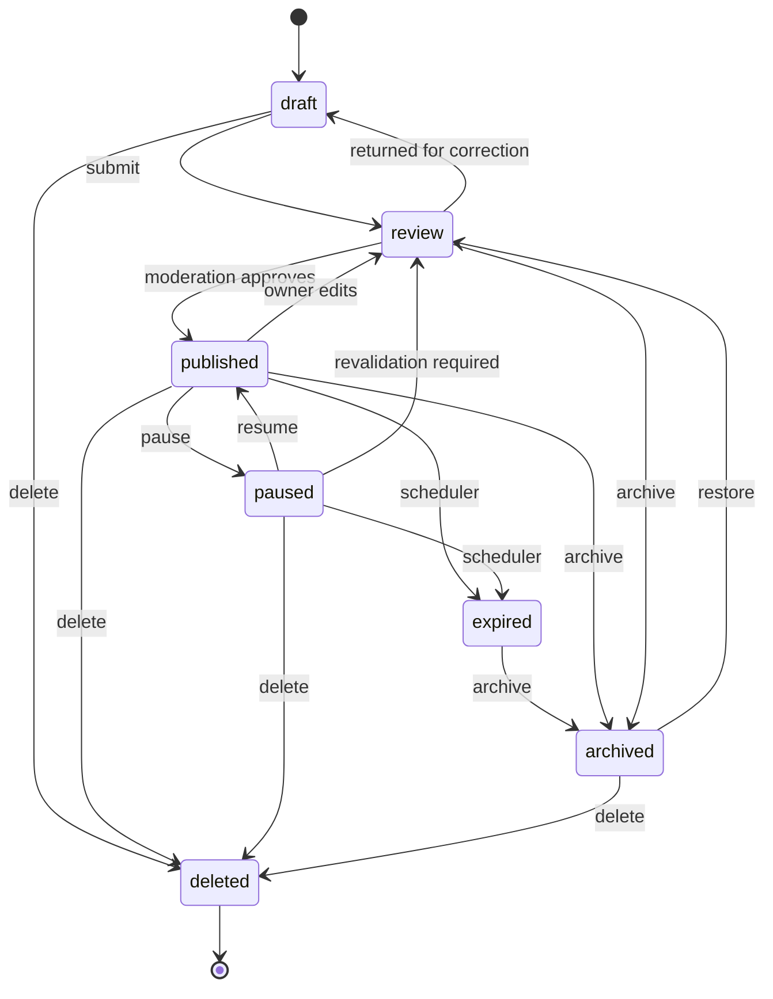

# 14. API Specification

> ## Payment Proof Persistence Note — 2026-10-09
> 

> The V1 manual-submission request may accept a media public ID for proof. Document 13 currently persists this as `payment_intents.submitted_payment_proof_reference` (VARCHAR), not a declared media foreign key. Until a schema gate changes that model, store only the media public ID/reference—not a filesystem path, storage key, signed URL, or binary data—and validate in Laravel that the media exists, belongs to the submitting user, is eligible for payment-proof use, and is not publicly exposed. This application-level validation does not provide database-level referential integrity; decide through the schema review whether a dedicated nullable media FK is required before production.
> 

> ## Cross-Document Contract Addendum — 2026-10-09
> 

> - **Contact reveal:** the only V1 contact-disclosure command is `POST /listings/{id}/contact-reveals`. The older `GET /listings/{id}/contact` route is superseded and must not be implemented. In-app conversation creation remains `POST /listings/{id}/conversations`.
> 

> - **Public routes:** Document 23's intended public URL shape is `/listing/{slug}-{public-id}`, `/category/{slug}`, `/location/{slug}`, and eligible `/business/{slug}`. The canonical API resolver is `/listings/by-public-id/{public_id}` so the public-ID suffix is authoritative and a slug-history table is not required for basic listing canonical redirects. Location slug resolution remains open because the current schema uses integer location IDs and does not yet establish canonical public slugs.
> 

> - **Listing media:** direct multipart upload is V1. `POST /listings/{id}/media` is the listing-scoped upload operation. `POST /media` may only remain for explicitly documented non-listing media targets; it must not be a second ambiguous route for the same listing upload. Limits and formats are governed by the updated Document 20 addendum/contract.
> 

> - **Subscription reads:** `GET /me/subscription` means the caller's current effective subscription summary; `GET /me/subscriptions` means the caller's subscription history/collection. Document each response schema separately and do not use the paths interchangeably.
> 

> - **Concurrency:** `If-Match` is optional in V1; missing header follows documented last-write-wins behavior, while a supplied stale ETag returns `412 precondition_failed`. Do not return `428` unless a later accepted contract change makes the header mandatory.
> 

> - **Public rate limits and Next.js SSR:** the proposed public-read limit is IP-based. Production must configure trusted proxies and only honor forwarding headers from known proxies. SSR must not spoof an arbitrary client IP; use a verified forwarded client address for end-user quotas and a separate, explicitly defined service credential only for service-to-service endpoints where appropriate. Test real-user quota behavior through the production proxy chain.
> 

> - **SEO producer decision (2026-10-09):** Next.js owns XML sitemap generation and public metadata assembly using existing documented public API/reference responses; V1 does not add a dedicated sitemap-feed endpoint. The sitemap generator must follow opaque cursors internally, never expose them as crawlable `?page=N`, include only API-eligible canonical resources, and refresh/invalidate on lifecycle, visibility, expiry, and canonical changes. This does not close the separate location-slug schema/resolver gate.
> 

> - **Outbox/idempotency:** `outbox_events` is the durable event-publication mechanism; `api_idempotency_keys` in MySQL is authoritative. Redis is an accelerator/lock only.
> 

> ## Current Contract Reconciliation Addendum — 2026-10-09
> 

> The current database decision baseline is **55 tables / 89 declared foreign-key relationships** per Document 13 after Gate #11 adds `user_push_devices`; Gates #12–#14 add no tables or FKs. The older 52-table / 84-FK pre-Gate-11 baseline (and the earlier 80-FK historical count), the historical “no push-device table” gap, and draft `/me/devices/{device_id}` paths are superseded and must not guide implementation.
> 

> 
> 

> **Canonical V1 device endpoints:** `GET /me/push-devices`, `POST /me/push-devices`, `PATCH /me/push-devices/{id}`, and `DELETE /me/push-devices/{id}`. Raw push tokens are never returned in ordinary API responses.
> 

> 
> 

> **Artifact/runtime status — 2026-10-09:** the available Gate #14 DBML, migration, validation SQL and schema review were statically reconciled to 55 tables / 89 declared FKs, including the BIGINT UNSIGNED `user_push_devices.user_id` FK to `users.id`. Clean-MySQL runtime validation remains pending. Generate and validate the final OpenAPI 3.1 contract after the clean-MySQL gate passes; regenerate schema artifacts only if runtime validation or a subsequent approved schema change requires it. See the Architecture Cross-Document Audit & Closure Register.
> 

> 
> 

> Older audit notes and gap tables below are retained as history where marked superseded; they do not override the closed Gate #11–#14 decisions.
> 

# API Re-Audit — 2026-10-04

**Audit target:** Document 14 against the regenerated **Document 13 Version 1.4** physical schema.

## Audit result

**Historical audit result — SUPERSEDED 2026-10-09.** The earlier 52-table / 84-FK result applied to the pre-Gate-11 baseline and must not be treated as the current schema/runtime PASS. The current closed-gate decision baseline is **55 tables / 89 declared foreign-key relationships** per the reconciliation addendum above. Current generated-artifact reconciliation and clean-MySQL runtime validation remain open; no current runtime PASS is asserted.

### Resolved schema findings

| Finding | Result | Required action |
| --- | --- | --- |
| Category attribute applicability | **RESOLVED** | `category_attribute_applicability` is physical and must drive category-specific attribute exposure/validation. |
| Category/listing-type eligibility | **RESOLVED** | `category_listing_type_applicability` is physical and must drive listing-type validation. |
| `is_multi_value` | **RESOLVED** | `category_attribute_definitions.is_multi_value` is physical. |
| Generic idempotency persistence | **RESOLVED** | `api_idempotency_keys` is the durable authoritative store; Redis may only accelerate locking/cache behavior. |
| Listing pricing | **RESOLVED** | API may use `price_min`, `price_max`, and `price_period`. |
| Notification listing context | **RESOLVED** | `notifications.listing_id` is the authoritative optional listing reference. |
| Admin actor references | **RESOLVED** | Administrative/review/audit actor fields reference dedicated `admins` where applicable. |
| Payment idempotency scope | **RESOLVED** | Payment intent idempotency is scoped to authenticated `user_id`. |

## Corrections required inside the existing document

The older text in sections **25, 27.2, and 27.2A** contains historical statements saying that applicability tables and `is_multi_value` were absent and that the model had 52 tables / 80 FK relationships. Those statements are now **SUPERSEDED** by Document 13 Version 1.4 and this audit.

The following API-GAP items are therefore closed:

- **API-GAP-04 — category/listing-type eligibility: CLOSED.**
- **API-GAP-09 — `is_multi_value`: CLOSED.**
- Generic authenticated idempotency schema gate: **CLOSED** through `api_idempotency_keys`.

## Physical-model API implications

1. `GET /categories/{slug}/attributes` must return only attributes applicable to that category, applying nullable overrides from `category_attribute_applicability` over the base definition.
2. Listing create/edit validation must reject a `listing_type` not present in `category_listing_type_applicability` for the selected category.
3. Multi-value request/response behavior must follow `is_multi_value`; clients must not infer cardinality from option count.
4. Retry-sensitive authenticated writes must persist idempotency state durably and compare the request hash on replay.
5. Listing price resources must represent fixed, ranged, periodic, free/contact-only and other supported pricing modes consistently with Document 13.
6. Notification resources may include listing context through the public listing identifier.
7. Admin-only operations remain outside the client REST surface; the dedicated `admins` identity is a Filament/back-office concern.

## Additional API contract findings

### A. Business-owned listing conversation recipient

**Status: resolved for V1.** Conversations for business-owned listings route to the active primary business representative. Multi-member assignment remains an open business workflow.

### B. Account reactivation

**Status: resolved for API shape.** `POST /me/reactivation` is idempotent and restores only an account eligible for restoration. Server-side restrictions and listing state are re-evaluated.

### C. Account deletion

**Status: resolved for API boundary.** `POST /me/deletion-requests` starts the marketplace soft-delete workflow. Firebase identity deletion is coordinated separately after retention/deletion policy permits it.

### D. Expired listing renewal

**Status: resolved for API shape.** `POST /listings/{id}/renew` is the explicit renewal command. Renewal may return the listing to `review`; it never bypasses moderation.

### E. Canonical listing route

**Status: resolved for API shape.** `/listings/by-public-id/{public_id}` returns the canonical public listing and current canonical slug/URL. The web/SEO layer compares the requested slug suffix and emits HTTP 301 when the resource remains publicly eligible.

## Remaining implementation gates

These are **not** database reconciliation blockers:

1. Account deletion/retention details.
2. Verification levels beyond phone/email.
3. Push-device token persistence.
4. Saved-search persistence if saved-search notifications remain in scope.
5. Final report reason/target code registry.
6. Final enum registry for public API values such as visibility/pricing/report states.

Business-member permissions, protected-location/contact rules, listing expiration/renewal, subscription commercial rules, moderation thresholds, media limits, rate limits, and the communication/read-state/user-safety model are now explicitly closed for V1.

## Re-audit acceptance

- [x]  Document 14 checked against Document 13 Version 1.4.
- [x]  Historical pre-Gate-11 52-table / 84-FK baseline documented as superseded.
- [x]  Available Gate #14 artifacts statically reconciled to 55 tables / 89 FKs on 2026-10-09; clean-MySQL execution remains a separate open gate.
- [x]  Former applicability schema gaps closed.
- [x]  `is_multi_value` gap closed.
- [x]  Durable authenticated idempotency model confirmed.
- [x]  Pricing range/period model aligned.
- [x]  Notification listing context aligned.
- [x]  Admin authentication boundary aligned.
- [ ]  Clean MySQL runtime migration executed.
- [ ]  Remaining product/security decisions formally approved.
- [ ]  OpenAPI 3.1 generated and contract-tested.

**Historical audit conclusion — superseded 2026-10-09.** The earlier 52-table / 84-FK schema-alignment conclusion is not the current implementation gate. Current decision baseline: 55 tables / 89 declared FKs. Static artifact reconciliation is now complete; clean-MySQL runtime validation remains open. Final OpenAPI 3.1 generation follows the runtime gate.

## 0.1 Current Baseline Alignment — 2026-10-02

**Historical database baseline (superseded 2026-10-09):** this earlier audit referred to Document 13 as a 52-table physical model. The current closed-gate decision baseline is 55 tables / 89 declared foreign-key relationships; see the Current Contract Reconciliation Addendum at the top of this document. The physical schema includes `category_attribute_applicability`, `category_listing_type_applicability`, and `api_idempotency_keys`. `category_attribute_definitions.is_multi_value` is physical, listing pricing supports `price_min`, `price_max`, and `price_period`, and notifications use nullable `listing_id` context. Clients must never infer eligibility from category names or UI state.

**Catalogue baseline:** 25 top-level categories and 372 subcategories. Phase 3B option and unit resolution is complete. Controlled options are seeded from the approved catalogue/registry; runtime option invention is prohibited.

**Search baseline:** MySQL search for V1. A future search index remains a derived/rebuildable projection and does not change the public API contract.

**Authentication baseline:** Firebase Authentication for marketplace users; dedicated Laravel `admins` identity and guard for Filament. Firebase credentials and OTP codes are never accepted as API business payloads.

**Source of truth:** MySQL is authoritative for transactional marketplace data. Firestore, Redis, search projections, and notification providers are secondary/derived infrastructure.

**Implementation gate:** Document 14 is the API contract. Before implementation begins, the corrected database migration/seed package must pass its structural validation, and the open decisions listed in this document must be explicitly accepted, changed, or deferred.

**Project:** KHOJ BHET  

**Document:** API Specification  

**Document ID:** KB-TECH-014  

**Status:** Active — API Specification Baseline; final OpenAPI 3.1 artifact and clean-MySQL runtime validation remain gated  

**Version:** 1.4  

**Owner:** KHOJ BHET Engineering  

**Last Reviewed:** 2026-10-15  

**Parent:** 02. TECHNICAL DEFINITION  

**Previous:** 13. Database Architecture & Data Model  

**Next:** 15. Frontend Architecture  

**Related:** 05. User Stories & Use Cases, 08. Product & Business Rules, 09. Software Architecture, 10. Technology Stack, 12. Engineering Standards, 13. Database Architecture & Data Model, 16. Backend Architecture, 18. Authentication & Authorization, 19. Security Architecture, 20. Media & File Storage, 21. Search Architecture, 22. Notification System, 23. SEO Architecture, ADR-001, ADR-002, ADR-004, ADR-005, ADR-006, ADR-007, ADR-008

---

# 1. Document Purpose

This document defines the **externally observable API contract** of KHOJ BHET: resources, endpoints, authentication, authorization behavior, request and response formats, errors, pagination, idempotency, and the privacy rules that govern what each caller may see.

The API is the single integration boundary between the clients (Next.js web, React Native + Expo mobile) and the backend implementation. Clients never implement business rules on their own (SA-PR-001, SA-PR-005).

> **Core principle:** The API exposes domain operations, not database tables. Lifecycle, moderation, entitlement, and privacy rules are enforced server-side on every request. A response never contains data the caller is not permitted to see.
> 

This document defines the **contract**. It does not define Laravel controllers, Form Requests, API Resources, or services. Those belong in **16. Backend Architecture** and must implement this contract without leaking Laravel-specific details to clients (12. Engineering Standards, section 5).

# 2. Authority and Status

## 2.1 Authority Chain

**Notion Document 14 → OpenAPI 3.1 file → backend implementation → TypeScript client types → Contract tests**

- This document is the authoritative written contract.
- `docs/api/openapi.yaml` is the machine-readable representation derived from this document. It must not contain endpoints or fields that are not defined here.
- Typed clients for Next.js and Expo are generated from the OpenAPI file, not written independently.
- If implementation differs from this document, the difference is **API drift** and must be resolved explicitly.

## 2.2 Inputs

This document is derived from the approved baseline of:

- **09. Software Architecture** (modular monolith, domain commands, request processing chain);
- **10. Technology Stack** (Laravel 13, Firebase Authentication, Axios, REST, MySQL);
- **12. Engineering Standards** (section 10 REST rules, section 11 Axios rules);
- **13. Database Architecture** (current closed-gate decision baseline: 55 tables / 89 declared foreign-key relationships; public IDs, lifecycle, visibility, location exposure, category applicability, durable idempotency, and listing price range/period);
- **05. User Stories & Use Cases** (UC-001 to UC-024);
- **08. Product & Business Rules** (KB-BR-* rules).

## 2.3 What Is Proposed vs Fixed

Sections marked **Proposed** are design decisions made in this document where the upstream documents were silent. They are listed in section 27 so they can be accepted or changed deliberately. Items that depend on an open product decision are marked **Open** and are not to be implemented until resolved.

# 3. API Principles

| ID | Principle | Meaning |
| --- | --- | --- |
| API-PR-001 | Server-side authority | Every protected operation is authorized on the server. Client checks are UX only. |
| API-PR-002 | Domain commands over CRUD | Meaningful operations (submit, pause, resume, archive) are explicit command endpoints, not status fields written by clients. |
| API-PR-003 | Resource-oriented | Nouns for resources, HTTP verbs for semantics, predictable URLs. |
| API-PR-004 | Public IDs only | Internal BIGINT keys are never exposed. Resources use the ULID public_id as <code>id</code>. Documented exception: Nepal reference location data (section 15.4). |
| API-PR-005 | Secure by default | Restricted fields are omitted or nulled with an explanation, never merely hidden by the UI (KB-BR-PRIV-004). |
| API-PR-006 | Predictable shape | One success envelope, one error format, one pagination model across all endpoints. |
| API-PR-007 | Safe retries | Unsafe operations that clients may retry support idempotency keys (SA-PR-009). |
| API-PR-008 | Framework-independent | The contract must be implementable by a future Node.js + Express.js backend without client changes (10. Technology Stack, section 14.4). |
| API-PR-009 | Additive evolution | Adding fields or endpoints is non-breaking. Removing or changing meaning is breaking and requires a new version or a deprecation plan. |
| API-PR-010 | Provider-neutral | Payment, storage, notification, and search providers never appear in resource shapes except as opaque identifiers. |

# 4. API Surfaces

| Surface | Base path | Consumers | Authentication | Status |
| --- | --- | --- | --- | --- |
| Client API | <code>/api/v1</code> | Next.js web, React Native + Expo mobile | Public, or Firebase ID token (Bearer) | V1 baseline |
| Webhook endpoints | <code>/api/v1/webhooks</code> | External providers (payments, later) | Provider signature verification | Reserved; no gateway in V1 |
| Admin / back-office | Filament panel (not a REST surface) | Platform admins and moderators | Laravel <code>admin</code> guard | No admin REST API in V1 (Proposed) |

**Admin boundary (Proposed AD-API-01).** Per Document 13, administrators authenticate through the dedicated `admins` table and the Laravel `admin` guard into Filament, not through Firebase. In V1 the Filament panel calls the same application services directly. No admin REST endpoints are published. If a future admin client (for example an admin mobile app) is needed, a separate `/api/v1/admin` surface with the `admin` guard is added through an ADR.

This keeps Rule 8 of Document 10 intact: Firebase user authentication is never reused as administrative authentication.

# 5. Request Conventions

## 5.1 Transport and Format

| Item | Convention |
| --- | --- |
| Protocol | HTTPS only in staging and production |
| Content type | <code>application/json; charset=utf-8</code>. Media upload uses <code>multipart/form-data</code>. |
| Versioning | URI major version: <code>/api/v1</code> |
| JSON field names | <code>snake_case</code> |
| Enum values | lowercase <code>snake_case</code> strings |
| Identifiers | ULID strings (26 characters) from <code>public_id</code> |
| Timestamps | ISO 8601 in UTC with <code>Z</code>, for example <code>2026-10-01T04:47:40Z</code>. Nepal-local display is a client concern (13, section 28). |
| Money | Decimal as a string plus currency code: <code>{"amount": "25000.00", "currency": "NPR"}</code>. Floating point is never used. |
| Null vs absent | Fields defined by the contract are always present. Unknown or not-permitted values are <code>null</code> and, where the reason matters, accompanied by an access object (section 14). |
| Language | <code>Accept-Language</code>: <code>en</code> supported in V1. <code>ne</code> is reserved for localized display names. |

## 5.2 Standard Headers

| Header | Direction | Purpose |
| --- | --- | --- |
| <code>Authorization: Bearer</code> followed by a Firebase ID token | Request | Authenticates a marketplace user |
| <code>Idempotency-Key</code> | Request | Client-generated unique key (UUID or ULID, max 64 characters) for retry-safe operations (section 11) |
| <code>If-Match</code> | Request | Optimistic concurrency for listing edits (section 12) |
| <code>X-Request-Id</code> | Request / Response | Correlation ID. The server accepts a client value or generates one and always echoes it. It is also written to logs and audit events. |
| <code>ETag</code> | Response | Version tag for cacheable and editable resources |
| <code>RateLimit-Limit</code>, <code>RateLimit-Remaining</code>, <code>RateLimit-Reset</code>, <code>Retry-After</code> | Response | Rate-limit state (section 13) |
| <code>Deprecation</code>, <code>Sunset</code> | Response | Deprecation signalling (section 23) |

# 6. Authentication

Authentication follows **ADR-002** and Document 13 sections 7 and 8.

## 6.1 Marketplace Users

- Users sign up and sign in with **Firebase Authentication** in the client (UC-001, UC-002). The KHOJ BHET API does not receive passwords or OTP codes.
- Clients send the Firebase **ID token** as `Authorization: Bearer <token>` on every authenticated request.
- The backend verifies the token signature, issuer, audience, and expiry, then maps `firebase_uid` to the `users` record. The API never trusts a user ID supplied by the client for identity.
- After verification the backend checks `users.status` and active `account_restrictions` before processing the request.
- Tokens are short-lived. Clients refresh them through the Firebase SDK. The API issues no session cookies for marketplace users, so CSRF protection is not applicable to the client API.

## 6.2 Bootstrap Endpoint

`POST /api/v1/auth/session` is an idempotent bootstrap call made by the client after every Firebase sign-in:

- If no `users` row exists for the verified `firebase_uid`, one is created with a new `public_id`, along with an empty profile and default notification preferences.
- If the row exists, `last_login_at` is updated.
- The response is the caller's account representation (section 15.2).
- Email and phone verification timestamps are synchronized from the verified token claims.

## 6.3 Failure Behavior

| Condition | Status | Error code |
| --- | --- | --- |
| No or malformed token on a protected endpoint | 401 | <code>unauthenticated</code> |
| Expired token | 401 | <code>token_expired</code> (client refreshes and retries once) |
| Invalid signature, wrong audience, or revoked token | 401 | <code>token_invalid</code> |
| Valid token, account suspended or disabled | 403 | <code>account_suspended</code> |
| Valid token, restriction blocks this action | 403 | <code>account_restricted</code> |

## 6.4 Administrators

Administrators do not authenticate to the client API. See AD-API-01 in section 4.

# 7. Authorization Model

Every endpoint documents its required access. The evaluation order follows 09. Software Architecture, section 13:

**Authentication → Authorization → Resource scope → Entitlement → Consent / privacy → Information visibility**

| Code | Access level | Meaning |
| --- | --- | --- |
| P | Public | No token required. Only public-class data is returned. |
| A | Authenticated | Valid Firebase ID token and an active account. |
| O | Owner / scope | Authenticated and within the resource scope: the listing owner, the owning business member with a sufficient role, or the user's own record. |
| B | Business role | Active <code>business_members</code> row with a role permitted for the operation (owner, admin, manager, member). |
| E | Entitlement-gated | Requires an active entitlement for a named feature in addition to A. Entitlement never overrides privacy, safety, moderation, or seller consent (KB-BR-SUB-005, KB-BR-LOC-012). |
| S | System | Provider webhook or internal scheduler. Not callable by clients. |

## 7.1 Existence Hiding

For resources a caller may not see at all (another user's draft listing, a conversation the caller is not part of), the API returns **404 Not Found**, not 403, so existence is not disclosed. 403 is used when the resource is visible but the action or a specific field is not permitted.

## 7.2 Approved V1 Business Role Matrix

**Status: Approved for V1 — 2026-10-04.** This matrix is the authoritative V1 permission baseline for the four `business_members.role` values in Document 13: `owner`, `admin`, `manager`, and `member`. It is scoped to the specific business and never grants platform-wide administrative privileges.

| Operation | owner | admin | manager | member |
| --- | --- | --- | --- | --- |
| View business profile and permitted business resources | Yes | Yes | Yes | Yes |
| Edit business profile | Yes | Yes | No | No |
| Invite members | Yes | Yes | No | No |
| Change member role/status | Yes | Yes, except owner | No | No |
| Remove members | Yes | Yes, except owner | No | No |
| Create business listings | Yes | Yes | Yes | Yes |
| Edit business listings | Yes | Yes | Yes | Yes |
| Submit business listings | Yes | Yes | Yes | No |
| Pause business listings | Yes | Yes | Yes | No |
| Resume business listings | Yes | Yes | Yes | No |
| Archive business listings | Yes | Yes | No | No |
| Delete business listings | Yes | Yes | No | No |
| Act as a business representative on authorized listings | Yes | Yes | Yes | Yes |
| Manage platform users, categories, moderation, or system configuration | No | No | No | No |

**Authorization rules:**

1. An active membership row is required.
2. Every operation is evaluated against the caller's business role and the specific business/listing scope.
3. `admin` may manage ordinary members but cannot modify, remove, or demote the `owner`.
4. `member` may create/edit listings and represent the business, but cannot submit, pause, resume, archive, delete, or manage members.
5. `manager` may operate listings through submit/pause/resume but cannot manage members or archive/delete listings.
6. Business roles never confer platform-admin or moderation authority.
7. Listing ownership/representation rules still apply; membership alone does not authorize management of a listing outside the business scope.
8. Sensitive operations remain subject to account status, listing lifecycle, moderation, privacy, consent, entitlement, and other higher-priority rules.

`GET /businesses/{id}` may expose the caller's effective `my_permissions` as a derived capability list. The server remains authoritative; clients must not infer permissions from role labels alone.

# 8. Response Envelope

## 8.1 Single Resource

```json
{
  "data": {
    "id": "01J9Z3K8Q4W2M6X7V5N1B0C9DE",
    "type": "listing",
    "...": "resource fields"
  },
  "meta": {
    "request_id": "01J9Z3KAB2R0S8T6Y4U2F1G7HJ"
  }
}
```

## 8.2 Collection

```json
{
  "data": [ { "id": "...", "type": "listing" } ],
  "meta": {
    "request_id": "...",
    "page": {
      "limit": 20,
      "has_more": true,
      "next_cursor": "eyJ2IjoxLCJzIjoi...signed-opaque-cursor...",
      "prev_cursor": null
    }
  }
}
```

## 8.3 Command Result

Lifecycle and other command endpoints return the updated resource plus a state-change summary:

```json
{
  "data": { "id": "...", "type": "listing", "lifecycle_status": "review" },
  "meta": {
    "request_id": "...",
    "state_change": {
      "from": "draft",
      "to": "review",
      "at": "2026-10-01T05:10:00Z"
    }
  }
}
```

## 8.4 Pagination (Cursor)

- All potentially unbounded collections use **cursor pagination** (12. Engineering Standards, sections 10 and 12): listings, favorites, messages, notifications, own listings.
- Query parameters: `limit` (default 20, maximum 50) and `cursor` (opaque; clients must not parse or construct it).
- Cursors are opaque, signed, and integrity-protected. Clients must not decode, inspect, modify, or construct them. The cursor contains no exposed internal row ID. It binds the issued sort/filter fingerprint and a stable tie-breaker; combining it with a different sort or incompatible filter returns `400 invalid_cursor`. Relevance pagination must use a deterministic server-side tie-breaker so cursor ordering remains stable.
- Bounded reference collections (categories, provinces, plans) return the complete set without pagination.
- Total counts are not returned by default because they are expensive on large filtered sets. `include_total=true` is allowed only on endpoints that state it.

# 9. Error Format

Errors use **RFC 9457 Problem Details** (`application/problem+json`) with project extensions. Errors are machine-readable, safe, and never contain stack traces, SQL, secrets, tokens, or private contact data (12. Engineering Standards, section 16).

```json
{
  "type": "https://khojbhet.com/problems/validation-failed",
  "title": "The request data is invalid.",
  "status": 422,
  "code": "validation_failed",
  "detail": "One or more fields failed validation.",
  "request_id": "01J9Z3KAB2R0S8T6Y4U2F1G7HJ",
  "errors": [
    {
      "field": "attributes.bedrooms",
      "code": "required",
      "message": "Bedrooms is required for this category."
    }
  ]
}
```

## 9.1 Error Code Catalogue

| HTTP | <code>code</code> | When |
| --- | --- | --- |
| 400 | <code>invalid_request</code>, <code>invalid_cursor</code>, <code>invalid_filter</code> | Malformed JSON, unknown or illegal query parameters, bad cursor |
| 401 | <code>unauthenticated</code>, <code>token_expired</code>, <code>token_invalid</code> | Section 6.3 |
| 403 | <code>forbidden</code> | Authenticated but not permitted to perform the action on a visible resource |
| 403 | <code>account_restricted</code>, <code>account_suspended</code> | Account status or restriction blocks the action |
| 403 | <code>entitlement_required</code> | Feature needs an entitlement the caller lacks. The error includes the feature code. |
| 403 | <code>consent_required</code> | The seller has not consented to the requested disclosure |
| 403 | <code>contact_restricted</code> | Contact details cannot be disclosed to this caller yet |
| 404 | <code>not_found</code> | Resource does not exist or the caller may not know it exists |
| 409 | <code>invalid_state_transition</code> | Action not allowed from the current lifecycle state (KB-BR-LIST-029). Includes <code>current_status</code> and <code>allowed_actions</code>. |
| 409 | <code>conflict</code>, <code>duplicate</code> | Unique constraint or concurrent modification |
| 409 | <code>idempotency_in_progress</code> | Same idempotency key is still being processed |
| 410 | <code>listing_unavailable</code> | Listing was once public and is now permanently unavailable (Proposed, section 21.3) |
| 412 | <code>precondition_failed</code> | <code>If-Match</code> does not match the current version |
| 413 | <code>payload_too_large</code> | Body or upload exceeds the limit |
| 415 | <code>unsupported_media_type</code> | Wrong content type or disallowed file type |
| 422 | <code>validation_failed</code> | Field-level validation failure. Always includes <code>errors[]</code>. |
| 422 | <code>listing_not_ready</code> | Submit attempted while required data is missing. Includes <code>errors[]</code> listing every gap. |
| 422 | <code>idempotency_key_reused</code> | Same key sent with a different payload |
| 429 | <code>rate_limited</code> | Section 13 |
| 500 | <code>server_error</code> | Unexpected failure. The message is generic; details stay in logs under <code>request_id</code>. |
| 503 | <code>service_unavailable</code> | Maintenance or dependency outage. Includes <code>Retry-After</code> where known. |

# 10. Filtering, Sorting, and Search

Search and filtering are defined explicitly (12. Engineering Standards, section 10). V1 search is **MySQL-based** behind a backend search abstraction (ADR-004, ADR-008). The contract below is stable even if a dedicated engine is introduced later.

## 10.1 Listing Query Parameters

`GET /listings` is both the browse and the search endpoint (UC-010, UC-011).

| Parameter | Type | Meaning |
| --- | --- | --- |
| <code>q</code> | string, 2 to 100 characters | Free-text query over title and description |
| <code>category</code> | category slug | Category or subcategory. Includes descendants when a parent is given. |
| <code>listing_type</code> | enum, repeatable | <code>sale</code>, <code>rent</code>, <code>lease</code>, <code>free</code>, <code>exchange</code>, <code>offer</code>, <code>wanted</code>, <code>service</code>, <code>job</code> (13, section 61.1) |
| <code>price_min</code>, <code>price_max</code>, <code>price_period</code> | decimal strings, enum | Inclusive monetary range in NPR plus an explicit period where applicable. `price_period` values include `once`, `daily`, `weekly`, `monthly`, `yearly`, and `per_item`; `free` listings use effective amount `0` and `price_period: null`. Job salary and wanted-listing budgets use the range fields with the applicable period. If the physical schema cannot persist these directly, approved category attributes must supply them before implementation. |
| <code>province</code>, <code>district</code>, <code>municipality</code>, <code>ward</code>, <code>locality</code>, <code>named_place</code> | reference ID | Administrative or local-place filter. A deeper level implies its parents. |
| <code>postal_code</code> | string | Exact postal code (KB-BR-LOC-003) |
| <code>attr[code]</code> | typed value | Category-specific filter, for example <code>attr[bedrooms]=3</code>. Only attributes with <code>is_filterable = true</code> for the selected category are accepted (KB-BR-SEARCH-002). Range form: <code>attr[area_min]</code> and <code>attr[area_max]</code> for numeric attributes. Multi-value attributes accept repeated values. |
| <code>posted_by</code> | object | Listings of a specific poster (public listings only). Shape: `{ "type": "user" | "business", "id": "ULID" }`; the discriminator removes ambiguity between user and business IDs. |
| <code>sort</code> | enum | <code>newest</code> (default), <code>oldest</code>, <code>price_asc</code>, <code>price_desc</code>, <code>relevance</code> (valid only when <code>q</code> is present) |
| <code>limit</code>, <code>cursor</code> | integer, string | Section 8.4 |
- Unknown parameters return `400 invalid_filter`. They are never silently ignored.
- **Eligibility is enforced by the server, not the client.** Normal public search returns only listings with `lifecycle_status = published`, an approved moderation state, and a public visibility state. Drafts, review, paused, expired, archived, rejected, restricted, removed, and deleted listings never appear (KB-BR-SEARCH-001, KB-BR-SEARCH-004).
- Search results and listing detail apply the same visibility rules (KB-BR-SEARCH-005). Restricted fields never appear in search results (KB-BR-SEARCH-003).

## 10.2 Filter Discovery

Clients build category filter UIs from `GET /categories/{slug}/attributes`, which returns each attribute definition with `data_type`, `unit`, options, `is_filterable`, `is_multi_value`, and `is_required`. Filters are never hard-coded in clients.

# 11. Idempotency

Clients may retry requests after network failure. The architecture distinguishes "transaction failed" from "transaction completed but the response was lost" (09, section 29).

- The client sends `Idempotency-Key` on the operations listed below.
- The server stores the key with a request hash, response status, response body, and expiry for **24 hours** in durable authoritative storage. Redis may be used only as an acceleration/lock layer; it is not the sole source of idempotency state.
- Same key and same body: the original response is replayed with header `Idempotent-Replayed: true`.
- Same key and different body: `422 idempotency_key_reused`.
- Same key while the first request is still running: `409 idempotency_in_progress`.
- Axios clients must not auto-retry unsafe operations unless an idempotency key is attached (12. Engineering Standards, section 11).

| Operation | Idempotency |
| --- | --- |
| <code>POST /listings</code> (create draft) | Key required |
| Listing lifecycle commands (submit, pause, resume, archive) | Naturally idempotent by state. A repeat on an already-reached state returns the current resource with 200, not 409. |
| <code>POST /listings/{id}/conversations</code>, <code>POST /conversations/{id}/messages</code> | Key required |
| <code>POST /payment-intents</code>, <code>POST /payment-intents/{id}/manual-submission</code> | Key required. The key maps to <code>payment_intents.idempotency_key</code> (UNIQUE). |
| <code>POST /reports</code> | Key required; duplicate target and reason handling per KB-BR-MOD-004 |
| <code>POST /media</code> | Key recommended |
| <code>PUT /me/favorites/{listing_id}</code> | Naturally idempotent (KB-BR-SEARCH-011) |
| Webhooks | Deduplicated on provider event and transaction reference |

### Idempotency storage and scope

Generic idempotency state must be persisted durably; Redis alone is insufficient because it is disposable. Payment idempotency keys are scoped to the authenticated account, so one user's key cannot block another user's request. Visitor `POST /reports` idempotency requires a documented anonymous abuse-control scope before implementation.

# 12. Concurrency Control

Listing edits can race, especially between an owner and a business co-editor.

- `GET /listings/{id}` (owner view) and `GET /me/listings/{id}` return an `ETag`.
- `PATCH /listings/{id}` and the sub-resource `PUT` operations accept `If-Match`. A mismatch returns `412 precondition_failed`. `If-Match` is **optional but recommended**; when omitted, last-write-wins applies and the edit is still audited.
- Lifecycle transitions are guarded by state conditions in the transaction (13, section 34), so concurrent submit or pause calls cannot produce an invalid state.

# 13. Rate Limiting and Abuse Control

Exact thresholds are an **Open** product and security decision (08, sections 28 and 34; 19. Security Architecture). The contract fixes the mechanism; the numbers below are **Proposed defaults** to be ratified.

| Tier | Applies to | Keyed by | Proposed limit |
| --- | --- | --- | --- |
| Public read | Listing browse, search, reference data | IP | 120 requests per minute |
| Authenticated read | All authenticated GET endpoints | User | 240 per minute |
| Authenticated write | Create and update operations | User | 60 per minute |
| Sensitive | Contact reveal, message send, report submit, auth bootstrap | User and IP | 10 to 30 per minute depending on endpoint |
| Upload | Media upload | User | 20 per hour burst, tuned in Document 20 |
| Webhook | Provider callbacks | Provider allow-list | Provider-specific |

Responses include `RateLimit-*` headers. Exceeding a limit returns `429 rate_limited` with `Retry-After`. Listing-creation volume limits (spam control) are a separate business-level control and are expressed through `account_restricted` or `validation_failed`, not through HTTP rate limiting.

# 14. Information Visibility Contract

The API classifies every response field as **Public**, **Restricted**, or **Private/Internal** (08, section 12). Classification is enforced by the server's response/representation layer, never by UI hiding.

## 14.1 Access Object

Wherever a field can be restricted, the response carries an access descriptor so clients can explain the restriction without learning the value:

```json
"exact": null,
"exact_access": {
  "granted": false,
  "missing": ["entitlement", "seller_consent"]
}
```

`missing` values: `authentication`, `entitlement`, `seller_consent`, `account_status`, `listing_state`. The descriptor reveals **why** access is not granted, never the protected value.

## 14.2 Listing Field Visibility Matrix

| Field | Visitor | Registered user | Entitled and consented | Owner / business scope |
| --- | --- | --- | --- | --- |
| id, slug, title, description, listing_type, category | Yes | Yes | Yes | Yes |
| price (amount, currency, pricing mode) | Yes | Yes | Yes | Yes |
| Public attributes (<code>is_public = true</code>) | Yes | Yes | Yes | Yes |
| Non-public attributes | No | No | No | Yes |
| Administrative location (province to ward), locality, named place, postal code | Yes | Yes | Yes | Yes |
| Approximate map point | Yes | Yes | Yes | Yes |
| Exact coordinates and <code>address_line</code> | No | No | Yes | Yes |
| Media (processed and approved) | Yes | Yes | Yes | Yes, including pending and rejected media |
| Poster display name, verification labels, business name | Yes | Yes | Yes | Yes |
| Phone, email, direct contact details | No | No | Yes | Yes |
| Available contact methods (names only, for example message, phone) | Yes | Yes | Yes | Yes |
| lifecycle_status, moderation_status, moderation reason | No (only published listings are visible) | No | No | Yes |
| Internal moderation notes, reporter identities, audit data | Never | Never | Never | Never (Filament only) |
| Favorite state for the caller | Not applicable | Yes | Yes | Yes |

**Entitled and consented** means the caller is authenticated, has an active entitlement for the feature, the seller has consented where consent is required, the account is in good standing, and the listing is published. Entitlement alone never grants exact location or contact details (KB-BR-LOC-012, KB-BR-PRIV-005). The seller consent model is **Approved for V1** by Document 08's 2026-10-04 decision summary. Exact location and direct contact are restricted by default and require the corresponding seller consent plus entitlement and all other access checks.

## 14.3 Location Exposure

The stored location may be more precise than what is exposed (13, section 15). Listing location has an exposure mode: `approximate` (default), `exact`, or `private`.

- The **approximate point** is computed and fuzzed on the server (for example snapped to a grid or offset within a radius). Clients must never derive it from exact coordinates, and exact coordinates are never present in the payload when the caller lacks access, even if the client ignores them.
- With mode `private`, only the administrative and local-place levels the poster allows are shown; no map point is returned.

## 14.4 Cache Safety

Responses whose content depends on the caller (anything with an access object evaluated per user, any authenticated response) are sent with `Cache-Control: private, no-store` and `Vary: Authorization`. Only anonymous public representations are cacheable by shared caches (section 20).

# 15. Resource Model

This section defines the resource representations. Field lists are the **contract**; fields marked Open depend on unresolved product decisions.

## 15.1 Conventions

Every resource has `id` (ULID public_id) and `type`. Timestamps are `created_at` and `updated_at` unless noted. Nested summaries use the same field names as the full resource.

## 15.2 Account (Me)

Returned by `POST /auth/session` and `GET /me`.

```json
{
  "id": "01J9Z3K8Q4W2M6X7V5N1B0C9DE",
  "type": "user",
  "status": "active",
  "email": "user@example.com",
  "phone": "+9779800000000",
  "email_verified": true,
  "phone_verified": true,
  "profile": {
    "display_name": "Sita Sharma",
    "avatar": { "id": "01J9...", "urls": { "thumb": "...", "medium": "..." } },
    "bio": null
  },
  "roles": ["user"],
  "restrictions": [],
  "created_at": "2026-09-20T08:00:00Z",
  "updated_at": "2026-10-01T04:47:40Z"
}
```

- `firebase_uid` and internal IDs are never returned.
- `restrictions` lists active restrictions the user may know about (type, scope, `ends_at`), not internal reasons or admin identities.
- `roles` and the effective permissions are informational. Authorization is always re-evaluated server-side.

## 15.3 Listing

Two representations share the same field names.

**Listing summary** (search results, cards, favorites):

```json
{
  "id": "01J9Z4A1B2C3D4E5F6G7H8J9KM",
  "type": "listing",
  "slug": "2-bhk-flat-for-rent-janakpur-ward-5",
  "title": "2 BHK flat for rent",
  "listing_type": "rent",
  "category": { "id": "01J8...", "slug": "flat", "name": "Flat" },
  "price": { "amount": "15000.00", "currency": "NPR", "mode": "fixed" },
  "location": { "display": "Ward 5, Janakpurdham", "municipality": "Janakpurdham", "district": "Dhanusha" },
  "primary_media": { "id": "01J9...", "urls": { "thumb": "...", "medium": "..." } },
  "published_at": "2026-09-30T10:00:00Z",
  "is_favorited": false
}
```

**Listing detail** adds `description`, `attributes[]`, full `location`, `media[]`, `poster`, `business`, `contact` (access descriptor and available methods), and `expires_at`. The owner view adds `lifecycle_status`, `moderation_status`, `moderation_reason`, `visibility_status`, `allowed_actions[]`, `version` (also sent as `ETag`), and `representations[]`.

```json
{
  "id": "01J9Z4A1B2C3D4E5F6G7H8J9KM",
  "type": "listing",
  "slug": "2-bhk-flat-for-rent-janakpur-ward-5",
  "title": "2 BHK flat for rent",
  "description": "Second floor, water and parking available.",
  "listing_type": "rent",
  "category": { "id": "01J8...", "slug": "flat", "name": "Flat" },
  "price": { "amount": "15000.00", "currency": "NPR", "mode": "fixed" },
  "attributes": [
    { "code": "bedrooms", "name": "Bedrooms", "data_type": "integer", "value": 2, "unit": null },
    { "code": "facilities", "name": "Facilities", "data_type": "enum", "values": [
        { "value": "parking", "label": "Parking" },
        { "value": "water", "label": "Water supply" } ] }
  ],
  "location": {
    "administrative": {
      "province": { "id": 2, "name": "Madhesh" },
      "district": { "id": 17, "name": "Dhanusha" },
      "municipality": { "id": 305, "name": "Janakpurdham" },
      "ward": { "id": 4012, "number": 5 }
    },
    "locality": { "id": 9001, "name": "Ramanand Chowk Area" },
    "named_place": { "id": 77, "type": "chowk", "name": "Ramanand Chowk" },
    "postal_code": "45600",
    "display": "Near Ramanand Chowk, Ward 5, Janakpurdham",
    "exposure": "approximate",
    "approximate_point": { "latitude": 26.7288, "longitude": 85.9250, "radius_m": 500 },
    "exact": null,
    "exact_access": { "granted": false, "missing": ["entitlement", "seller_consent"] }
  },
  "media": [
    { "id": "01J9...", "is_featured": true, "sort_order": 0,
      "urls": { "thumb": "...", "medium": "...", "large": "..." } }
  ],
  "poster": {
    "type": "user",
    "display_name": "Sita Sharma",
    "role": "landlord",
    "verifications": [ { "type": "phone", "status": "verified" } ]
  },
  "business": null,
  "contact": {
    "methods": ["message", "phone"],
    "access": { "granted": false, "missing": ["authentication", "entitlement"] }
  },
  "published_at": "2026-09-30T10:00:00Z",
  "expires_at": "2026-11-30T10:00:00Z",
  "is_favorited": false
}
```

Notes:

- `attributes[]` supplies typed values: `value` for single-value attributes, `values` for multi-value attributes (13, section 64.4). Typed storage columns are never exposed.
- `poster.verifications[]` states only what was actually verified (KB-BR-USER-006, KB-BR-USER-012). Expired or revoked verifications are omitted (KB-BR-USER-011).
- `price.mode` values are **Proposed**: `fixed`, `negotiable`, `on_request`. The final `pricing_mode` enum is owned by Document 13 and Document 08.
- `expires_at` is authoritative. V1 listings that reach Published receive a 30-calendar-day validity period; Draft and Review do not consume validity time; there is no grace period. The server computes expiry during lifecycle transitions, never from client-supplied values (Document 08 §39).

## 15.4 Reference Data Identifiers (Documented Exception)

Nepal administrative data (province, district, municipality, ward, locality) and named places are **static reference data**. Their codes are unique only within a parent scope (13, section 61.9), so they have no globally unique public ID. They are exposed with their **stable integer `id`**. This is the only exception to API-PR-004 and is **Proposed (AD-API-02)**; it requires confirmation in Document 13 that these IDs are stable across seed updates. Deprecated administrative units remain resolvable so historical listings stay valid.

## 15.5 Category and Attribute Definition

```json
{
  "id": "01J8...",
  "type": "category",
  "slug": "flat",
  "name": "Flat",
  "parent_id": "01J8...",
  "listing_types": ["sale", "rent"],
  "children": []
}
```

```json
{
  "code": "bedrooms",
  "name": "Bedrooms",
  "data_type": "integer",
  "unit": null,
  "is_required": true,
  "is_filterable": true,
  "is_searchable": false,
  "is_multi_value": false,
  "validation": { "min": 0, "max": 50 },
  "options": []
}
```

`data_type` values: `text`, `integer`, `decimal`, `boolean`, `date`, `datetime`, `enum`, `json`. Required, filterable, and searchable flags come from `category_attribute_definitions` and the approved catalogue (13.1 Category & Attribute Catalogue).

## 15.6 Media

```json
{
  "id": "01J9...",
  "type": "media",
  "media_type": "image",
  "mime_type": "image/jpeg",
  "width": 1600,
  "height": 1200,
  "file_size": 482113,
  "processing_status": "ready",
  "moderation_status": "approved",
  "urls": { "thumb": "...", "medium": "...", "large": "..." },
  "created_at": "2026-10-01T05:00:00Z"
}
```

- `processing_status`: `pending`, `processing`, `ready`, `failed`. A media object that is not `ready` and approved never appears in public responses (KB-BR-MEDIA-002, KB-BR-MEDIA-005).
- URLs are generated by the storage abstraction (ADR-005). Clients must not assume a host or path pattern.

## 15.7 Business

Fields: `id`, `slug`, `name`, `description`, `status`, `verifications[]`, `member_count`, `created_at`, `updated_at`. For an authenticated business member, `my_role` and `my_permissions` may additionally be included; they are omitted for visitors and non-members. Business `status` values follow the schema: `pending`, `active`, `suspended`, `restricted`, `closed`, `archived`.

## 15.8 Conversation and Message

- **Conversation:** `id`, `listing` (summary or tombstone), `participants[]` (public display fields only), `last_message_at`, `unread_count` (Open: depends on read-state storage, section 27), `created_at`.
- **Message:** `id`, `conversation_id`, `sender` (display fields), `body`, `message_type`, `created_at`, `deleted` (boolean; body is `null` when deleted).
- MySQL is authoritative for conversations and messages. Firestore, if used, is a realtime projection only (13, section 19; 10, section 4.2). REST remains the source of truth for history and for sending.

## 15.9 Plan, Subscription, Entitlement, Payment Intent

- **Plan:** `id`, `code`, `name`, `description`, `price`, `duration` (Open), `features[]` (codes and descriptions).
- **Subscription:** `id`, `plan`, `status`, `starts_at`, `ends_at`.
- **Entitlement:** `feature_code`, `status`, `source`, `starts_at`, `ends_at`. Answers "does this account currently have capability X?" (13, section 20).
- **Payment intent:** `id`, `plan` or purchased item, `amount`, `currency`, `provider`, `status`, `manual_review` (`status`, `decision`, `reason`, visible to the owner), `created_at`, `updated_at`. Provider references and admin identities are not exposed.

## 15.10 Report

Fields: `id`, `target_type` (`listing`, `user`, `message`), `target_id`, `reason` (approved reason code), `description`, `status` (reporter-visible status only), `created_at`. Moderator identities, internal notes, and decisions are not exposed (KB-BR-MOD-005).

## 15.11 Notification

Fields: `id`, `type`, `title`, `body`, `data` (deep-link target), `read_at` (Open, section 27), `created_at`. Delivery state and provider responses are internal. Notification delivery is not business truth (13, section 25).

# 16. Endpoint Catalogue

All paths are relative to `/api/v1`. Path parameters in braces are public IDs unless stated. **Access** uses the codes in section 7. **Refs** point to use cases (UC) and business rules (BR).

## 16.1 System

| Method | Path | Access | Purpose | Refs |
| --- | --- | --- | --- | --- |
| GET | <code>/health</code> | P | Liveness and dependency status (minimal, no internals) | 09 s28 |
| GET | <code>/meta</code> | P | Enums (listing types, pricing modes, report reasons), upload limits, supported locales, API version | 12 s10 |

## 16.2 Authentication and Account

| Method | Path | Access | Purpose | Refs |
| --- | --- | --- | --- | --- |
| POST | <code>/auth/session</code> | A (token only) | Create or fetch the marketplace user for the verified Firebase identity; returns the account | UC-001, UC-002; ADR-002 |
| GET | <code>/me</code> | A | Current account, profile, restrictions | UC-002 |
| PATCH | <code>/me/profile</code> | A | Update display name, bio, avatar (media ID) | UC-003 |
| GET | <code>/me/verifications</code> | A | List own verification records | BR-USER-010 |
| POST | <code>/me/verifications/sync</code> | A | Re-sync email and phone verification from the Firebase token. Document and identity verification is Open. | BR-USER-006 |
| POST | <code>/me/deactivation</code> | A | Deactivate the account (soft; listings move to inactive or archived per lifecycle rules) | 13 s61.8 |
| POST | <code>/me/deletion-requests</code> | A | Request account deletion. Soft-delete first; financial, moderation, and audit records are retained. | 13 s61.8; BR open item |

Sign-out and password or OTP recovery are handled entirely by the Firebase client SDK. The API has no endpoint for them.

## 16.3 Reference Data

All reference endpoints are public, cacheable (section 20), and return the full bounded set.

| Method | Path | Access | Purpose | Refs |
| --- | --- | --- | --- | --- |
| GET | <code>/categories</code> | P | Full category tree with eligible listing types | BR-LIST-010, BR-LIST-013 |
| GET | <code>/categories/{slug}</code> | P | One category with children | UC-019 |
| GET | <code>/categories/{slug}/attributes</code> | P | Attribute definitions and options for the category (drives forms and filters) | BR-LIST-012, BR-SEARCH-002 |
| GET | <code>/locations/provinces</code> | P | Provinces of Nepal | BR-LOC-001 |
| GET | <code>/locations/provinces/{id}/districts</code> | P | Districts in a province (integer ID) | BR-LOC-001 |
| GET | <code>/locations/districts/{id}/municipalities</code> | P | Municipalities and rural municipalities in a district | BR-LOC-001 |
| GET | <code>/locations/municipalities/{id}/wards</code> | P | Wards of a municipality | BR-LOC-001 |
| GET | <code>/locations/wards/{id}/localities</code> | P | Localities / toles of a ward | BR-LOC-002 |
| GET | <code>/locations/named-places</code> | P | Chowks, landmarks, bazaars, markets. Filters: <code>ward</code>, <code>locality</code>, <code>type</code>, <code>q</code>. Paginated (large set). | BR-LOC-002, BR-LOC-005 |
| GET | <code>/locations/search</code> | P | Place lookup by text through the replaceable geocoding provider, proxied and cached by the server. Clients never call public Nominatim directly (10, section 10.3). | 10 s10 |
| GET | <code>/plans</code> | P | Available plans and features | UC-021 |

## 16.4 Listing Discovery (Public)

| Method | Path | Access | Purpose | Refs |
| --- | --- | --- | --- | --- |
| GET | <code>/listings</code> | P (A optional for <code>is_favorited</code>) | Browse, search, filter, sort published listings (section 10) | UC-010, UC-011; BR-SEARCH-001 to 005 |
| GET | <code>/listings/{id}</code> | P (A optional) | Listing detail with visibility rules applied. Non-public listings return 404 to non-owners. | UC-012; BR-PRIV-001 to 004 |
| GET | <code>/listings/by-public-id/{public_id}</code> | P (A optional) | Resolve the canonical public listing by stable public ID for SEO routes. Response includes the current canonical slug/URL so the web layer can redirect a stale slug suffix. | BR-SEARCH-022; Doc 23 |
| POST | <code>/listings/{id}/contact-reveals</code> | A, E | Execute the direct-contact reveal command only when entitlement, listing visibility, seller consent, and all access conditions pass. Otherwise return the documented 403 Problem Details code. Rate limited, idempotent where defined, and audited. | UC-014; BR-CONTACT-002, 003; BR-SUB-005 |
| GET | <code>/businesses/{id}</code> | P | Public business profile | UC-023 |
| GET | <code>/businesses/{id}/listings</code> | P | Public listings of a business (same filters as <code>/listings</code>) | BR-BIZ-003 |

## 16.5 Listing Management (Owner and Business Scope)

| Method | Path | Access | Purpose | Refs |
| --- | --- | --- | --- | --- |
| GET | <code>/me/listings</code> | A | Own and business-scope listings. Filters: <code>lifecycle_status</code>, <code>moderation_status</code>, <code>business</code>. | UC-004 to UC-009 |
| GET | <code>/me/listings/{id}</code> | O | Owner view with all states, <code>allowed_actions</code>, and <code>ETag</code> | BR-LIST-003 |
| POST | <code>/listings</code> | A | Create a draft listing. Body includes category, listing type, content, price, optional attributes, location, representations, owner context (user or business). | UC-004; BR-LIST-001, 010 to 015 |
| PATCH | <code>/listings/{id}</code> | O | Update core fields. On a published listing this returns it to <code>review</code> (KB-BR-LIST-043). | UC-005; BR-LIST-040 to 043 |
| PUT | <code>/listings/{id}/attributes</code> | O | Replace the category-specific attribute set | BR-LIST-012, 041 |
| PUT | <code>/listings/{id}/location</code> | O | Set the single authoritative listing location and exposure mode | BR-LOC-010 to 013 |
| PUT | <code>/listings/{id}/media</code> | O | Set attached media IDs, order, and the featured item | BR-MEDIA-003, 004, 006 |
| PUT | <code>/listings/{id}/representations</code> | O | Set representation records (owner, seller, agent, and so on). At most one primary. | BR-LIST-002; 13 s61.3 |
| GET | <code>/listings/{id}/readiness</code> | O | Preflight check. Returns every missing or invalid requirement without changing state. | BR-LIST-011, 021; section 9 of Doc 08 |
| POST | <code>/listings/{id}/submit</code> | O | Draft to Review. Fails with <code>listing_not_ready</code> if requirements are unmet. | UC-006; BR-LIST-021, 022 |
| POST | <code>/listings/{id}/pause</code> | O | Published to Paused | UC-008; BR-LIST-024 |
| POST | <code>/listings/{id}/resume</code> | O | Paused to Published, only if requirements still hold | BR-LIST-025 |
| POST | <code>/listings/{id}/archive</code> | O | Archive. Body has optional <code>reason</code>: <code>sold</code>, <code>rented</code>, <code>closed</code>, <code>other</code>. Recorded in the lifecycle event. | UC-009; BR-LIST-027 |
| POST | <code>/listings/{id}/restore</code> | O | Archived back toward Review through an authorized republication operation | 13 s61.5 |
| DELETE | <code>/listings/{id}</code> | O | User-facing delete. Soft delete; retention and audit rules apply. Terminal for normal operations. | BR-LIST-028 |
| GET | <code>/listings/{id}/lifecycle-events</code> | O | Transition history visible to the owner | BR-DATA-004 |

Publish is not a client command. Review to Published is performed by moderation (Filament) and the system (UC-007). Expiration is performed by the scheduler.

## 16.6 Media

| Method | Path | Access | Purpose | Refs |
| --- | --- | --- | --- | --- |
| POST | <code>/media</code> | A | Upload one file (<code>multipart/form-data</code>). Returns <code>202 Accepted</code> with <code>processing_status: pending</code>. Content is validated by content type and signature, not extension alone. | BR-MEDIA-001, 002; 12 s19 |
| GET | <code>/media/{id}</code> | O | Own media and processing state (poll until ready) | BR-MEDIA-005 |
| DELETE | <code>/media/{id}</code> | O | Remove own media not required by a retained record | BR-MEDIA-006 |

**V1 upload model (AD-API-03 — approved): direct multipart upload to Laravel**, using local application storage behind the storage abstraction (ADR-005). Do not implement upload-intent/complete endpoints in V1. `POST /listings/{id}/media` is the listing-scoped multipart upload operation; `POST /media` is reserved for explicitly authorized non-listing media targets (for example, verification/profile/business media) and must validate its target type and authorization. The V1 listing limits are 20 images per listing, 21 total media items including at most one video, 10 MB per image, and one MP4 H.264/AAC video up to 50 MB and 60 seconds. V1 image formats are JPEG, PNG, and WebP. Plans do not increase these limits. Document 20 defines processing and infrastructure requirements; `GET /meta` may publish these limits only if its response schema is defined here.

## 16.7 Favorites

| Method | Path | Access | Purpose | Refs |
| --- | --- | --- | --- | --- |
| GET | <code>/me/favorites</code> | A | Saved listings, newest first. Unavailable listings stay in the list with <code>available: false</code> and no private data. | UC-013; BR-SEARCH-012 |
| PUT | <code>/me/favorites/{listing_id}</code> | A | Save. Idempotent; saving an already saved listing returns 200. | BR-SEARCH-010, 011 |
| DELETE | <code>/me/favorites/{listing_id}</code> | A | Remove. Idempotent. | UC-013 |

## 16.8 Contact and Messaging

| Method | Path | Access | Purpose | Refs |
| --- | --- | --- | --- | --- |
| POST | <code>/listings/{id}/conversations</code> | A | Start a conversation with the poster, or return the existing one for this listing and caller. Optional first message in the body. Evaluates listing, user, account, and method eligibility. | UC-014; BR-CONTACT-001 |
| GET | <code>/conversations</code> | A | Caller's conversations, most recent activity first | UC-014 |
| GET | <code>/conversations/{id}</code> | O | Conversation metadata. 404 for non-participants. | BR-CONTACT-001 |
| GET | <code>/conversations/{id}/messages</code> | O | Message history, cursor-paginated, newest first | 13 s19 |
| POST | <code>/conversations/{id}/messages</code> | O | Send a message. Blocked when the account is restricted from messaging. | BR-CONTACT-001, 005 |
| DELETE | <code>/conversations/{id}/messages/{message_id}</code> | O | Soft-delete own message (<code>deleted_at</code>) | 13 s61.8 |

**Historical gap statement — superseded by the later closed database gates:** Document 13 now includes user_blocks and conversation_participants.last_read_message_id / last_read_at. V1 blocking and the conversation read cursor are part of the current baseline; per-message read receipts remain deferred.

## 16.9 Reports and Safety

| Method | Path | Access | Purpose | Refs |
| --- | --- | --- | --- | --- |
| POST | <code>/reports</code> | P or A | Report a listing, user, or message with an approved reason code. Visitors may report listings (UC-015); reporting a user or message requires authentication (UC-016). Creates a moderation record. | UC-015, UC-016; BR-MOD-001 to 004 |
| GET | <code>/me/reports</code> | A | Own reports and their reporter-visible status | Doc 05 s9.8 |

Moderation review and decisions (UC-017, UC-018) run in Filament. No REST endpoint reveals moderation internals.

## 16.10 Businesses

| Method | Path | Access | Purpose | Refs |
| --- | --- | --- | --- | --- |
| GET | <code>/me/businesses</code> | A | Businesses the caller belongs to, with role | UC-023 |
| POST | <code>/businesses</code> | A | Create a business; the creator becomes <code>owner</code> (status starts as <code>pending</code>) | UC-023 |
| PATCH | <code>/businesses/{id}</code> | B | Update business profile | UC-023 |
| GET | <code>/businesses/{id}/members</code> | B | List members and statuses | UC-024 |
| POST | <code>/businesses/{id}/members</code> | B | Invite a member (<code>invited</code> status) | UC-024 |
| PATCH | <code>/businesses/{id}/members/{user_id}</code> | B | Change role or status | UC-024; BR-BIZ-002 |
| DELETE | <code>/businesses/{id}/members/{user_id}</code> | B | Remove a member (status <code>removed</code>) | UC-024 |
| POST | <code>/businesses/{id}/members/me/accept</code>, <code>/decline</code> | A | Accept or decline the caller's own invitation | UC-024 |

## 16.11 Subscriptions, Entitlements, and Payments

| Method | Path | Access | Purpose | Refs |
| --- | --- | --- | --- | --- |
| GET | <code>/me/subscriptions</code> | A | Current and past subscriptions | UC-021 |
| GET | <code>/me/entitlements</code> | A | Effective feature entitlements | UC-022; BR-SUB-001 to 003 |
| POST | <code>/payment-intents</code> | A | Start a purchase for a plan. V1 provider is <code>manual</code>. Idempotency key required. | UC-021; BR-PAY-001; ADR-006 |
| GET | <code>/payment-intents/{id}</code> | O | Intent status and manual-review outcome | BR-PAY-002 |
| POST | <code>/payment-intents/{id}/manual-submission</code> | O | Submit a payment reference and optional proof (media ID). Moves the intent to pending manual review. | 13 s21, s64.5 |
| GET | <code>/me/payment-intents</code> | A | Own payment history | BR-PAY-003 |
| POST | <code>/webhooks/payments/{provider}</code> | S | Reserved. Verified provider callbacks. Not enabled until a gateway is integrated. | ADR-006; SA s17 |

**Payment rules in the contract:**

- A successful client response, redirect, or manual submission **never** activates an entitlement. Activation happens only after server-side confirmation: admin approval in Filament for manual payments, or a verified webhook plus server-side verification for gateways (KB-BR-PAY-004; 13, section 21).
- A manual-payment decision always records reviewer, time, decision, and reason (13, section 64.5). The owner sees the decision and reason text, never the reviewer's identity.
- `payment_intents.idempotency_key` is UNIQUE; reuse follows section 11.

## 16.12 Notifications

| Method | Path | Access | Purpose | Refs |
| --- | --- | --- | --- | --- |
| GET | <code>/me/notifications</code> | A | In-app notification history, cursor-paginated | BR-USER-020; ADR-007 |
| POST | <code>/me/notifications/{id}/read</code> | A | Mark this user's notification read; persisted in `notifications.read_at`. Bulk-read and unread-count endpoints are not part of the V1 contract unless separately added. | Doc 22 |
| GET | <code>/me/notification-preferences</code> | A | Channel and event preferences. Mandatory security notifications cannot be disabled. | BR-USER-021 |
| PUT | <code>/me/notification-preferences</code> | A | Update preferences | BR-USER-021 |
| PUT | <code>/me/devices/{device_id}</code> | A | Register or refresh an FCM or Expo push token for the current device (Open: requires a device table, see section 27) | ADR-007; 10 s9 |
| DELETE | <code>/me/devices/{device_id}</code> | A | Unregister a device (for example on sign-out) | ADR-007 |

# 17. Listing Lifecycle Contract

Lifecycle and moderation are separate state dimensions (13, section 61.5). Clients request transitions through commands. The server validates the current state, the actor, and the business rules, and rejects invalid transitions with `409 invalid_state_transition` (KB-BR-LIST-029).



| Command | From | To | Who may call | Notes |
| --- | --- | --- | --- | --- |
| <code>submit</code> | draft | review | Owner, authorized business member | Requires readiness checks to pass (BR-LIST-021) |
| <code>PATCH</code> edit | published | review | Owner, authorized business member | Any edit returns to review; no minor-edit bypass (BR-LIST-043) |
| <code>pause</code> | published | paused | Owner, authorized business member; Admin via Filament | BR-LIST-024 |
| <code>resume</code> | paused | published | Same actors | Moves to review instead when revalidation is required |
| <code>archive</code> | published, expired, review | archived | Owner, authorized business member; Admin via Filament | Optional reason: sold, rented, closed, other |
| <code>restore</code> | archived | review | Owner; Admin via Filament | Republication goes through review again |
| <code>DELETE</code> | draft, published, paused, archived | deleted | Owner; Admin via Filament | Soft delete; retention and audit apply (BR-LIST-028) |
| approve / reject / remove | review, published | moderation dimension | Moderator, Admin (Filament only) | Not exposed in the client API |
| expire | published, paused | expired | System scheduler | Duration is Open (BR-LIST-026) |

Every transition writes a `listing_lifecycle_events` row with exactly one human actor reference, or none for system transitions, and an `audit_events` row for sensitive transitions. Every successful transition emits an outbox event for search and notification work (13, section 33).

The owner representation includes `allowed_actions[]` so clients render only valid buttons. The list is advisory; the server remains authoritative.

# 18. Asynchronous Behavior

| Operation | Response | Client behavior |
| --- | --- | --- |
| Media upload | <code>202 Accepted</code>, <code>processing_status: pending</code> | Poll <code>GET /media/{id}</code> with backoff until <code>ready</code> or <code>failed</code>. A listing may be saved with pending media but cannot be submitted until required media is ready (BR-LIST-011). |
| Submit for review | <code>200</code> with <code>review</code> state | Show "under review". Publication happens later and produces a notification. |
| Search visibility | V1 reads MySQL directly, so results are immediately consistent. If a derived index is introduced, eventual consistency is documented here and the contract is unchanged. | None |
| Notifications | Created asynchronously | Treat delivery as best effort; business state does not depend on it. |

# 19. Security Requirements for the API

Detailed controls belong to **19. Security Architecture**. The following are API-level requirements:

- HTTPS only. HSTS enabled in production.
- **CORS** allow-list contains only the web application origins per environment. Native mobile clients are not subject to CORS.
- The web application's server-side rendering calls the API server-to-server. Tokens are never placed in URLs or query strings.
- **Input validation** at the boundary for every body, query parameter, path ID, and file. Unknown body fields are rejected on write endpoints to prevent mass assignment.
- **Output filtering** through explicit API Resources; models are never serialized directly.
- Public IDs are non-sequential ULIDs to prevent enumeration. Sequential internal IDs are never returned.
- Object-level authorization on every `{id}` route, never only route-level (prevents IDOR).
- Logs and error bodies never contain tokens, passwords, payment references, proof content, or private contact data.
- Contact reveal, message send, report submit, and manual payment submission are audited with `X-Request-Id`.
- Webhook endpoints verify provider signatures, enforce timestamp tolerance, and deduplicate events before any state change.
- Uploaded files are validated by signature and size, renamed server-side, and never executed or served with an executable content type.
- Responses to unauthorized access to hidden resources are 404 (section 7.1) so existence is not leaked.

# 20. Caching

| Resource class | Cache policy |
| --- | --- |
| Reference data (categories, attributes, provinces to localities, plans) | <code>Cache-Control: public, max-age=3600, stale-while-revalidate=86400</code> with <code>ETag</code>. Invalidated when administrators change the data. |
| Anonymous public listing detail and list pages | Short shared cache (for example <code>max-age=60</code>) with <code>ETag</code> and <code>Last-Modified</code>. The web application may use ISR on top (10, section 3.1). Because personalization such as <code>is_favorited</code> varies by caller, authenticated requests bypass the shared cache. |
| All authenticated responses | <code>Cache-Control: private, no-store</code> and <code>Vary: Authorization</code> |
| Contact reveal, payment, message, and moderation-related responses | <code>no-store</code> |

Redis caches in the backend are disposable and never change the contract (10, section 7; 13, section 23).

# 21. SEO and Public Availability

## 21.1 Canonical Identity

Each public listing has a stable public ULID (`public_id`) and a human-readable slug. The slug is descriptive and is **not** the identity (13, section 27). The public web URL is `/listing/{slug}-{public-id}`. The API resolves the resource by stable public ID through `/listings/by-public-id/{public_id}` and returns the current canonical slug/URL. The web layer compares the requested slug with the current slug and emits HTTP 301 when the public resource remains eligible. This does not require a separate slug-history table for basic canonical redirects, because the public ID remains stable. If a slug-only API lookup is retained for another use case, it must be separately specified and must not be the sole resolver for the public URL.

## 21.2 Public Data Only

Public API responses used for rendering, metadata, structured data, and sitemaps contain only public-class fields. Restricted data never appears in HTML source, metadata, structured data, URLs, or public API responses (KB-BR-SEARCH-021).

## 21.3 Unavailable Listings (Proposed)

KB-BR-SEARCH-023 leaves behavior for deleted, expired, and removed listing URLs to the SEO architecture. Proposed API behavior pending Document 23:

| Listing state | Public API result |
| --- | --- |
| Never published (draft, review, rejected) | <code>404 not_found</code> (never disclosed) |
| Paused | <code>404 not_found</code> (temporary; page may be re-enabled) |
| Expired, paused, archived, suspended, or otherwise temporarily unavailable (including renewable states) | <code>404 not_found</code> with a non-disclosing body. Public visibility must also require expires_at &gt; UTC_NOW(). |

Document 23 defines SEO behavior, but the producer contract for sitemap/metadata data is not yet fully specified. Before implementation, choose either Next.js generation from documented public API responses or add an explicit backend public sitemap-feed contract; do not assume an endpoint exists until defined here.

# 22. Contract Testing and Tooling

- **OpenAPI 3.1** file at `docs/api/openapi.yaml` is the machine-readable contract. It is validated in CI.
- TypeScript types for Next.js and Expo are generated from the OpenAPI file (12. Engineering Standards, section 9: keep response types aligned with the API Specification).
- The shared Axios client layer (12, section 11) centralizes base URL, Firebase token injection, timeouts, error normalization to the problem format, and retry policy. Retries are limited to safe methods and idempotent-keyed writes.
- **Contract tests** verify, for each endpoint: authentication and authorization matrix, visibility of restricted fields (a negative test must prove an unauthorized caller cannot obtain a protected value), validation errors, idempotency replay, pagination, and error shape.
- Critical-path feature tests cover lifecycle transitions, ownership, entitlement, contact reveal, payment confirmation, and reporting (12, section 21).
- The backend architecture selects contract-first: Document 14 and its OpenAPI 3.1 artifact define the public contract; Laravel implementation and tests must conform. The final OpenAPI file remains gated on the current schema artifact regeneration and clean-MySQL runtime validation.

# 23. Versioning and Deprecation

- Major version in the URI. `/api/v1` is the only version at launch.
- **Non-breaking:** new endpoints, new optional request fields, new response fields, new enum values where clients are told to tolerate unknown values.
- **Breaking:** removing or renaming fields or endpoints, changing types or semantics, changing required fields, tightening validation in a way that rejects previously valid input.
- Clients must ignore unknown response fields and treat unknown enum values as a safe default.
- Breaking changes follow 12. Engineering Standards section 30: identify consumers, document, provide migration guidance, deprecate with `Deprecation` and `Sunset` headers, monitor usage, then remove. Architecturally significant breaks require an ADR.
- Mobile apps stay on old versions for long periods. A deprecated version is supported until measured usage justifies removal.
- A future Node.js or Express.js backend must satisfy this contract unchanged unless an ADR changes it.

# 24. Use Case to Endpoint Traceability

| Use case | Endpoints | Key rules |
| --- | --- | --- |
| UC-001 Register Account | Firebase client sign-up, then <code>POST /auth/session</code> | USER-001, USER-002 |
| UC-002 Sign In | Firebase client sign-in, then <code>POST /auth/session</code>, <code>GET /me</code> | USER-003, USER-004 |
| UC-003 Manage Profile | <code>GET /me</code>, <code>PATCH /me/profile</code>, <code>POST /media</code> | USER-005 |
| UC-004 Create Listing | <code>POST /listings</code>, <code>PUT .../attributes</code>, <code>.../location</code>, <code>.../media</code>, <code>.../representations</code>, <code>GET .../readiness</code> | LIST-001, 010 to 015, 020 |
| UC-005 Edit Listing | <code>PATCH /listings/{id}</code> and the <code>PUT</code> sub-resources | LIST-040 to 043 |
| UC-006 Submit Listing | <code>POST /listings/{id}/submit</code> | LIST-021, 022 |
| UC-007 Publish Listing | Moderation (Filament) and system; observable through <code>GET /me/listings/{id}</code> and notifications | LIST-022, 023, MOD-010 |
| UC-008 Pause Listing | <code>POST /listings/{id}/pause</code>, <code>/resume</code> | LIST-024, 025 |
| UC-009 Archive Listing | <code>POST /listings/{id}/archive</code>, <code>DELETE /listings/{id}</code> | LIST-027, 028 |
| UC-010 Search Listings | <code>GET /listings?q=</code> | SEARCH-001 to 005 |
| UC-011 Filter Listings | <code>GET /listings</code>, <code>GET /categories/{slug}/attributes</code>, location reference endpoints | SEARCH-002, LOC-001 to 005 |
| UC-012 View Listing | <code>GET /listings/{id}</code>, <code>/listings/by-public-id/{public_id}</code> | PRIV-001 to 004, LOC-010 to 013 |
| UC-013 Save Listing | <code>PUT/DELETE /me/favorites/{listing_id}</code>, <code>GET /me/favorites</code> | SEARCH-010 to 012 |
| UC-014 Contact Poster | <code>POST /listings/{id}/conversations</code>, <code>/conversations/*</code>, <code>POST /listings/{id}/contact-reveals</code> | CONTACT-001 to 005 |
| UC-015 Report Listing | <code>POST /reports</code> | MOD-001 to 005 |
| UC-016 Report User | <code>POST /reports</code> | MOD-001 to 005 |
| UC-017 Moderate Listing | Filament (no client API) | MOD-010 to 014 |
| UC-018 Moderate User | Filament (no client API) | MOD-010 to 014 |
| UC-019 Manage Category | Filament writes; read through <code>GET /categories*</code> | ADMIN rules |
| UC-020 Manage Location Data | Filament writes; read through <code>GET /locations/*</code> | LOC-001 to 005 |
| UC-021 Manage Subscription | <code>GET /plans</code>, <code>POST /payment-intents</code>, <code>/me/subscriptions</code>, <code>/me/payment-intents</code> | SUB-001 to 005, PAY-001 to 004 |
| UC-022 Enforce Entitlement | System. Visible through <code>GET /me/entitlements</code> and <code>403 entitlement_required</code>. | SUB-001 to 005 |
| UC-023 Manage Business | <code>POST /businesses</code>, <code>PATCH /businesses/{id}</code>, <code>GET /me/businesses</code> | BIZ-001, 003 |
| UC-024 Manage Business Members | <code>/businesses/{id}/members*</code> | BIZ-001, 002 |

The cross-document authority for traceability remains **00.4 Requirements, Use Cases, User Flows Traceability Matrix**. This table must be reconciled with it when it is next updated.

# 25. Schema-to-API Coverage Check

> **Historical coverage correction — superseded by later schema gates:** the earlier 52-table baseline lacked applicability tables and is no longer current. The current Document 13 baseline includes category_attribute_applicability, category_listing_type_applicability, and category_attribute_[definitions.is](http://definitions.is)_multi_value; see the current baseline addendum and closed Gate #11–#14 decisions.
> 

| Schema domain (Document 13) | Client API coverage |
| --- | --- |
| users, profiles, verifications | Covered (auth, me, verifications) |
| admins, admin_role_assignments, roles, permissions, role_permissions, user_roles | Not exposed (admin through Filament; roles are read-only informational on <code>/me</code>) |
| account_restrictions | Read-only summary on <code>/me</code>; management in Filament |
| categories, category_attribute_definitions, category_attribute_options | Covered (read) |
| businesses, business_members | Covered |
| countries, provinces, districts, municipalities, wards, localities, named_places | Covered (read) |
| listings, listing_representations, listing_attributes, listing_locations, listing_media, listing_lifecycle_events | Covered |
| media, media_variants | Covered |
| favorites | Covered |
| conversations, conversation_participants, messages | Covered |
| plans, plan_features, subscriptions, entitlements | Covered (read; created by confirmed payments) |
| payment_intents, payment_transactions | Intents covered; transactions are internal reconciliation data and not exposed |
| reports | Create and own status read |
| moderation_cases, moderation_actions | Not exposed (Filament) |
| notification_preferences, notifications, notification_deliveries | Preferences and notifications covered; deliveries are internal |
| audit_events, outbox_events, search_index_records | Internal only; never exposed |

The API is intentionally narrower than the schema. Tables with no client endpoint are by design, not omissions.

# 26. Non-Goals

This document does not define:

- Laravel controllers, Form Requests, API Resources, policies, jobs, or modules (Document 16);
- Firebase client SDK configuration or Firestore security rules (Documents 17 and 18);
- the media storage implementation or upload limits (Document 20);
- the search engine, ranking, or index schema (Document 21);
- notification templates and provider integration (Document 22);
- SEO route structure, sitemaps, and metadata generation (Document 23);
- final payment gateway fields and adapters (ADR-006);
- an admin REST API (see AD-API-01).

# 27. Decisions, Gaps, and Open Items

> **Historical audit reconciliation — superseded:** the pre-Gate-11 baseline did not contain category applicability tables. The current Document 13 baseline includes category_attribute_applicability, category_listing_type_applicability, is_multi_value, and api_idempotency_keys. API-GAP-04, API-GAP-09, and the generic idempotency storage gate are closed at the schema-decision level; regenerated artifacts and clean-MySQL runtime validation remain separate open gates.
> 

## 27.1 Proposed Decisions Made in This Document

| ID | Decision | Needs approval in |
| --- | --- | --- |
| AD-API-01 | No admin REST API in V1; Filament calls application services directly | ADR-002 follow-up, Doc 16, Doc 18 |
| AD-API-02 | Nepal reference data exposed by stable integer ID (exception to public-ULID rule) | Doc 13 |
| AD-API-03 | V1 media upload is direct multipart; two-step upload added later if object storage is adopted | Doc 20, ADR-005 |
| AD-API-04 | JSON snake_case, cursor pagination, RFC 9457 error format, <code>data</code> and <code>meta</code> envelope | Doc 12, Doc 16 |
| AD-API-05 | Idempotency keys stored for 24 hours on listed operations | Doc 16, Doc 19 |
| AD-API-06 | Unavailable-listing behavior: 404 for never-published or paused, 410 for previously public and now unavailable | Doc 23 |
| AD-API-07 | Approved V1 business role matrix (section 7.2) | Doc 04; implementation consumed by Doc 18 |
| AD-API-08 | Proposed rate-limit defaults (section 13) | Doc 19 |
| AD-API-09 | Archive <code>reason</code> (sold, rented, closed, other) captures the "mark as sold or rented" story without adding lifecycle states | Doc 08, Doc 13 |

## 27.2 Historical Schema Gap Register — Reconcile Against Current Baseline

The following table originated during the earlier 52-table audit. Treat each row as historical unless its status is explicitly open in the current Gate #11–#14 baseline. Closed gates and the current 55-table / 89-FK baseline take precedence; do not implement against the historical 52-table assumptions.

| ID | Gap | Affected endpoints | Source |
| --- | --- | --- | --- |
| API-GAP-01 — CLOSED / HISTORICAL | Resolved by the later Gate #11 user_push_devices model. V1 provider is FCM; Expo push-service token persistence is deferred. | GET/POST/PATCH/DELETE /me/push-devices | ADR-007, Document 13 Gate #11, Document 14 current push-device contract |
| API-GAP-02 — CLOSED / HISTORICAL | Resolved by the current Document 13 user_blocks table and the approved directional block/unblock rules. | Block/unblock operations; see current endpoint inventory and authorization contract | Document 13 current baseline; Doc 05 s9.7, BR-CONTACT-004 |
| API-GAP-03 — HISTORICAL / SUPERSEDED | The earlier audit reported missing consent persistence. The current Document 13 listings model includes exact_location_consent and direct_contact_consent; Document 14's canonical direct-contact command is POST /listings/{id}/contact-reveals. | Current consent/visibility rules in section 14.2; the former GET contact path is not part of the current API contract. | BR-PRIV-005, BR-LOC-012, Doc 05 s9.4; Document 13 current baseline |
| API-GAP-04 — CLOSED / HISTORICAL | Resolved by category_listing_type_applicability in the current Document 13 baseline. | Category discovery and listing validation | Document 13 current baseline; BR-LIST-013 |
| API-GAP-05 — STORAGE CLOSED; ENDPOINT REVIEW OPEN | Document 13 now stores conversation read cursor fields and notification read_at. Do not infer that bulk-read or unread-count endpoints exist; only endpoints explicitly listed in the current API contract may be implemented. | Conversation read-cursor operations and notification read operations, subject to the current endpoint inventory | Document 13 current baseline; Doc 22 |
| API-GAP-06 | No saved-search entity (notification events mention saved-search matches) | None defined | BR-USER-020 |
| API-GAP-07 — CLOSED / HISTORICAL | Visibility and pricing values are defined in the final registry and reconciled with Document 13. | Listing resource | Document 13 final enum registry; Gate #14 |
| API-GAP-08 — CLOSED / HISTORICAL | Report target and reason codes are defined by the closed Gate #13 registry; current Document 14 values are authoritative. | POST /reports | Document 14 Gate #13; BR-MOD-002 |
| API-GAP-09 — CLOSED / HISTORICAL | Resolved: category_attribute_[definitions.is](http://definitions.is)_multi_value is present in the current Document 13 baseline. | Category attribute definitions | Document 13 current baseline |

## 27.2A — Phase I Database Reconciliation — 2026-10-03

**Status: RESOLVED for API/schema alignment.**

Document 13 Phase I changes supersede the earlier API-GAP-04 and API-GAP-09 blockers:

- `category_attribute_applicability` now materializes category/subcategory attribute applicability and override behavior.
- `category_listing_type_applicability` now materializes explicit listing-type eligibility.
- `category_attribute_definitions.is_multi_value` is a physical column.
- `api_idempotency_keys` is the durable authoritative store for generic authenticated idempotency.
- `payment_intents` idempotency is scoped by authenticated `user_id`.
- `listings` now persist `price_min`, `price_max`, and `price_period`.
- `categories.slug` remains globally unique.
- `notifications.listing_id` is the authoritative optional listing context reference.

**Historical baseline statement — superseded 2026-10-09:** the earlier regenerated physical baseline was 52 tables / 84 declared foreign-key relationships. The current closed-gate decision baseline is **55 tables / 89 declared foreign-key relationships** per Document 13 after Gate #11. The approved 25-category / 372-subcategory catalogue is unchanged.

Open gaps that remain open are explicitly limited to the product/security items listed in section 27.3 and are not silently treated as schema capabilities.

## 27.3 Open Product Decisions Affecting the API

### Resolved API flow clarifications — 2026-10-03

### API-GATE-02 — Exact-location and contact consent/entitlement — CLOSED 2026-10-04

**Authoritative product rules:** Document 08, `KB-BR-LOC-014`, `KB-BR-PRIV-006`, `KB-BR-CONTACT-006`, and `KB-BR-CONTACT-007`.

| Protected capability | Required for ordinary caller | Owner/business scope |
| --- | --- | --- |
| Exact location | Authenticated + Published listing + active `listing.exact_location` entitlement + `exact_location_consent=true`  • no block/restriction/moderation/privacy/safety prohibition | Allowed without paid entitlement for its own listing |
| Direct phone/email | Authenticated + Published listing + active `listing.direct_contact` entitlement + `direct_contact_consent=true`  • no block/restriction/moderation/privacy/safety prohibition | Allowed without paid entitlement for its own configured contact details |
| In-app conversation | Authenticated + Published listing + `allow_in_app_contact=true`  • communication policy allows contact + no block/restriction | Not entitlement-gated |

**Consent defaults:** `exact_location_consent=false`, `direct_contact_consent=false`, `allow_in_app_contact=true`.

**API behavior:** protected values are omitted from unauthorized representations and represented through the existing access descriptor (`granted`, `missing`). The API must never reveal the protected value in an error, access descriptor, search result, indexable representation, or client-side metadata. Paid entitlement never overrides seller consent or higher-priority privacy/safety/moderation rules. Consent revocation applies immediately to future API responses.

**Location exposure:** public/ordinary registered-user responses may expose administrative location, locality/named place, postal code, and an approximate/fuzzed map point according to listing visibility. Exact coordinates and `address_line` remain protected.

**Contact endpoint:** `POST /listings/{id}/contact-reveals` is the explicit command for direct-contact disclosure. In-app conversation creation uses `POST /listings/{id}/conversations` and does not require the direct-contact entitlement.

**Status: CLOSED.** This removes remaining implementation gate #2 from the 2026-10-04 re-audit list.

- **Account reactivation:** `POST /me/reactivation` restores a deactivated account only when the account is eligible for restoration. Authorization, restrictions, and listing-state restoration are re-evaluated server-side; the endpoint is idempotent.
- **Account deletion:** `POST /me/deletion-requests` starts the soft-delete workflow. Firebase identity deletion is **not** performed by this API call; the backend must explicitly coordinate provider-side identity deletion only after the retention/deletion workflow permits it. Until then the Firebase identity remains a provider-side identity record without marketplace access.
- **Expired listing renewal:** `POST /listings/{id}/renew` is the explicit renewal command for an eligible expired listing. Renewal never bypasses moderation: the resulting state is `review` when republication requires review. V1 validity is 30 calendar days with no grace period; renewal duration and policy are governed by Document 08 §39 and must not be treated as an open API decision.
- **Business inbox:** conversations created for a business-owned listing are addressed to the listing's active primary business representative for the initial V1 inbox model. Multi-member routing/assignment is an open business workflow and must not be inferred from the number of business members.
- **Slug redirect:** `/listings/by-public-id/{public_id}` resolves the stable public ID and returns the current canonical slug/URL. The public SEO/web layer compares the requested slug suffix and emits HTTP 301 only when the resource remains publicly eligible.

Carried from 08. Product & Business Rules section 34. The API shape accommodates them but behavior is not final.

- ~~Listing expiration duration (<code>expires_at</code>)~~ — CLOSED by Document 08 §39: all V1 listing types use a 30-calendar-day validity period, no grace period, and explicit owner-authorized renewal; expiry is enforced at read time as well as by lifecycle automation.
- ~~exact-location and contact entitlement rules, and the seller consent model~~ — **RESOLVED 2026-10-04**; see section 14.2 and API-GATE-02 below.
- subscription pricing, duration, grace periods, and listing limits;
- moderation thresholds and report escalation;
- final business-member permission matrix;
- media limits;
- abuse and rate-limit thresholds;
- final communication model (realtime delivery, blocking, read state);
- account deletion and retention details;
- verification levels beyond phone and email.

# 28. Review Checklist

- [ ]  Every endpoint has an access level, a purpose, and a use case or rule reference.
- [ ]  Every protected endpoint authorizes on the server and at object level.
- [ ]  Restricted fields have a visibility rule and a negative test.
- [ ]  Public responses expose no internal IDs, no moderation internals, and no private contact data.
- [ ]  Lifecycle transitions match Document 13 section 61.5 and 63.6.
- [ ]  Idempotency is defined for every retry-sensitive write.
- [ ]  Payment success never grants entitlement without server-side confirmation.
- [ ]  Error format and codes are consistent across all endpoints.
- [ ]  Pagination, filtering, and sorting are explicit and reject unknown parameters.
- [ ]  Caching rules separate anonymous public data from caller-specific data.
- [ ]  Schema gaps (section 27.2) are resolved or consciously deferred.
- [ ]  OpenAPI file matches this document.
- [ ]  Contract is free of Laravel-specific details.

# 29. Document Maintenance

Update this document when:

- an endpoint, resource field, error code, or behavior changes;
- a use case or business rule that affects the contract changes;
- the database model changes in a way that affects resources;
- an ADR changes authentication, search, payment, storage, or notification architecture;
- a gap or proposed decision in section 27 is resolved.

The synchronization order is: **Document 14 → OpenAPI file → implementation → generated client types → contract tests**. No change is accepted that exists only in code or only in the OpenAPI file.

**Authority rule:** If this document conflicts with an approved ADR, the ADR takes precedence until this document is updated. If an implementation conflicts with this document, the discrepancy is API drift and must be resolved through this document or an ADR.

# 30. Document Status

**Historical status snapshot — superseded 2026-10-15:** This earlier section's Draft label is not the current document status. Current status is **Active — API Specification Baseline**; the final OpenAPI 3.1 artifact and clean-MySQL runtime validation remain gated. The current schema decision baseline is 55 tables / 89 declared FKs.

Once approved, this document becomes the baseline contract for Document 15 (Frontend Architecture), Document 16 (Backend Architecture), Document 17 (Mobile Application Architecture), and Document 24 (Testing & QA).

**Next:** 15. Frontend Architecture

## 31. API Decision Closure Log — 2026-10-04

### API-GATE-01 — Final business-member permission matrix — CLOSED

The V1 business-member authorization matrix is **approved**. The authoritative product matrix is Document 04 section 24; the API enforcement matrix is section 7.2 of this document.

**V1 roles:** `owner`, `admin`, `manager`, `member`.

**Effective permissions:**

- `owner`: full business-scope management, including member administration and all business-listing lifecycle operations permitted by product rules.
- `admin`: same operational scope as owner except it cannot modify, remove, or demote the owner.
- `manager`: create/edit/submit/pause/resume business listings; no member administration or archive/delete authority.
- `member`: create/edit business listings and represent the business; no submit/pause/resume/archive/delete or member administration authority.

**Boundary:** Business roles are scoped to the specific business and never grant platform-admin or moderation authority. Listing operations remain subject to ownership/representation, lifecycle, moderation, privacy, consent, entitlement, account-status, and safety rules.

**API impact:** Access level `B` now evaluates the caller's active `business_members` row against the operation-specific role permission. `my_permissions` may expose the derived effective capabilities for the caller. Clients must not infer authorization from role labels alone.

**Status:** CLOSED. This removes remaining gate #1 from the 2026-10-04 re-audit list. Document 18 implementation must consume this approved matrix rather than define a conflicting role model.

## API-GATE-03 — Listing Expiration and Renewal Duration/Limits — CLOSED 2026-10-04

**Status: CLOSED / APPROVED V1**

Document 14 now adopts the authoritative V1 listing lifecycle policy from Document 08:

- Published listings have a **30-calendar-day validity period** beginning when they enter Published state.
- expires_at is the authoritative expiration timestamp.
- Draft and Review do not consume published validity time.
- All V1 listing types use the same 30-day duration; category/listing-type-specific durations are deferred.
- Expiration has **no grace period** and removes the listing from normal public discovery/search/SEO eligibility.
- Pausing does not stop or reset the expiration clock.
- A listing that expires while Paused becomes Expired and cannot be resumed directly.
- Renewal is an explicit authenticated command: POST /listings/{id}/renew.
- Renewal is available to the authorized owner or business representative for an eligible Expired listing.
- Each approved renewal grants a new **30-calendar-day** validity period.
- V1 has **no hard lifetime or consecutive renewal count limit**. Account restrictions, moderation/safety controls, and separate subscription/listing-limit rules remain applicable.
- Renewal enters **Review** rather than Published; the new 30-day period starts only after renewal approval and re-publication.
- Renewal must revalidate ownership/representation, account status, listing data, category/type eligibility, media/location, privacy/contact settings, moderation/safety, and applicable entitlement/limit rules.
- Renewal is protected by the durable authenticated idempotency mechanism; concurrent requests must not create duplicate lifecycle transitions.
- Owner reminders are targeted for approximately 7 days and 1 day before expiration; notification delivery is best-effort and does not change lifecycle authority.
- Expired records remain retained for owner/authorized management and renewal and are not physically deleted merely because they expired.

### API contract implications

POST /listings/{id}/renew is a command endpoint, not a generic update to expires_at. Clients cannot directly set or extend expires_at. The server calculates the new expiration only as part of the approved lifecycle transition.

A successful renewal request may therefore return the listing in **Review** rather than Published. The API must communicate the resulting lifecycle state and any moderation/review requirement clearly.

### Gate acceptance

- [x]  Exact V1 expiration duration approved.
- [x]  Expiration state and discovery behavior approved.
- [x]  Pause/expiration interaction approved.
- [x]  Renewal duration approved.
- [x]  Renewal count limit explicitly resolved: no hard V1 count limit.
- [x]  Renewal review requirement approved.
- [x]  Grace period explicitly resolved: none in V1.
- [x]  Idempotency/concurrency behavior aligned with Document 13.
- [x]  Notification timing defined as best-effort product behavior.

**API-GATE-03: CLOSED.**

## API-GATE-04 — Subscription Pricing, Grace Periods & Listing Limits — CLOSED 2026-10-04

**Status: CLOSED / APPROVED V1**

Document 14 adopts the V1 subscription policy defined in Document 08.

### V1 plan catalogue

| Plan | Monthly Price | Active Listing Limit |
| --- | --- | --- |
| Free | NPR 0 | 3 |
| Plus | NPR 199 | 10 |
| Business | NPR 999 | 50 |
- Paid plans are monthly.
- Prices and limits are authoritative server-side configuration and are not hard-coded in clients.
- Free remains a valid marketplace plan.
- Active listing quota counts Published and Paused listings.
- Draft, Expired and Archived listings do not consume the active quota.
- Renewal cannot result in exceeding the applicable active listing limit.
- Business members share the Business account's quota; membership roles do not multiply it.

### Entitlement and payment rules

- Subscription status is an entitlement source, not an authorization replacement.
- Protected capabilities such as exact location/direct contact remain subject to seller consent, privacy, safety, listing state and authorization.
- Manual/admin-approved payment is the V1 activation path.
- Payment success does not grant access until the authoritative payment/subscription state is activated.

### Grace

- V1 subscription grace period: **3 calendar days**.
- Grace is distinct from listing expiration; listing expiration has no grace.
- Grace does not increase listing quota or bypass authorization/privacy/safety rules.
- If renewal/payment succeeds during grace, the paid subscription is reactivated according to renewal rules.
- After grace ends, paid entitlements terminate and Free-plan capabilities/limits apply.

### Cancellation/downgrade

- Cancellation stops future renewal but preserves the already-paid period.
- If a paid account ends above the Free listing quota, existing listings are retained; new creation/renewal is blocked while it would exceed the active quota.
- Listings are not silently deleted solely because of downgrade.

### API contract requirements

- GET /plans exposes server-controlled plan, pricing, billing-period, limit and entitlement metadata.
- GET /me/subscription exposes the caller's authoritative subscription state and effective dates.
- GET /me/entitlements exposes effective entitlements, including source and expiry where appropriate.
- Clients must not infer entitlement from plan labels, price, payment UI state, or local storage.
- Subscription/payment transitions are idempotent and auditable.

### Deferred commercial features

Annual plans, coupons, pooled/team plans, automatic recurring charging, prorated upgrades/downgrades, usage billing, category-specific quotas, and unlimited plans are explicitly outside V1.

### Gate acceptance

- [x]  V1 plan catalogue and prices defined.
- [x]  Billing period defined.
- [x]  Active listing quota semantics defined.
- [x]  Grace period defined.
- [x]  Cancellation/downgrade behavior defined.
- [x]  Entitlement precedence defined.
- [x]  Manual/admin-approved activation aligned with payment architecture.
- [x]  Deferred commercial features explicitly bounded.

**API-GATE-04: CLOSED.**

## API-GATE-05 — Moderation Thresholds & Escalation — CLOSED 2026-10-04

**Status: CLOSED / APPROVED V1**

Document 14 adopts the following V1 moderation policy from Document 08. Thresholds are server-side configuration, not client constants.

### Automatic moderation outcomes

- **ALLOW:** no blocking rule and no unresolved required review condition; publication may proceed only after all normal lifecycle, entitlement, validation, and safety gates pass.
- **REVIEW:** medium-risk content or a configured escalation trigger; the listing remains non-public until human review completes.
- **BLOCK:** confirmed prohibited content, severe fraud/safety/legal violation, or another hard platform rule; publication is prevented until the blocking condition is resolved and a new review is completed.

### Mandatory review triggers

A listing enters Review before publication when any of the following applies:

- automated risk score **50–79**;
- high-risk/prohibited-content classifier hit requiring human confirmation;
- configured suspicious price or metadata anomaly;
- repeated edit/resubmission after a moderation rejection;
- seller/account is under enhanced monitoring;
- category or listing type is configured as high-risk;
- materially changed protected location/contact information after publication;
- a report or safety signal reaches an escalation threshold.

### Automatic block triggers

A listing is blocked when a hard rule is confirmed, including:

- risk score **80–100** together with a hard-policy signal;
- confirmed prohibited goods/services;
- confirmed fraud, impersonation, scam, or malicious-link behavior;
- confirmed severe safety or legal violation;
- account-level enforcement prohibiting new publication;
- missing mandatory legal/compliance information where V1 requires it.

A score alone, without a hard-policy signal, must not permanently block a listing; it escalates to Review unless another approved hard rule applies.

### Report escalation

- **1 report:** record the report; do not automatically unpublish solely because one unverified report exists.
- **3 reports on the same listing within 24 hours:** suspend public visibility and create/escalate a moderation case to **high** priority.
- **5 reports within 24 hours:** escalate to **urgent**; public visibility remains suspended pending review.
- A confirmed severe safety, fraud, or legal report may immediately suspend visibility regardless of report count.
- Report counts are deduplicated per reporter/listing/reason/window to reduce abuse.

### Admin review targets

- **Urgent:** target review within **4 hours**.
- **High:** target review within **24 hours**.
- **Normal:** target review within **72 hours**.
- These are operational targets, not end-user guarantees.
- Unresolved urgent/high cases remain non-public when safety or fraud risk requires it.

### V1 moderation actions

Supported actions: `warn`, `request_changes`, `suspend_listing`, `reject_listing`, `restore_listing`, `restrict_account`, `escalate`, `close_case`.

Every administrative moderation action records the actor, reason, target, timestamp, and relevant metadata. `request_changes` returns the listing to its authorized editor with a structured reason. `suspend_listing` removes public visibility without deleting authoritative listing data. `reject_listing` requires a new submission/review cycle.

### Re-review and appeals

- Rejected/blocked listings may be corrected and resubmitted unless the underlying rule is permanently prohibited.
- Appeals use the moderation/support workflow.
- Where practical, an appeal is reviewed by an admin other than the original decision-maker.
- Restored listings must pass the normal publication gate again; moderation history remains auditable.

### Implementation constraints

- Moderation state and lifecycle state are separate authoritative concerns. A listing is publicly Published only when both permit publication.
- Clients cannot bypass moderation by writing lifecycle/status fields directly.
- Risk scores, classifier results, report counts, and escalation state are server-side derived data.
- Thresholds are stored in server configuration/registry so they can change without client releases.
- Safety-critical hard rules fail closed; unavailable required moderation dependencies route the listing to Review rather than Publish.

### Gate acceptance

- [x]  ALLOW / REVIEW / BLOCK outcomes defined.
- [x]  Risk-score thresholds defined.
- [x]  Report escalation thresholds defined.
- [x]  Admin review targets defined.
- [x]  V1 moderation action set defined.
- [x]  Re-review and appeal behavior defined.
- [x]  Server-side configuration and fail-closed behavior defined.

**API-GATE-05: CLOSED.**

## API-GATE-06 — Media Limits — CLOSED 2026-10-04

**Status: CLOSED / APPROVED V1**

The API adopts the V1 media policy from Document 08.

### Limits

- Maximum **20 images** per listing.
- Maximum **1 video** per listing.
- Maximum **21 total media objects** per listing.
- Maximum **10 MB** per image upload.
- Maximum **50 MB** per video upload.
- Maximum **60 seconds** per video.
- Accepted images: JPEG, PNG, WebP.
- Accepted video: MP4 using H.264/AAC for V1.

### API enforcement

- Media limits are enforced server-side and are identical for web and mobile clients.
- Upload endpoints validate actual file content/signature, size, media type, and video duration; client MIME declarations are not authoritative.
- A media object must pass processing before it can be exposed as a public listing asset.
- Uploading/removing/reordering material media on a Published listing follows the existing lifecycle rule and returns the listing to Review.
- Per-file/per-listing limits are separate from API rate limits.
- Subscription plans do not increase V1 media limits.
- Upload failures or limit violations do not create an exposed public media object.
- The API returns structured validation errors when media count, size, format, or duration limits are exceeded.
- Media storage remains provider-neutral behind the storage abstraction; V1 physical storage remains local application/server storage.

### Contract examples

- `POST /listings/{id}/media` accepts an individual multipart media upload.
- `PUT /listings/{id}/media` controls the authorized media set/order for the listing.
- Public listing responses include only media that is authorized, successfully processed, and visible.
- Media IDs remain public ULIDs; internal storage keys are never exposed.

### Gate acceptance

- [x]  Per-listing image limit defined.
- [x]  Per-listing video limit defined.
- [x]  Total media limit defined.
- [x]  Image/video file-size limits defined.
- [x]  Video duration limit defined.
- [x]  Accepted formats defined.
- [x]  Server-side validation defined.
- [x]  Processing/publication behavior defined.
- [x]  Plan/quota interaction defined.

**API-GATE-06: CLOSED.**

## API-GATE-07 — Rate-Limit and Abuse Thresholds — CLOSED — 2026-10-04

**Decision status: CLOSED / APPROVED for V1.**

The earlier section 13 table contained Proposed defaults and an unresolved “10 to 30 per minute” sensitive-endpoint range. The V1 contract is now deterministic and is governed by Document 08 section 43.

### Approved V1 limits

| Scope | Key | Limit |
| --- | --- | --- |
| Public read | IP | 120/minute |
| Authenticated read | User | 240/minute |
| Standard write | User | 60/minute |
| Auth bootstrap | User + IP | 5/minute |
| Contact reveal | User + IP | 10/minute |
| Conversation creation | User + IP | 10/minute |
| Message send | User + conversation | 30/minute + 300/hour |
| Report submit | User + IP | 5/hour |
| Media upload | User | 20/hour rolling |
| Listing publish/submit | User | 10/hour |
| Listing renew | User | 10/hour |
| Payment initiation | User | 10/hour |
| Webhooks | Provider source/signature | Provider-specific |

### Contract rules

- Technical rate limits return **429** with Problem Details code rate_limited and Retry-After.
- Responses expose RateLimit-Limit, RateLimit-Remaining, and RateLimit-Reset.
- Limits use atomic distributed counters/token buckets; Redis may implement enforcement but is not transactional business truth.
- Endpoint limits may be supplemented by global user/IP/device abuse controls.
- Repeated violations escalate from 429 to temporary endpoint throttling and, where justified, account/network restrictions.
- No permanent account restriction is based solely on one transient rate-limit breach.
- Business quotas, media-per-listing limits, moderation report thresholds, and subscription limits are separate from HTTP rate limiting.
- Paid plans do not receive higher API limits in V1.
- Firebase controls authentication/OTP delivery; marketplace API does not duplicate OTP quotas.
- Idempotent replay prevents duplicate business operations but may still consume rate-limit budget.

### Implementation requirement

The OpenAPI 3.1 contract must document 429 responses for rate-limited endpoints and the standard rate-limit response headers. The backend implementation must enforce the approved limits server-side, and contract/integration tests must cover both ordinary success and deterministic 429 behaviour.

**Gate #7 acceptance: CLOSED.**

## API-GATE-08 — Communication Model — CLOSED — 2026-10-04

**Status: CLOSED / APPROVED for V1.** Communication, read-state, and user-safety interaction rules are now finalized. Persistence authority is Document 13 and product authority is Document 08.

**Acceptance: CLOSED.**

### API-GATE-08 — Detailed V1 Communication Contract

- GET /conversations — authenticated participant conversations with derived unread_count.
- GET /conversations/{id} — participant-scoped conversation detail.
- GET /conversations/{id}/messages — cursor-paginated message history.
- POST /listings/{id}/conversations — create or return the existing listing conversation when eligibility passes.
- POST /conversations/{id}/messages — send a message; durable idempotency key required.
- POST /conversations/{id}/read — advance the participant read cursor to a supplied visible message or the latest visible message.
- POST /users/{id}/block — create the caller's directional user-safety relationship; idempotent.
- DELETE /users/{id}/block — remove the caller's relationship; idempotent.
- GET /users/{id}/block — returns only the caller's own relationship state.

### Authorization

- All communication and read endpoints require authentication.
- Conversation creation requires Published listing, allow_in_app_contact=true, and successful account, moderation, privacy, safety, and communication checks.
- Business-owned listing conversations route to the active primary business representative for new conversations.
- While the directional safety relationship is active, the affected user cannot create a conversation, send a message, or receive new messages through that relationship.
- Existing history remains retained.

### Read-state contract

- last_read_message_id is authoritative.
- last_read_at is server-maintained metadata.
- Read advancement is monotonic and idempotent.
- unread_count is derived and clients must not treat it as authoritative state.
- [notifications.read](http://notifications.read)_at remains independent.

### Errors

- Communication blocked by the active safety relationship returns HTTP 403 with code communication_blocked.
- Conversation resources not belonging to the caller use safe 404/not-found behavior where appropriate.
- Failed communication authorization creates no message.

### Persistence and realtime

- MySQL is authoritative for conversations, participants, messages, and read state.
- Firestore may provide realtime projection/transport only and must be reconstructible from MySQL.
- Typing/presence are optional ephemeral UX, not authoritative V1 state.

### Deferred

Group conversations, message editing, forwarding, reactions, disappearing messages, per-message read receipts, and persistent typing/presence are deferred from V1.

**API-GATE-08 acceptance: CLOSED.**

## API-GATE-09 — Account Deletion & Retention — 2026-10-04

**Status: CLOSED / Approved V1**

### A. Deactivation

`POST /me/deactivation`

- Authentication required.
- Idempotent.
- Moves an eligible account to `deactivated`.
- Does not delete marketplace data.
- Existing listings are removed from public discovery while deactivated.
- Returns the current account state.

### B. Reactivation

`POST /me/reactivation`

- Authentication required.
- Idempotent.
- Restores an eligible `deactivated` account to `active`.
- A `deletion_pending` account must first cancel its deletion request.
- A terminal `deleted`/anonymized account cannot be reactivated.
- Subject to account restriction, suspension, safety, and other authoritative controls.

### C. Request Account Deletion

`POST /me/deletion-requests`

- Authentication required.
- Creates or returns the caller's active durable deletion request.
- V1 cooling-off period: **30 calendar days**.
- Account enters `deletion_pending`.
- Normal marketplace interaction is disabled.
- Active listings are removed from discovery.
- Request is idempotent; repeated requests do not create duplicate active requests.
- Returns `scheduled_for` and current request status.
- Durable authenticated idempotency is required for first creation.

### D. Cancel Account Deletion

`POST /me/deletion-requests/cancel`

- Authentication required.
- Allowed only while the request is `pending` or `deferred` and no terminal/legal hold prevents cancellation.
- Idempotent.
- Cancels the active request and restores `active` status when permitted.
- Cannot reverse a completed deletion.
- Returns the current account/request state.

### E. Finalization

Final deletion is not a synchronous client operation. A server-side queued workflow executes after `scheduled_for`.

Required guarantees:

- retry-safe;
- transactionally authoritative in MySQL;
- no public discovery of deleted account/listings;
- Firebase Authentication deletion coordinated only after the marketplace state reaches its safe terminal stage;
- derived search/cache/realtime projections are removed or rebuilt;
- retained audit/payment/moderation/security records remain access-controlled;
- failures are observable and retryable without creating duplicate deletion effects.

### F. Retention / response behavior

Normal public and registered-user APIs must never expose retained personal data merely because it remains in the database. Deleted users are represented by an anonymized/deleted-user reference where historical records must remain visible to an authorized actor.

### G. Error contract

Relevant Problem Details codes include:

- `account_deletion_pending`
- `account_already_deleted`
- `deletion_request_not_cancellable`
- `account_deletion_on_hold`
- `account_restricted`
- `account_suspended`

A resource that is no longer visible to the caller may continue to use safe `404` behavior where appropriate.

### H. Gate #9 acceptance criteria

- Deactivation/reactivation and deletion/cancellation are distinct API flows.
- 30-day cooling-off period is explicit.
- Durable deletion request is authoritative.
- Final deletion is asynchronous and retry-safe.
- Firebase identity deletion is coordinated after authoritative marketplace finalization.
- Retention categories and durations are explicit.
- Legal/safety holds are explicit.
- Terminal deletion cannot be reactivated.

## Gate Closure Tracker — 2026-10-04

**Gate #9 — Account Deletion & Retention Details: CLOSED.**

Remaining product/technical implementation gates:

1. **Gate #10 — Verification Levels beyond phone/email**
2. **Gate #11 — Push-device Token Persistence**
3. **Gate #12 — Saved-search Persistence**
4. **Gate #13 — Final Report Reason/Target Code Registry**
5. **Gate #14 — Final Public API Enum Registry**

## API-GATE-10 — Verification Levels beyond Phone/Email — 2026-10-04

**Status: CLOSED / Approved V1**

### Verification resource model

Verification is exposed as a subject-specific resource. The API may expose `type`, `state`, `verified_at`, and safe display metadata. It must not expose verification evidence or sensitive review data unless an authorized private/admin endpoint explicitly requires it.

### V1 supported types

- `phone` — user contact verification
- `email` — user contact verification
- `identity` — optional user identity verification
- `business` — optional business verification

Deferred:

- `professional`
- `address`

### V1 states

- `pending`
- `approved`
- `rejected`
- `expired`
- `revoked`
- `canceled`

Only `approved` is rendered as an active positive verification label.

### User verification endpoints

`GET /me/verifications` — authenticated user; returns the caller's verification records and safe status metadata.

`POST /me/verifications/identity` — authenticated user; starts an identity-verification request using the approved verification workflow. Durable idempotency is required.

`GET /me/verifications/identity` — authenticated user; returns the current identity-verification state and safe metadata.

`POST /me/verifications/business` — authorized Business Owner/Admin; starts a business-verification request for the specified Business. Durable idempotency is required.

`GET /businesses/{id}/verification` — returns only the public-safe business verification state/label where the caller is entitled to see it.

### Review operations

Administrative verification review remains outside ordinary marketplace-user permissions. Authorized verification operators/admins may approve, reject, request correction/re-submission, expire, or revoke a verification through the administrative API/application.

### Security and privacy

- Identity-document numbers, document images, tax identifiers, internal review notes, reviewer identity, and evidence URLs are never returned by ordinary public/user marketplace resources unless the endpoint is explicitly authorized for the verification subject.
- Verification does not override account restrictions, suspension, moderation, consent, privacy, or communication blocking.
- Subscription entitlements do not create verification state.
- `identity=approved` does not imply `business=approved` or listing legitimacy.

### Error contract

Relevant Problem Details codes include:

- `verification_not_available`
- `verification_already_pending`
- `verification_not_approved`
- `verification_rejected`
- `verification_expired`
- `verification_revoked`
- `verification_not_authorized`
- `verification_evidence_invalid`

### Gate #10 acceptance criteria

- Identity and business verification are supported in V1.
- Phone/email remain distinct verification types.
- Verification states are explicit and API-safe.
- Verification is subject-specific.
- Sensitive evidence is not exposed through public APIs.
- Verification does not replace authorization or moderation.
- Professional/address verification remain deferred.

## Gate Closure Update — 2026-10-04

**Gate #10 — Verification Levels beyond Phone/Email: CLOSED.**

Remaining gates:

1. **Gate #11 — Push-device Token Persistence**
2. **Gate #12 — Saved-search Persistence**
3. **Gate #13 — Final Report Reason/Target Code Registry**
4. **Gate #14 — Final Public API Enum Registry**

## Gate #11 — Push-device Token Persistence — API Contract — 2026-10-04

**Status: CLOSED / Approved V1**

### Resource

PushDevice is an authenticated, user-owned delivery-endpoint resource. Ordinary responses contain only safe metadata such as id, platform, provider, status, permission_state, last_seen_at, token_updated_at, created_at, and updated_at. The raw FCM token, token hash, installation identifier, provider response payloads, and encryption material are never returned by ordinary APIs.

### Endpoints

| Method | Endpoint | Purpose |
| --- | --- | --- |
| GET | /me/push-devices | List the caller's registered push devices using safe metadata only |
| POST | /me/push-devices | Register a new installation or idempotently update its current token |
| PATCH | /me/push-devices/{id} | Update token/permission metadata for the caller's device registration |
| DELETE | /me/push-devices/{id} | Revoke the caller's device registration |

### Registration contract

POST /me/push-devices accepts installation_id, platform, provider, token, and optional permission_state. V1 accepts only provider=fcm and platform=ios|android|web.

Registration is authenticated and idempotent for the same user + installation + provider. A changed token replaces the previous token atomically. A token already associated with another authoritative device is rejected rather than silently creating duplicate ownership.

### Update/revocation contract

PATCH may update the current token and permission state only for a device owned by the caller. DELETE explicitly revokes the registration and makes it ineligible for future push delivery. Re-registering with a valid token may reactivate the same installation record.

### Delivery behavior

The notification service selects only active registrations belonging to an eligible account and satisfying notification preferences/channel rules. FCM unregistered/invalid-token feedback marks the endpoint invalid and prevents further normal delivery attempts. Transient provider failures may be retried according to notification-delivery policy.

### Security and authorization

- All four endpoints require authentication.
- Users may access only their own device registrations.
- Account deactivation/deletion and communication/security restrictions suppress normal push delivery even if a device row is technically active.
- Push-device registration does not satisfy phone/email/identity/business verification.
- Subscription entitlements do not grant additional device registrations or bypass notification/security rules.
- Token values are never placed in logs, public URLs, analytics payloads, or error responses.

### Problem Details

V1 device-specific errors include:

- push_device_not_authorized
- push_device_not_found
- push_device_invalid_token
- push_device_token_conflict
- push_provider_not_supported
- push_platform_not_supported
- push_device_revoked

### Idempotency and rate limits

Registration/update are standard authenticated writes and must use the normal authenticated write protection. POST supports the project's durable authenticated idempotency mechanism where the client retries a registration request. DELETE is idempotent. No separate high-throughput limit is granted to paid plans.

### Gate closure

The earlier API gap “No table for push device tokens (FCM or Expo)” is resolved by the approved user_push_devices model. V1 provider is FCM; Expo-specific token persistence is deferred.

## Gate Closure Tracker — Post Gate #11 — 2026-10-04

**Gate #11 — Push-device Token Persistence: CLOSED.**

Authoritative decisions:

- Document 08 defines the business behavior.
- Document 13 defines user_push_devices as the authoritative persistence model: **55 tables / 89 declared FKs**.
- Document 14 defines the authenticated device-registration API and safe response boundary.
- Document 04 defines ownership and permission alignment.
- V1 push provider is FCM; Expo-specific token persistence is deferred.

### Remaining gates

1. **Gate #12 — Saved-search Persistence**
2. **Gate #13 — Final Report Reason/Target Code Registry**
3. **Gate #14 — Final Public API Enum Registry**

### Artifact regeneration status

DBML, Laravel migration, and SQL validation/review artifacts remain pending regeneration against the post-Gate-11 schema. No generated artifact should be treated as current until that regeneration is completed and validated.

## Gate #11 API Canonicalization Correction — 2026-10-04

**Authoritative endpoint names for implementation:** the /me/push-devices resource paths defined above supersede the earlier draft /me/devices/{device_id} names that appear in historical API-gap notes.

Canonical V1 paths are:

- GET /me/push-devices
- POST /me/push-devices
- PATCH /me/push-devices/{id}
- DELETE /me/push-devices/{id}

Do not implement the historical /me/devices/{device_id} draft paths. This correction removes the endpoint-name ambiguity without changing the underlying Gate #11 business or database decision.

## Gate #14 Final Cross-Document Enum Audit — 2026-10-04

**Status: CLOSED / FINAL CONTRACT RECONCILIATION PASS**

The public API enum registry is authoritative and has been reconciled against Documents 08, 13, 13.1 and 04.

### Resolved historical/proposed drift

- `pricing_mode=on_request` is superseded by `upon_request`.
- `pricing_mode=range` is now mandatory in the final registry and physical schema.
- `price_period=monthly` is now included in the final registry and physical schema.
- Verification state `verified` is superseded by `approved`; `canceled` is included in V1.
- Internal listing lifecycle `deleted` is not a public API enum and must not be emitted as a public listing lifecycle value.

### Public V1 registry

`listing_type`: `sale`, `rent`, `lease`, `free`, `exchange`, `offer`, `wanted`, `service`, `job`.

`listing_lifecycle_status`: `draft`, `review`, `published`, `paused`, `expired`, `archived`, `rejected`.

`visibility`: `public`, `restricted`, `private`.

`pricing_mode`: `fixed`, `negotiable`, `range`, `free`, `contact_only`, `upon_request`.

`price_period`: `once`, `hourly`, `daily`, `weekly`, `monthly`, `yearly`, `per_item`.

`verification_type`: `phone`, `email`, `identity`, `business`.

`verification_state`: `pending`, `approved`, `rejected`, `expired`, `revoked`, `canceled`.

`report.target_type`: `listing`, `user`, `message`.

`report.reason_code`: Gate #13 approved 20-code registry.

### Artifact gate

The final DBML/migration/validation package is now statically reconciled at **55 tables / 89 declared foreign-key relationships**. OpenAPI generation must use this final registry and must not reintroduce the superseded values above.

## Approved V1 Contract Scope — Contact and Monetization (2026-10-18)

This addendum applies with Document 02 and Document 08 and supersedes older examples that imply paid contact/location entitlements or subscription purchase are active MVP behavior.

- **Visitor contact:** public listing reads are permitted only for publicly eligible fields. Visitors must authenticate before `POST /listings/{id}/conversations`. The server returns a sign-in-required response without protected values; it does not return phone/email/exact-location data in the error or contact descriptor.
- **Authenticated contact:** conversation creation requires an active authenticated user, a publicly eligible/published listing, active account, seller `allow_in_app_contact`, and passing block/safety/moderation checks. Re-check all conditions server-side at creation time.
- **Contact reveal:** `POST /listings/{id}/contact-reveals` must not be implemented as a paid direct-contact reveal in V1. If the route is retained for future compatibility, V1 must return a stable non-disclosing response (or the route must be marked unavailable/not part of the generated V1 OpenAPI contract); do not return protected phone/email/exact location. Prefer excluding deferred functionality from the V1 OpenAPI artifact.
- **Listing detail:** non-owner responses contain only approximate/administrative location and no protected direct contact values. Owner views may include the owner's own stored information under owner authorization.
- **Monetization:** subscription purchase, payment submission for paid plans, gateway checkout, and paid entitlement enforcement are not V1 API acceptance criteria. Remove deferred routes from the generated V1 OpenAPI contract unless a route has a separately approved non-monetization V1 purpose. Do not infer endpoint availability from the existence of long-term use cases.
- **Privacy sweep:** no protected contact/location value may leak through response schemas, errors, logs, caches, HTML/SSR, JSON-LD, sitemaps, `llms.txt`, notifications or push payloads.

Contract tests must prove these rules for Visitor, authenticated non-owner, owner, blocked user, seller-disabled contact, and unavailable listing. This is a contract baseline; the final OpenAPI artifact remains gated by clean-MySQL runtime validation and full route/schema reconciliation.

## OpenAPI 3.1 Validation Gate — 2026-10-18

**Status: BLOCKED — final artifact and validator evidence not available in the accessible project files at this review.** Document 14 remains the human-readable API contract; it is not itself proof that a machine-readable OpenAPI artifact exists or validates.

After TV-01 database validation and reconciliation, generate a versioned OpenAPI 3.1 YAML/JSON artifact. Validate syntax and OpenAPI 3.1 semantics, then reconcile every operation with Document 14 and the current physical schema. The review must cover Firebase Bearer authentication, request/response schemas, error envelope, pagination, idempotency, optional `If-Match` behavior and stale-ETag `412`, rate-limit responses, public privacy filtering, upload limits, push-token redaction, and the canonical route decisions in this document. Record artifact path/version, validator/tool version, command, result, date and unresolved exceptions. Do not claim contract readiness until the artifact and PASS evidence are stored and linked.

## MVP Monetization Scope Boundary — 2026-10-18

Paid subscriptions, paid entitlement activation, paid contact/location unlocks, recurring billing and gateway checkout are Stage 4/future-phase only, not MVP acceptance requirements. Existing future-phase routes or data-model concepts must not be implemented as live paid flows without an approved change-control decision. This scope boundary does not remove the separately documented MVP manual-payment submission/review flow where included in the prioritized MVP.

## TV-04 Location Resolver Contract — Implementation Blocker (2026-10-18)

Location SEO routes are not implementation-ready until Document 13 defines a stable public identifier/slug model. Do not construct location URLs from integer database IDs. Until the physical schema and resolver contract are approved, location landing pages must remain disabled or non-indexable and excluded from XML sitemaps.

When enabled, the resolver must resolve only approved location levels; guarantee deterministic uniqueness; normalize Unicode safely without unapproved transliteration; reject unknown/ambiguous/ineligible locations with a non-disclosing 404; and return one canonical URL shared by Next.js metadata, canonical tags, JSON-LD and sitemap generation. Rename/alias redirects are allowed only when the canonical target is unambiguous. The test gate must cover duplicate names in different parent regions, slug collisions, Devanagari names, renamed locations, disabled/unapproved locations, and stale sitemap entries. Schema changes must regenerate DBML, Laravel migrations and validation SQL together.