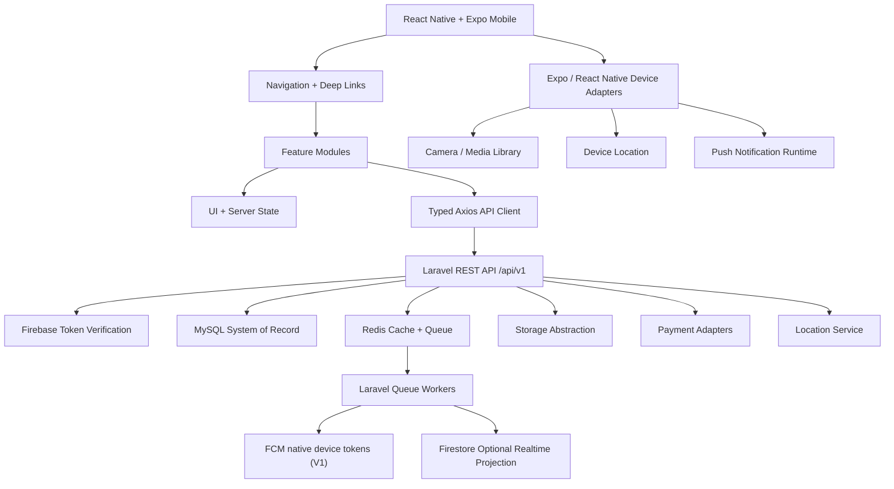

# 17. Mobile Application Architecture

> **Implementation status clarification — 2026-10-15:** “Active” means this is the current authoritative design baseline, not that implementation is release-ready. Implementation sign-off remains gated by the final OpenAPI 3.1 contract, successful clean-MySQL migration/runtime validation, and the relevant component tests. Component-specific schema or provider gates documented below remain independently binding.
> 

Document ID: KB-TECH-017

Status: Active — Mobile Application Architecture Baseline

Version: 1.0

Owner: KHOJ BHET Engineering

Last Reviewed: 2026-10-08

Parent: 02. TECHNICAL DEFINITION

Previous: 16. Backend Architecture

Next: 18. Authentication & Authorization

Related: 07. UX/UI Specification, 08. Product & Business Rules, 09. Software Architecture, 10. Technology Stack, 12. Engineering Standards, 13. Database Architecture & Data Model, 14. API Specification, 15. Frontend Architecture, 16. Backend Architecture, 18. Authentication & Authorization, 19. Security Architecture, 20. Media & File Storage, 21. Search Architecture, 22. Notification System, 23. SEO Architecture

# 1. Document Purpose

This document defines the production mobile application architecture for KHOJ BHET.

It translates the approved product rules, UX/UI specification, technology stack, API contract, frontend architecture, backend architecture, catalogue model, authentication model, notification model, media model, and security boundaries into a concrete mobile-client architecture.

The mobile application is a separate client from the Next.js web application. It shares the same Laravel REST API contract and business authority, but it does not share the web application's rendering architecture.

The mobile application is responsible for:

- mobile navigation and presentation;
- user interaction;
- local UI state;
- API consumption;
- authenticated sessions;
- dynamic listing forms;
- media capture and upload UX;
- location and map interaction;
- favorites;
- conversations and messaging UI;
- notifications and deep links;
- subscription and payment UX;
- local cache and controlled offline behavior;
- accessibility and device-specific capabilities;
- mobile analytics and observability hooks approved by the project.

The mobile application is **not** authoritative for authorization, ownership, entitlement, payment validity, privacy, exact-location access, contact access, moderation, category eligibility, attribute validity, listing lifecycle, or any other business rule.

**Core rule:** client-side checks improve UX only. Laravel remains authoritative for all business decisions.

# 2. Architectural Authority

The mobile architecture follows:

Product Requirements

→ User Stories / Use Cases

→ User Flows

→ UX/UI Specification

→ Product & Business Rules

→ Software Architecture

→ Technology Stack

→ Database Architecture

→ API Specification

→ Frontend Architecture / Mobile Application Architecture

→ Implementation

→ Tests

Primary authorities for this document:

1. UX/UI Specification — interaction and presentation behavior.
2. Product & Business Rules — marketplace behavior.
3. Software Architecture — system boundaries.
4. Technology Stack — selected technologies.
5. Engineering Standards — implementation conventions.
6. API Specification — public API contract.
7. Backend Architecture — server-side implementation boundary.
8. Mobile Application Architecture — mobile-specific implementation boundary.

# 3. Technology Baseline

| Area | Baseline |
| --- | --- |
| Mobile framework | React Native + Expo |
| Expo SDK | 57 |
| React Native | 0.86, as dictated by Expo SDK 57 |
| Language | TypeScript |
| API | Laravel REST API /api/v1 |
| HTTP client | Axios |
| Authentication | Firebase Authentication |
| Primary data source | Laravel API backed by MySQL |
| Realtime projection | Firestore only where explicitly implemented; MySQL remains authoritative |
| Push notifications | FCM native device tokens; Expo Notifications may be a client library, not the V1 token provider |
| Maps | MapLibre-compatible implementation |
| Search | Laravel API → MySQL search for V1 |
| Storage | Laravel storage abstraction; local V1 server storage |

React Native must follow the Expo SDK version. It must not be upgraded independently from the selected Expo SDK baseline.

Exact package versions are pinned in the mobile application's lockfile. Major-version upgrades require deliberate review and, where materially architectural, an ADR.

# 4. Architectural Goals

The mobile application optimizes for:

- one shared marketplace API contract across web and mobile;
- Android-first production readiness with iOS compatibility through Expo;
- fast startup and predictable navigation;
- low duplicated business logic;
- secure authenticated API access;
- dynamic category-driven listing creation;
- reliable media upload;
- useful offline resilience without pretending the app is fully offline-first;
- notification-driven re-entry into marketplace workflows;
- safe handling of restricted information;
- accessibility;
- testability;
- provider independence;
- low initial infrastructure complexity.

# 5. High-Level Architecture

The mobile architecture is:

Mobile UI

→ Navigation

→ Feature Modules

→ Application Services / State

→ Typed API Client

→ Laravel REST API /api/v1

→ Authorization / Business Rules / MySQL / Redis / Queues / External Adapters

Device services remain behind mobile adapters:

Mobile Feature

→ Device Adapter

→ Expo / React Native capability

Examples:

- Camera;
- image library;
- location;
- notifications;
- secure storage;
- network status;
- deep links;
- app lifecycle.

The mobile application must never connect directly to MySQL, Redis, internal storage, payment databases, or administrative services.

# 6. Client Boundary

The mobile application is a consumer of the public API.

Allowed:

- rendering API resources;
- sending authenticated API requests;
- maintaining local UI state;
- maintaining controlled cache;
- performing non-authoritative client validation;
- using device capabilities;
- receiving push notifications;
- storing approved local preferences.

Not allowed:

- deciding entitlement;
- deciding listing ownership;
- assigning lifecycle states;
- bypassing API validation;
- constructing hidden/private fields;
- directly modifying Firestore as a source of truth;
- directly querying MySQL;
- trusting client-supplied user IDs;
- embedding gateway secrets;
- treating local premium flags as authorization.

# 7. Application Structure

Recommended conceptual structure:

```
src/
├── app/
│   ├── navigation/
│   ├── providers/
│   ├── bootstrap/
│   └── deep-links/
├── features/
│   ├── auth/
│   ├── home/
│   ├── listings/
│   ├── categories/
│   ├── search/
│   ├── locations/
│   ├── favorites/
│   ├── conversations/
│   ├── notifications/
│   ├── reports/
│   ├── subscriptions/
│   ├── payments/
│   └── account/
├── components/
│   ├── ui/
│   ├── layout/
│   ├── forms/
│   ├── media/
│   └── feedback/
├── services/
│   ├── api/
│   ├── auth/
│   ├── storage/
│   ├── notifications/
│   ├── location/
│   ├── media/
│   ├── deep-links/
│   └── telemetry/
├── state/
├── hooks/
├── types/
├── config/
├── validation/
└── utils/
```

The exact physical structure may evolve without changing the architectural boundaries.

# 8. Feature-Oriented Architecture

Features own user journeys and their presentation.

A feature may contain:

- screens;
- components;
- hooks;
- API functions;
- feature-specific types;
- feature validation;
- state;
- tests.

Shared infrastructure belongs outside feature modules.

Do not create one giant global service containing all marketplace behavior.

Do not duplicate API/business rules independently inside each feature.

# 9. Navigation Architecture

Navigation must represent user journeys rather than database tables.

Conceptual navigation:

```jsx
Root
├── Public
│   ├── Home
│   ├── Search
│   ├── Category
│   ├── Location
│   └── Listing Detail
├── Authenticated
│   ├── Home
│   ├── Create Listing
│   ├── My Listings
│   ├── Favorites
│   ├── Messages (including conversation read cursor)
│   ├── Contact Reveal (entitlement + consent gated)
│   ├── Businesses and Members
│   ├── Verification Requests
│   ├── User Safety (block/unblock/report)
│   ├── Notifications
│   └── Account
│       ├── Profile
│       ├── Security
│       ├── Notification Preferences
│       ├── Verification Status
│       ├── Subscriptions
│       └── Deactivate / Reactivate / Delete / Cancel Deletion
│       └── Settings
└── Modal / Flow Screens
    ├── Sign In
    ├── Media Picker
    ├── Location Picker
    ├── Report
    ├── Payment
    └── Confirmation
```

Navigation guards are UX controls only. Authorization remains server-side.

# 10. Public and Authenticated Navigation

Public screens must remain usable without authentication where the product/API permits.

Authentication-required actions include, subject to the API contract:

- creating listings;
- editing owned listings;
- managing favorites;
- messaging;
- subscription management;
- account operations;
- authenticated reports/actions.

The app must not assume that authentication automatically grants access to a resource.

# 11. Deep Linking

Deep links are a first-class architecture requirement.

Supported conceptual destinations include:

- listing details;
- category pages;
- location/search pages;
- conversation;
- notification target;
- subscription/payment result;
- account/security flows.

A deep link must be treated as an untrusted navigation request.

Flow:

Deep Link

→ Parse

→ Validate Route Shape

→ Resolve Authentication Requirement

→ Navigate

→ Fetch Authoritative Resource

→ Render Current Server State

Do not embed protected data directly in deep-link parameters.

Listing deep links should identify the canonical public listing resource, preferably by its canonical slug or approved public identifier.

# 12. Web-to-Mobile Linking

Public listing URLs from the web should be able to open the mobile application where platform configuration permits.

The canonical web URL remains valid even when the app is not installed.

The application must not create a second incompatible identity for the same listing.

Universal/App Links configuration belongs to deployment configuration and must be tested on real Android/iOS builds.

# 13. API Client Architecture

Do not scatter raw Axios requests throughout screens.

Preferred flow:

Feature

→ Typed API Function

→ Shared Axios Client

→ /api/v1

The shared client implements Document 14 conventions:

- Authorization: Bearer Firebase ID token;
- X-Request-Id;
- Idempotency-Key;
- If-Match;
- ETag;
- rate-limit headers;
- Retry-After;
- deprecation/sunset headers where supplied.

The API client must normalize transport failures into application-consumable error categories without hiding the original request ID.

# 14. API Contract and Type Safety

Authority chain:

Document 14

→ OpenAPI 3.1

→ Generated/maintained TypeScript contract types

→ Mobile API client

→ Feature implementation

→ Contract tests

The mobile client should use the same public API contract as the web application.

Core resource types include:

- User;
- Category;
- Category Attribute;
- Listing;
- Listing Media;
- Location;
- Favorite;
- Conversation;
- Message;
- Notification;
- Subscription;
- Payment;
- Report;
- entitlement-related representations exposed by the API.

The mobile application must not create competing interpretations of public enums.

# 15. Authentication Integration

Firebase Authentication provides the user authentication mechanism.

Mobile flow:

1. Start Firebase authentication flow.
2. Maintain Firebase authentication state.
3. Obtain/refresh Firebase ID token.
4. Store sensitive session material using platform-secure mechanisms.
5. Attach the ID token to protected API requests.
6. Handle expiry and refresh.
7. Sign out cleanly when required.
8. Let Laravel verify identity and authorize the operation.

The mobile app must never:

- trust a client-supplied user ID;
- treat Firebase claims alone as marketplace authorization;
- store passwords;
- embed server secrets;
- bypass Laravel authorization.

Detailed authentication and authorization rules belong to Document 18.

# 16. Secure Local Storage

Sensitive local values must use secure platform storage through an approved abstraction.

Appropriate examples:

- authentication/session material where required by the SDK;
- device registration information;
- notification-related identifiers where necessary;
- small security-sensitive preferences.

Do not store:

- raw passwords;
- payment secrets;
- unrestricted API secrets;
- private listing data without a documented reason;
- administrative credentials.

Ordinary non-sensitive UI preferences may use ordinary local storage.

# 17. State Architecture

Separate state into:

### Server state

- listings;
- categories;
- attributes;
- locations;
- favorites;
- conversations;
- messages;
- notifications;
- subscriptions;
- account profile;
- entitlements.

### UI state

- selected tab;
- modal visibility;
- gallery index;
- form step;
- temporary inputs;
- map viewport;
- keyboard/UI state.

### Device state

- network availability;
- app lifecycle;
- permission state;
- push-token registration state;
- media picker state.

Do not copy entire API resources into a global store without a demonstrated need.

# 18. Server-State Caching

Caching is an optimization, never a source of truth.

Suitable candidates:

- category metadata;
- attribute definitions;
- Nepal reference locations;
- public listing representations;
- stable configuration.

Authorization-sensitive responses must never be shared between users.

Cache keys must include all relevant identity and query dimensions.

# 19. Offline and Network Resilience

KHOJ BHET V1 is **offline-resilient, not fully offline-first**.

When offline:

- previously cached public content may remain viewable;
- UI should clearly show stale/offline state;
- read operations may use safe cached data;
- new server-authoritative mutations should normally wait for connectivity;
- failed mutations must remain clearly distinguishable from successful mutations.

The application must not claim that a listing, payment, favorite, message, or lifecycle action succeeded merely because it was queued locally.

Where an offline mutation is supported, it must have:

- durable local operation identity;
- idempotency handling;
- retry policy;
- conflict handling;
- visible pending state;
- eventual server confirmation.

# 20. App Bootstrap

Startup should perform only necessary work.

Conceptual bootstrap:

```
Launch
→ Load Environment
→ Initialize Core Services
→ Restore Firebase Auth State
→ Register Device/Push State as Required
→ Resolve Deep Link
→ Load Minimal App Configuration
→ Render Initial Route
```

Do not block startup on non-critical catalogue, analytics, or recommendation data.

# 21. Home and Discovery

Home should be optimized for:

- fast initial rendering;
- category discovery;
- location discovery;
- search entry;
- recent/relevant marketplace content exposed by the API.

Home recommendations or feeds are server-authoritative.

The client must not invent ranking or recommendation rules that materially change marketplace behavior.

# 22. Search

V1 search path:

Mobile

→ Laravel API

→ MySQL search

Search is a server capability, not a direct database operation.

Search state may be represented by navigation parameters such as:

```jsx
search?q=...&category=...&province=...&district=...&municipality=...&price_min=...&price_max=...
```

The app should preserve search state when navigating into a listing and returning to results.

A future dedicated search engine must remain behind the Laravel API and must not require a mobile contract change.

# 23. Category and Attribute Architecture

The marketplace uses the approved category catalogue and category-specific attribute applicability.

The mobile listing form must be dynamic.

Flow:

Select Category

→ Select Subcategory

→ Select Listing Type

→ Fetch Applicable Attributes

→ Resolve Controlled Options

→ Build Form Schema

→ Render Controls

→ Client Validation

→ Submit

→ Server Validation

→ Continue Lifecycle

The authoritative applicability rules come from the API.

The mobile application must not hard-code a separate complete form for each of the approved catalogue categories.

# 24. Dynamic Form Engine

The form engine maps API attribute definitions to reusable mobile controls.

Examples:

| API field type | Mobile control |
| --- | --- |
| text | Text input |
| long_text | Multiline text input |
| integer / decimal | Numeric input |
| boolean | Switch / checkbox |
| date | Date picker |
| enum | Select / radio-style control |
| multi-value enum | Multi-select / checkbox group |
| location | Location selector |
| media | Media picker |

The renderer must honor:

- required;
- nullable;
- multi-value;
- options;
- units;
- filterable;
- searchable;
- category applicability;
- listing-type applicability.

# 25. Controlled Options

Controlled options are authoritative.

The client must never invent enum values.

Flow:

API Registry

→ Mobile Form Schema

→ Mobile Control

→ API Submission

If an option disappears or becomes invalid between form rendering and submission, the server response must be treated as authoritative and the UI must reconcile.

# 26. Listing Creation Workflow

The client first collects category and listing type, then creates the draft because `POST /listings` requires both in its request body. The API response supplies the listing ID/public ID and current representation. The client then loads authoritative readiness before displaying missing requirements.

Select Category + Listing Type

→ `POST /listings` with category and listing type

→ Receive created listing representation

→ `GET /listings/{id}/readiness`

→ Complete required fields and media

→ Refresh readiness/representation

→ Submit for review

→ Category Attributes

→ Price

→ Location

→ Media

→ Preview

→ Submit

→ Server Validation / Review

Long forms should be divided into meaningful steps.

Draft progress may be persisted locally where appropriate, but a local draft is not automatically a server draft.

When a server draft exists, its server identity and lifecycle state remain authoritative.

# 27. Listing Lifecycle

The mobile UI presents lifecycle states returned by the API, including approved states such as:

- draft;
- review;
- published;
- paused;
- expired;
- archived.

`removed` is not a client-assignable listing lifecycle value. The final API lifecycle enum is `draft`, `review`, `published`, `paused`, `expired`, `archived`, and `rejected`; removal is a separately authorized DELETE/moderation action according to Document 14. The client must not directly assign arbitrary lifecycle values.

Use explicit domain actions such as:

- submit;
- pause;
- resume;
- archive;
- restore;
- renew;
- DELETE/removal only where authorized by Document 14.

# 28. Optimistic Concurrency

Where ETag is supplied:

1. retain the current ETag;
2. send If-Match on supported edits;
3. handle a supplied stale ETag with the documented 412 response;

Document 14 makes If-Match optional in V1. If omitted, documented last-write-wins behavior applies; clients should still send ETags wherever supported and must not claim conflict detection when no precondition was sent.

1. explain that the resource changed;
2. reload or reconcile;
3. never silently overwrite another update.

This is especially important for listing edits and other multi-device account activity.

# 29. Idempotent Mutations

Retry-sensitive mutations must follow Document 14 idempotency rules.

Examples:

- listing submission;
- payment initiation;
- renewal;
- account deletion request;
- other documented unsafe writes.

The same idempotency key must be reused when retrying the same logical operation.

A new key represents a new logical operation.

# 30. Price Presentation

The API provides decimal strings and currency information.

The mobile client must:

- preserve decimal precision;
- avoid binary floating-point business calculations;
- format NPR consistently;
- distinguish fixed price, range, periodic price, free, contact-only, and other approved modes;
- never invent a pricing state.

# 31. Nepal Location Architecture

The mobile location UI must support:

Country

→ Province

→ District

→ Municipality

→ Ward

→ Locality/Tole

→ Chowk/Landmark

Optional fields:

- postal code;
- latitude;
- longitude;
- approximate location;
- exact location;
- landmark.

The canonical human-readable location is not replaced by coordinates.

The UI must respect the API's privacy and entitlement rules for exact location.

# 32. Location and Map Adapter

Use a replaceable Location Service abstraction.

Conceptual flow:

Location Feature

→ Location Service

→ Map Adapter / Geocoding Adapter

→ Provider

Map rendering should use a MapLibre-compatible implementation.

Provider-specific SDK calls must not be spread through listing, search, or account features.

The backend remains responsible for authoritative location data and geocoding-related business decisions.

# 33. Device Location Permissions

Location access is permission-gated and must be requested only when a user action requires it.

The UI must distinguish:

- permission not requested;
- permission granted;
- permission denied;
- permission restricted/unavailable;
- location service unavailable.

The application must remain usable for manual location selection when precise device location is unavailable, subject to product rules.

# 34. Media Architecture

Mobile media flow: Select/Capture → Local Validation → Preview → Direct Multipart Upload → Server Processing → Ready/Failed. V1 supports images plus at most one listing video per listing. Images: JPEG/PNG/WebP, max 10 MB each, up to 20 images. Video: MP4 container, H.264 video/AAC audio, max 50 MB and 60 seconds; processing is asynchronous and the API supplies readiness/processing state plus poster/playback media when ready. Supported UX includes camera/photo library, video selection where the runtime supports it, image/video preview, image ordering/primary image, upload progress, retry, removal and server processing status. A local file is not permanently stored until the server confirms persistence.

# 35. Media Constraints

The client should perform early UX validation for:

- file type;
- file size;
- dimensions where required;
- maximum count;
- unsupported media.

These checks improve UX only.

The backend remains authoritative for media validation and acceptance.

The client must not attempt to bypass server media restrictions by altering metadata.

# 36. Favorites

Favorites are authenticated server state.

The UI may optimistically change the favorite control, but it must reconcile with the API response.

A changed icon is not proof that persistence succeeded.

Offline favorite actions should not silently appear as permanently saved unless the operation is explicitly supported by the offline mutation design.

# 37. Conversations and Messaging

MySQL remains authoritative for conversations, participants, and messages.

Firestore may be used only as a secondary realtime projection/transport where implemented.

Mobile messaging consumes the API contract.

The UI should represent:

- composing;
- sending;
- sent;
- failed;
- retry;
- unread;
- read;
- restricted;
- unavailable.

Business-owned listing conversations route to the active primary business representative under the current V1 rule.

Message content must never be trusted as an authorization mechanism.

# 38. Realtime Messaging

If realtime transport is enabled:

MySQL

→ Backend Event / Projection

→ Firestore or approved realtime transport

→ Mobile UI

Realtime delivery is an optimization.

A missing realtime event must not corrupt authoritative message persistence.

On reconnect, the mobile client must reconcile with the API rather than assuming the realtime stream is complete.

# 39. Notifications

Notification architecture:

Laravel

→ Queue

→ FCM native device-token delivery (V1)

→ Mobile Device

→ Deep Link / App Route

→ Laravel API

→ Current Resource State

The app must support:

- notification permission state;
- device-token registration;
- notification receipt;
- foreground handling;
- background handling;
- tap handling;
- deep-link resolution;
- unread state;
- notification list;
- read action;
- listing context where present.

Push delivery is not the source of truth. Notification records remain backend-controlled.

# 40. Push Token Persistence

V1 registers native device tokens using the Document 14 provider value `fcm`; Expo push-service tokens are not accepted. On Android, use the native Firebase/FCM registration token. On iOS, use the Firebase Messaging SDK to obtain the FCM registration token; an APNs token returned directly by a generic device-token API is not interchangeable with an FCM token. The implementation must test token creation, refresh, permission changes, logout/revocation, and delivery on real Android and iOS builds. If the selected Expo SDK/runtime cannot provide the required Firebase Messaging token path without unsupported native configuration, pause iOS push implementation and amend the architecture/API contract before shipping rather than silently registering an incompatible token.

The mobile app registers a device/push token through the approved API contract.

The client should support:

- token creation;
- token refresh;
- token replacement;
- device/session association as defined by the API;
- logout cleanup where required;
- invalid-token recovery.

Never assume one user has one device.

Never expose push tokens as public user data.

# 41. Subscription and Entitlement UI

The mobile client may display entitlement-dependent UX.

Examples:

- exact location;
- contact information;
- premium facilities;
- subscription status.

The API remains authoritative.

A locally stored premium flag is never a security boundary.

If entitlement changes while the app is open, the client must reconcile with the server before allowing protected actions.

# 42. Payments

The mobile application provides payment UX but does not implement gateway authority.

Conceptual flow:

Mobile

**V1 payment flow is manual submission and admin review only**, consistent with Documents 10 and 14. The client submits a payment request using `manual-submission` and attaches the required proof media/reference; Laravel records the submission and an authorized admin reviews it before any entitlement changes. Gateway redirects, provider callbacks, and payment webhooks are future-phase work and must not be represented as active V1 behavior.

→ Mobile Refresh

The client must never contain merchant secrets, gateway signing secrets, or server-side verification logic.

Payment success must be determined by the backend.

Returning from a payment application or browser is not proof of payment success.

# 43. Manual Payment

Manual payment is supported.

Flow:

User selects Manual Payment

→ submits reference/proof

→ Payment Pending Manual Review

→ Admin verifies

→ Approved / Rejected

→ Backend updates entitlement/order

→ Mobile refreshes authoritative state

The app must clearly distinguish pending, approved, rejected, failed, cancelled, and unknown states where exposed by the API.

# 44. Error Architecture

Normalize failures into user-meaningful categories:

| Error class | Mobile response |
| --- | --- |
| Validation | Field/form errors |
| Authentication | Sign-in / reauthentication |
| Authorization | Access explanation without leaking protected data |
| Not found | Not-found state |
| Conflict | Refresh/reconcile |
| Rate limited | Retry guidance using server timing where supplied |
| Network | Offline/retry state |
| Server | Safe generic error + request ID |
| Payment | Payment-specific status and next action |
| Media | Item-level retry/removal |

Never expose stack traces, internal exception messages, SQL errors, provider secrets, or internal identifiers unnecessarily.

# 45. Loading and Empty States

Every major mobile data surface defines:

1. loading;
2. loaded;
3. empty;
4. partial loading;
5. stale/offline;
6. error;
7. retry.

This applies to:

- home;
- search;
- listings;
- categories;
- locations;
- favorites;
- messages;
- notifications;
- account;
- subscriptions.

# 46. Accessibility

Accessibility is a first-class requirement.

Use:

- accessible labels;
- semantic roles;
- correct focus behavior;
- screen-reader descriptions;
- sufficient touch targets;
- readable typography;
- contrast;
- reduced-motion behavior;
- accessible dialogs;
- clear validation errors;
- non-color-only status communication.

Accessibility testing belongs in the mobile test strategy.

# 47. Responsive Device Support

The application must account for:

- small Android phones;
- large Android phones;
- tablets where supported;
- iPhones supported by the selected Expo baseline;
- different safe-area configurations;
- keyboard behavior;
- orientation constraints where defined.

Do not create separate business logic for device classes.

# 48. App Lifecycle

The app must correctly handle:

- cold start;
- warm start;
- background;
- foreground;
- process termination;
- interrupted network;
- interrupted uploads;
- notification tap;
- authentication state changes.

On returning to foreground, refresh only the server state whose freshness materially matters.

Do not globally refetch every API resource on every foreground event.

# 49. Background Work

Background execution must be limited to platform-supported and product-justified work.

Suitable candidates may include:

- controlled upload continuation where supported;
- notification registration;
- lightweight cache maintenance;
- approved synchronization.

Do not rely on unrestricted background execution for business-critical workflows.

Payment verification, listing publication, entitlement changes, and other authoritative operations must be completed by the backend.

# 50. Protected Data Rendering

Represent restricted data explicitly:

- visible;
- restricted;
- not_available;
- not_applicable;
- loading;
- error.

Never reconstruct restricted data from:

- cached HTML;
- screenshots;
- images;
- URL parameters;
- local storage;
- previous API responses;
- another listing.

This is especially important for:

- exact address;
- contact information;
- seller information;
- premium facilities.

# 51. Security Boundary

The mobile application is an untrusted client.

Security-sensitive decisions remain server-side.

Never put in the application bundle:

- Laravel secrets;
- Firebase Admin credentials;
- payment merchant secrets;
- private signing keys;
- database credentials;
- internal service credentials.

Public mobile configuration is not a secret merely because it is embedded in the app.

Detailed security controls belong to Document 19.

# 52. Certificate and Transport Expectations

All production API communication must use HTTPS.

The client must reject insecure production API configuration.

Development endpoints must be environment-specific.

Do not disable TLS verification to solve development certificate problems in production builds.

# 53. Environment Configuration

Use explicit environments:

- development;
- test/QA;
- staging;
- production.

Environment-specific values may include:

- API base URL;
- Firebase project configuration;
- notification configuration;
- map configuration;
- analytics configuration;
- feature flags.

Secrets must not be treated as ordinary public environment configuration.

# 54. Feature Flags

Feature flags may control rollout and UX availability.

They must not replace authorization.

Examples:

- new search UI;
- experimental media flow;
- notification UX;
- staged payment gateway rollout.

Server-side business availability remains authoritative.

# 55. Analytics and Observability

Analytics must be privacy-aware and approved by project policy.

Useful technical events include:

- app start;
- API error category;
- screen performance;
- upload failure;
- payment flow state;
- notification open;
- deep-link resolution failure.

Do not log:

- passwords;
- Firebase ID tokens;
- payment secrets;
- private contact information;
- exact protected addresses;
- full message bodies;
- unrestricted personal data.

Request IDs may be logged for diagnostics where appropriate.

# 56. Logging

Mobile logs must be environment-sensitive.

Development:

- detailed diagnostics are acceptable within controlled development environments.

Production:

- no verbose sensitive logs;
- no authentication tokens;
- no payment secrets;
- no full private API payloads.

Error reports should use stable categories and request IDs instead of dumping raw objects.

# 57. Performance Architecture

Priority order:

1. fast cold start;
2. minimal startup work;
3. small initial JS/runtime cost where practical;
4. efficient list rendering;
5. image optimization;
6. controlled API concurrency;
7. cache reuse;
8. deferred non-critical work.

Large listing/search collections must use virtualized list patterns.

Avoid rendering thousands of objects simultaneously.

# 58. Image Performance

Listing images should use server-provided optimized representations where available.

The client should:

- request suitable image dimensions;
- lazy-load where appropriate;
- avoid loading full-resolution originals for thumbnails;
- cache responsibly;
- release unnecessary image memory;
- show placeholders/loading states.

The server remains authoritative for stored media.

# 59. List and Pagination Strategy

Use the API's authoritative pagination contract.

For mobile:

- paginated lists;
- load-more;
- infinite scroll where appropriate.

Infinite scroll must preserve:

- loading state;
- end-of-results state;
- retry;
- duplicate prevention;
- refresh;
- pagination consistency.

Search results must not be lost when navigating into a detail screen and returning.

# 60. Refresh and Reconciliation

Pull-to-refresh or explicit refresh should retrieve authoritative server state.

When local state and server state disagree:

- server state wins;
- local pending mutations must be reconciled;
- conflicts must be visible where user action is required.

Never silently replace a user's unsaved local form data.

# 61. Data Ownership Rules

The mobile app owns:

- temporary UI state;
- local form drafts before server persistence;
- presentation state;
- cache metadata;
- device capability state.

Laravel owns:

- users;
- listings;
- ownership;
- category applicability;
- lifecycle;
- entitlements;
- privacy;
- payments;
- subscriptions;
- moderation;
- reports;
- notifications;
- conversations/messages;
- authoritative media metadata.

MySQL is the system of record.

Firestore is secondary and only used for explicitly approved realtime projection/transport.

Redis is cache/queue infrastructure, not client-accessible storage.

# 62. Web and Mobile Contract Parity

Web and mobile must consume the same public API semantics.

The clients may differ in:

- navigation;
- rendering;
- interaction;
- local caching;
- device capabilities.

They must not differ in:

- authorization meaning;
- listing lifecycle meaning;
- category applicability;
- enum definitions;
- entitlement rules;
- payment success rules;
- privacy rules.

When the API contract changes, both clients must be evaluated.

# 63. Mobile-Specific UX Versus Shared Domain Rules

Mobile-specific adaptations are allowed for:

- bottom navigation;
- gesture interaction;
- camera;
- mobile media selection;
- push notifications;
- mobile maps;
- native share;
- biometric/device features if later approved.

Do not duplicate marketplace domain rules merely because the UI differs.

# 64. Testing Strategy

Testing must cover:

### Unit tests

- formatters;
- API mappers;
- form schema rendering;
- validation helpers;
- reducers/state logic;
- deep-link parsing;
- entitlement presentation logic.

### Component tests

- listing cards;
- dynamic form controls;
- media components;
- error states;
- loading states;
- notification items.

### Integration tests

- authentication flow;
- API client;
- listing creation;
- listing edit;
- favorite;
- messaging;
- notifications;
- subscription;
- payment return/reconciliation.

### End-to-end tests

Critical user journeys on representative Android/iOS builds.

# 65. Contract Testing

The mobile application must be tested against the OpenAPI 3.1 contract.

Contract tests should detect:

- missing fields;
- enum drift;
- changed error shapes;
- pagination changes;
- authentication changes;
- changed required attributes;
- lifecycle command changes.

The API contract is the compatibility boundary.

# 66. Device Testing Matrix

At minimum test:

- current supported Android baseline;
- common low/mid-range Android device;
- common modern Android device;
- supported iPhone baseline;
- smaller screen;
- larger screen;
- slow network;
- offline;
- interrupted upload;
- notification tap from cold start;
- expired authentication state.

The exact supported OS matrix is finalized in release planning and build configuration.

# 67. CI/CD

Mobile CI/CD should perform:

1. dependency installation;
2. formatting/lint;
3. TypeScript checks;
4. unit/component tests;
5. contract checks;
6. build validation;
7. environment configuration validation;
8. platform build;
9. controlled release/distribution.

Production releases require versioned build artifacts and traceability to source commit.

# 68. Release Channels

Recommended release progression:

Development

→ Internal QA

→ Staging / Pre-production

→ Limited Release / Beta

→ Production

Production configuration must never be bundled into development builds accidentally.

# 69. Versioning and Compatibility

The mobile application version is independent of the API implementation version but dependent on API contract compatibility.

Breaking API changes require:

- explicit versioning strategy;
- migration plan;
- client compatibility period where needed;
- release coordination.

The mobile client should gracefully handle server deprecation signals where supplied.

# 70. Dependency Governance

Dependencies must be:

- justified;
- maintained;
- compatible with the selected Expo SDK;
- reviewed for security;
- compatible with Android/iOS build requirements.

Avoid adding libraries for functionality already supplied by Expo or React Native unless there is a documented reason.

Expo SDK and React Native versions must move together according to the approved baseline.

# 71. Provider Abstraction Rules

The following remain replaceable behind adapters:

- maps;
- geocoding;
- push provider;
- payment gateway;
- storage;
- analytics/telemetry;
- future search provider.

Provider-specific APIs must not leak into core marketplace feature logic.

# 72. Architecture Diagram



# 73. Important Mobile Architecture Rules

### Rule 1 — Laravel is authoritative

The mobile application never becomes the source of truth for business state.

### Rule 2 — MySQL is authoritative

Firestore, Redis, caches, and local storage are never authoritative for core marketplace entities.

### Rule 3 — API is the compatibility boundary

Web and mobile consume the same public API contract.

### Rule 4 — Client validation is UX only

All authoritative validation is repeated by Laravel.

### Rule 5 — Dynamic catalogue is mandatory

Listing forms are driven by the approved catalogue/API definitions.

### Rule 6 — Controlled options are authoritative

The client never invents enum values.

### Rule 7 — Payment return is not payment success

Only backend verification determines payment state.

### Rule 8 — Deep links are untrusted

Every deep link is parsed and resolved against current server state.

### Rule 9 — Offline is not authority

Local pending operations must not be presented as successful server operations.

### Rule 10 — Restricted data stays restricted

The client must never reconstruct protected information.

### Rule 11 — Provider SDKs are isolated

External providers are accessed through replaceable adapters.

### Rule 12 — Expo and React Native move together

React Native must follow the selected Expo SDK baseline.

# 74. Relationship to Other Documents

| Area | Authoritative document |
| --- | --- |
| Overall system architecture | 09. Software Architecture |
| Technology choices | 10. Technology Stack |
| Engineering rules | 12. Engineering Standards |
| Database and data model | 13. Database Architecture & Data Model |
| Public API contract | 14. API Specification |
| Web frontend | 15. Frontend Architecture |
| Laravel backend | 16. Backend Architecture |
| Mobile application | 17. Mobile Application Architecture |
| Authentication and authorization | 18. Authentication & Authorization |
| Security controls | 19. Security Architecture |
| Media and files | 20. Media & File Storage |
| Search | 21. Search Architecture |
| Notifications | 22. Notification System |
| SEO and machine-readable public discovery | 23. SEO Architecture |

# 75. Implementation Readiness Checklist

Before mobile implementation begins:

- [ ]  Expo SDK 57 baseline is pinned.
- [ ]  React Native 0.86 baseline is pinned through Expo.
- [ ]  TypeScript configuration is defined.
- [ ]  API base URLs are environment-specific.
- [ ]  OpenAPI contract/types are available.
- [ ]  Firebase mobile configuration is defined.
- [ ]  Secure storage strategy is defined.
- [ ]  Navigation/deep-link routes are defined.
- [ ]  Dynamic category/attribute form engine is defined.
- [ ]  Media upload contract is verified.
- [ ]  Location/map adapter boundary is defined.
- [ ]  Notification token registration contract is verified.
- [ ]  Payment initiation/return/reconciliation flow is verified.
- [ ]  Offline/cache behavior is documented.
- [ ]  Protected-data rendering rules are implemented.
- [ ]  Error taxonomy is mapped to UI states.
- [ ]  Accessibility baseline is implemented.
- [ ]  Unit/component/integration/E2E test strategy is configured.
- [ ]  Android/iOS build pipelines are configured.
- [ ]  Release environments are separated.
- [ ]  Security review is completed before production distribution.

# 76. Status

**Active — Mobile Application Architecture Baseline.**

This document establishes the V1 React Native + Expo mobile architecture for KHOJ BHET.

The architecture deliberately keeps the mobile application thin with respect to business authority: Laravel and MySQL remain authoritative, the API contract remains the web/mobile compatibility boundary, and device/provider integrations remain replaceable.

The next document in the technical-definition sequence is **18. Authentication & Authorization**.

## V1 Scope Clarification — 2026-10-18

Paid subscription purchase and paid entitlement activation are deferred beyond MVP under Documents 02 and 08. They must not appear as active MVP navigation or acceptance criteria. Visitors browse eligible public listings and are prompted to sign in before starting a conversation. After authentication, the client re-fetches contact eligibility from the API. The V1 client never exposes protected phone/email or exact residential location to non-owners; the API enforces all rules.