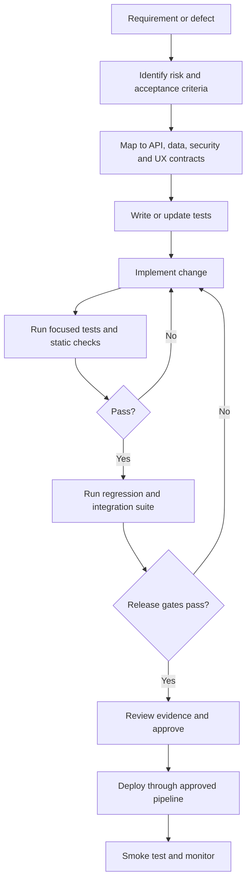

# 24. Testing & QA

**Project:** KHOJ BHET  

**Document ID:** KB-ENG-024  

**Status:** Active — Testing Strategy Baseline  

**Version:** 1.0  

**Owner:** KHOJ BHET Engineering  

**Last Reviewed:** 2026-10-15  

**Previous:** 23. SEO Architecture  

**Next:** 25. DevOps & CI/CD

---

## 1. Purpose

This document defines the quality assurance strategy for KHOJ BHET: what must be tested, at which layer, how test data is controlled, how defects are handled, and what evidence is required before a change can be released.

Testing verifies that implementation conforms to approved requirements, architecture, API contracts, database constraints, security policies, and user-visible behavior. It does not replace design review, threat modelling, code review, observability, or operational readiness.

## 2. Scope

QA covers the complete product system:

- Laravel 13 modular-monolith backend and REST API under `/api/v1`.
- MySQL as the authoritative transactional datastore.
- Firebase Authentication for public-user identity; Laravel remains authoritative for application authorization, roles, permissions, and business rules.
- Next.js public web experience and React Native + Expo mobile application.
- FilamentPHP 5 administration workflows and privileged staff operations.
- Listing lifecycle, moderation, reporting, categories and dynamic attributes, media, search, messaging, notifications, subscriptions, payments, and SEO eligibility.
- Redis-backed caching/queues where enabled, Firebase services, push delivery, and external payment providers through provider abstractions.
- Build, deployment, migration, backup/restore, logging, and operational procedures.

Future or optional infrastructure must be tested only when it is approved and included in the deployment design. Do not treat a proposed integration as an implemented dependency.

## 3. Quality Principles

1. **Requirements traceability:** each testable requirement maps to one or more test cases and a recorded result.
2. **Risk-based depth:** authorization, money, private data, moderation, and lifecycle boundaries receive the strongest coverage.
3. **Test at the lowest useful layer:** use unit tests for isolated rules, feature/API tests for application behavior, and end-to-end tests for critical user journeys.
4. **Production-like contracts:** tests use the actual API contract and supported database engine/version behavior; SQLite-only success is not sufficient evidence for MySQL correctness.
5. **Determinism:** tests must not depend on uncontrolled external services, real customer data, current production state, or arbitrary timing.
6. **Fail closed:** missing authentication, failed authorization, invalid state transitions, and provider errors must not grant access or create false success.
7. **Safe test data:** use synthetic accounts, masked fixtures, isolated credentials, and non-production payment credentials.
8. **Regression protection:** every fixed defect should gain a regression test at the appropriate layer.
9. **Observable outcomes:** failures must provide enough sanitized evidence to diagnose without leaking tokens, secrets, personal data, or payment credentials.
10. **No false claims:** a test suite passing does not prove every risk is eliminated; report scope, exclusions, and known limitations.

## 4. Quality Attributes

QA evaluates both functional correctness and non-functional characteristics:

- Functional suitability and business-rule correctness.
- Security, privacy, authorization isolation, and abuse resistance.
- Data integrity, transactional consistency, idempotency, and concurrency safety.
- Reliability, recoverability, and graceful degradation.
- Performance, scalability, and resource efficiency.
- Accessibility, usability, and responsive behavior.
- Compatibility across supported browsers, devices, OS versions, locales, and network conditions.
- Maintainability, testability, and consistency between documentation, API contracts, and implementation.
- Discoverability correctness: canonical URLs, robots policy, sitemaps, structured data, and public visibility rules.

## 5. Test Levels and Types

### 5.1 Static analysis and code quality

Run formatting, linting, type checks where applicable, dependency/security checks, and static analysis before merge. Validate configuration and API/OpenAPI artifacts when available. Static checks complement—not replace—runtime tests.

### 5.2 Unit tests

Test isolated domain rules and pure functions, including:

- Listing lifecycle and eligibility calculations.
- Expiry and visibility decisions.
- Category/attribute validation and normalization.
- Price and subscription calculations.
- Permission policies and role-specific decisions.
- Slug/canonicalization and Nepali/Devanagari normalization.
- Idempotency-key parsing and response decisions.
- Search filter validation and cursor handling.
- Notification routing and provider-independent message construction.

Unit tests should be fast, deterministic, and independent of network services.

### 5.3 Backend feature and integration tests

Use Laravel's test framework to exercise routes, middleware, policies, validation, transactions, jobs, events, storage abstractions, and persistence. Verify success and failure paths, status codes, response envelopes, validation errors, and side effects.

Integration tests must cover MySQL-specific behavior, migrations, indexes, foreign keys, unique constraints, transactions, locking/concurrency where relevant, and queue/cache integrations actually used by the application.

### 5.4 API contract tests

Validate every documented `/api/v1` endpoint against Document 14 and the generated OpenAPI 3.1 contract when that artifact is available. Verify:

- HTTP method, path, authentication requirement, authorization, request schema, response schema, and status codes.
- Stable error shape and validation semantics.
- Pagination, filtering, sorting, cursor integrity, and limits.
- Idempotency behavior for supported operations.
- ETag / If-Match preconditions where specified, including stale-write conflicts.
- Web/mobile parity: clients must observe the same authoritative business rules.
- No undocumented fields, internal identifiers, secrets, or protected fields leak through responses.

A contract change must be intentional, reviewed, and reflected in implementation, tests, and documentation together.

### 5.5 Frontend and UI tests

Test public web and Filament interfaces at component and workflow level. Validate loading, empty, success, validation, permission-denied, not-found, expired, and provider-failure states. Check responsive layouts, keyboard interaction, focus handling, accessible labels, form errors, and safe rendering of user-generated content.

Admin tests must verify that privileged actions are unavailable to unauthorized actors even when requests are forged outside the UI.

### 5.6 Mobile tests

For React Native + Expo, test application logic, navigation, API integration, authentication hand-off, secure token handling, permission prompts, image selection/upload, notifications, and error/retry behavior. Test supported Android and iOS targets on physical devices or reliable simulators before release.

Include app background/resume, interrupted uploads, weak or offline connectivity, expired authentication, duplicate taps, stale data, and app-version/API compatibility. Do not assume a UI-disabled button is a sufficient duplicate-submission control.

### 5.7 End-to-end tests

Automate high-value user journeys across UI, API, and persistence where stable test environments are available. Prioritize:

- Sign-in and authenticated account access.
- Create, edit, pause, publish, renew, expire, and remove a listing according to approved lifecycle rules.
- Upload, validate, display, and remove listing media.
- Search, filter, open a listing, and verify public visibility.
- Send and retrieve messages with correct participant isolation.
- Submit a report and complete moderation review.
- V1 manual payment: submit proof, admin approves or rejects, and verify the final payment and entitlement state. (Gateway callback and webhook journeys are future-phase and tested only when a gateway is approved.)
- Admin review and audit-sensitive actions.
- Notification preference and delivery-state behavior.
- Public SEO eligibility for a listing across detail page, sitemap, canonical URL, and structured data.

Use deterministic provider fakes or sandbox accounts; do not run destructive E2E tests against production.

### 5.8 Security and privacy tests

Security testing is mandatory for every release candidate and whenever affected code changes. Cover:

- Missing, malformed, expired, revoked, and wrong-audience Firebase ID tokens.
- Firebase UID-to-local-user mapping and account lifecycle edge cases.
- Object-level authorization (BOLA/IDOR) across listings, media, messages, reports, payment records, saved items, and account resources.
- Role/permission boundaries between public users, moderators, administrators, and system jobs.
- Mass assignment, input validation, injection, XSS, CSRF applicability to the actual client/session model, CORS, rate limits, and abuse controls.
- Upload type/size validation, content sniffing, unsafe filenames, access control, and protected-media URLs.
- Secret exposure, sensitive logging, excessive data in API errors, and private data in analytics/notifications.
- Replay, duplicate callbacks, idempotency conflicts, race conditions, and authorization after state changes.
- Enumeration of private or unavailable listings, users, messages, and payments.
- Dependency vulnerabilities and unsafe production configuration.

Security tests must follow Document 19. Do not introduce session cookies or CSRF assumptions into the Bearer-token client API unless the approved architecture explicitly changes.

### 5.9 Performance and load tests

Measure critical API and page journeys using representative synthetic data. Establish baselines before setting hard service-level thresholds. Test search/listing reads, listing writes, media upload flows, message retrieval, notification enqueueing, admin queues, and high-contention operations.

Record throughput, p50/p95/p99 latency, error rate, CPU/memory, database query counts, slow queries, queue depth, and resource saturation. Test cache cold starts and cache invalidation. Avoid unapproved load tests against production or third-party providers.

Numerical release thresholds remain **to be approved** after baseline measurements and infrastructure sizing; do not invent a pass threshold without an agreed service objective.

### 5.10 Accessibility, localization, and usability

Validate keyboard navigation, focus order, labels, contrast, screen-reader semantics, touch target usability, error announcements, and reduced-motion preferences where applicable. Test English and Nepali, Devanagari rendering, mixed-script input, Unicode normalization, long text, locale-sensitive display, and truncation. Confirm that text search does not corrupt or silently discard meaningful Nepali characters.

### 5.11 SEO and public visibility tests

Validate the Document 23 contract:

- Only eligible public resources are indexable.
- Private or ineligible resources are not exposed by pages, API responses, sitemaps, caches, structured data, or media URLs.
- Listing canonical URLs follow `/listing/{slug}-{public-id}`.
- Slug changes resolve deterministically without redirect loops or disclosure.
- `robots.txt`, sitemap references, canonical metadata, robots meta directives, and `llms.txt` remain consistent with the approved public route policy.
- Staging/test environments are protected from indexing.
- Devanagari slugs and metadata remain valid and stable.

Robots rules and `noindex` are not authorization controls; public endpoints must independently enforce visibility.

## 6. Critical Domain Test Matrix

| Domain | Minimum high-risk assertions |
| --- | --- |
| Authentication | Invalid or expired token rejected; Firebase identity mapped safely; no authorization inferred from client claims alone |
| Authorization | Cross-user resource access denied; staff-only actions require the correct permission; access is rechecked after state changes |
| Listings | Approved lifecycle transitions only; expiry and moderation state enforced at read time; unauthorized fields never leak |
| Categories and attributes | Only authoritative CAT-001–CAT-025 catalogue entries accepted; category-specific attributes validated; invalid combinations rejected |
| Database integrity | Foreign keys, unique constraints, transactions, rollback, and concurrent updates preserve invariants |
| Media | Upload validation; ownership/visibility checks; private media inaccessible without authorization; deletion and replacement behavior consistent |
| Search | Filters validated; cursors tamper-resistant; results exclude ineligible listings; Nepali input handled correctly |
| Messaging | Only participants can read/send; blocked or disallowed states enforced; duplicate retries do not duplicate effects where idempotency is required |
| Notifications | Preferences and target identity respected; retries are safe; failures are observable; payloads disclose no protected data |
| Payments | Amount/currency/order binding verified; callback authenticity checked; duplicate/out-of-order callbacks safe; client cannot self-assert paid status |
| Admin/moderation | Authorization, reason codes, state transition, and audit trail enforced; destructive actions tested with least privilege |
| SEO | Canonical, sitemap, robots, structured data, and indexability all agree with public visibility |
| Backup/recovery | Backup integrity verified; restore tested in isolation; recovery steps documented and timed |

## 7. Authentication and Authorization Test Rules

Firebase authenticates public users. Laravel verifies the Firebase ID token and applies local authorization and business rules. The local user record and application permissions are not trusted merely because a client supplies a UID, role, or permission.

For every protected resource, test at least:

1. Unauthenticated request.
2. Authenticated owner/participant with permission.
3. Authenticated unrelated user.
4. Authenticated user with insufficient role/permission.
5. Resource in a hidden, expired, suspended, deleted, or otherwise ineligible state.
6. Malformed identifier or invalid state.
7. Repeated request and concurrent state change where relevant.

Responses for unavailable/private resources must follow the non-disclosure policy in the relevant API/security document. Tests should assert both response status and absence of sensitive fields.

## 8. Data, Fixtures, and Environment Isolation

- Use a dedicated test database that can be reset safely; never point automated tests at production.
- CI should provision a clean database and apply migrations from the current repository state.
- Prefer factories and explicit fixtures over copied production data.
- Seed only authoritative catalogue fixtures; catalogue tests should verify the approved CAT-001–CAT-025 and corresponding subcategory baseline without silently changing it.
- Use fake mail, push, storage, queues, and payment providers for routine tests; add separate sandbox integration tests where required.
- Store secrets in the CI secret manager/environment, never in source control, test snapshots, logs, or committed fixtures.
- Isolate parallel test workers by database/schema, queue namespace, cache prefix, and storage directory.
- Freeze time or inject a clock for expiry, scheduling, subscription, and timestamp tests.
- Clean up external test resources and ensure retries do not leave duplicate state.
- Any use of production-derived data requires explicit approval, minimization, masking, access controls, and a documented retention/deletion plan.

## 9. Test Automation and Tooling Baseline

Use tools compatible with the approved stack; exact versions should be pinned in the repository and CI configuration.

- **Laravel/PHP:** PHPUnit or Pest (choose one project-wide convention), Laravel feature tests, PHP static analysis and formatter/linter.
- **API contract:** OpenAPI 3.1 validation and schema/contract tests once the canonical OpenAPI artifact is generated.
- **Web:** framework-aligned unit/component tests and browser automation for critical flows.
- **Mobile:** Jest/React Native Testing Library for unit/component behavior; device/simulator E2E tooling selected and documented before implementation.
- **Database:** MySQL integration tests with migration and constraint verification.
- **Security/dependencies:** dependency audit, secret scanning, static analysis, and targeted dynamic checks in a non-production environment.
- **Performance:** repeatable load-test scripts and a documented baseline dataset.
- **Accessibility:** automated checks plus manual keyboard and screen-reader verification.

Do not add a tool solely because it is listed here. Record the chosen tool, version, execution command, CI integration, and known limitations in Document 10 or Document 25 when finalized.

## 10. Test-Driven Change Workflow

For urgent fixes, the same controls apply; tests may be added alongside the fix but must not be silently omitted. Any exception requires a documented risk acceptance and owner.

## 11. Pull Request and CI Quality Gates

A pull request should include a concise change summary, linked requirement/issue, risk areas, test evidence, migration/configuration impact, API/OpenAPI impact, and documentation changes.

Minimum merge gates:

- Formatting, linting, static analysis, and type checks relevant to changed code pass.
- Focused unit and feature tests pass.
- Relevant MySQL integration tests pass.
- API contract tests pass for changed endpoints.
- Security/authorization regression tests pass for affected protected resources.
- No unresolved critical/high dependency or secret-scanning finding without an explicit, time-bound exception.
- Required code review and migration review are complete.
- Documentation and ADR updates are included when behavior or architecture changes.
- Test output is retained by CI with enough context to reproduce failures.

The exact branch protections and pipeline jobs are defined in Document 25 and Document 28. This document defines the quality criteria, not the pipeline implementation.

## 12. Release Readiness and Exit Criteria

A release candidate is eligible for approval only when:

- All release-blocking tests pass on the release candidate.
- Critical user journeys and high-risk domain tests have current evidence.
- No open Critical or High severity defect remains unless a named owner formally accepts the risk and a mitigation/expiry date is recorded.
- Security, privacy, authorization, and payment-integrity checks for the changed scope pass.
- Required database migrations and rollback/forward-recovery approach have been reviewed.
- API contract and client compatibility have been checked.
- Backup/restore and operational checks are current for releases that affect data or infrastructure.
- Monitoring, alerting, and support/runbook changes are ready where applicable.
- Known issues, test exclusions, and residual risks are documented.
- Product/engineering release approval is recorded.

A passing test suite alone does not authorize a release if a required security review, migration check, or operational gate is incomplete.

## 13. Defect Severity and Handling

| Severity | Definition | Expected handling |
| --- | --- | --- |
| Critical | Data breach, privilege escalation with broad impact, payment integrity failure, unrecoverable data corruption, or core service unavailable | Stop release; notify responsible leads immediately; fix or formally invoke incident process |
| High | Major feature unusable, significant data-integrity/security risk, or key workflow blocked without safe workaround | Block release by default; documented risk acceptance required for exception |
| Medium | Material defect with limited scope or a viable workaround | Prioritize in the release plan; verify fix and regression coverage |
| Low | Minor visual, copy, or low-impact behavior issue | Triage and schedule; must not conceal a security/accessibility problem |

Each defect record should include reproducible steps, expected versus actual result, environment/build, severity, affected requirement, sanitized evidence, suspected scope, regression test, owner, and resolution status. Reopen defects when the fix does not satisfy acceptance criteria.

## 14. Traceability and QA Evidence

Maintain traceability in the issue/test management workflow selected by the team. Each test case should have a stable ID, purpose, preconditions, fixture/data requirements, steps or automation entry point, expected result, actual result, status, environment, build/commit, and execution date.

Trace at minimum:

**Requirement → acceptance criteria → design/API/schema contract → implementation → test case → CI/release evidence → release decision.**

Test reports should distinguish Passed, Failed, Blocked, Skipped, and Not Run. Skipped or quarantined tests require a reason, owner, and expiry/review date. Flaky tests must be tracked and repaired; they must not be permanently ignored to make CI green.

## 15. Coverage and Metrics

Track metrics that support decisions rather than vanity targets:

- Requirement and acceptance-criteria coverage.
- Pass/fail/block/skip rate by suite and release.
- Critical-path and high-risk scenario coverage.
- Escaped defects and production incidents linked to missed tests.
- Defect reopen rate and mean time to diagnose/fix.
- Flaky-test frequency and quarantine age.
- API contract drift and migration failure rate.
- Performance baseline changes and resource saturation.
- Security findings by severity and remediation age.

Line coverage may be used as a diagnostic indicator, but it is not a substitute for assertions over behavior, authorization, state transitions, and failure paths. Numerical coverage thresholds are **pending team approval** and should be set after the baseline suite exists.

## 16. Nepal-Specific and Marketplace Scenarios

The test corpus must include realistic, synthetic cases for:

- Nepali and English names, Devanagari text, mixed scripts, Unicode normalization, punctuation, and long titles/descriptions.
- Locality and address data without exposing protected exact-location information.
- Nepal-relevant currency display and integer/decimal boundary handling as defined by the payment contract.
- Phone OTP flows, rate limits, resend cooldowns, invalid/expired OTPs, and provider failure.
- Slow, intermittent, or disconnected mobile networks; interrupted uploads; retries and duplicate submissions.
- Device locale/time-zone differences while storing and comparing authoritative timestamps consistently.
- Manual payment review (the only V1 method). eSewa, Khalti, connectIPS, Fonepay and cards are future-phase and are tested only when each provider/method is approved and integrated. Use sandbox/test credentials and verify provider-specific callback signatures and reconciliation rules.
- Marketplace abuse patterns: fake listings, spam, prohibited content, repeated reports, seller suspension, listing expiry, and attempts to evade moderation.
- Notification payload privacy and correct recipient selection across multiple devices.

Provider-specific behavior must be based on the approved payment/provider contract, not assumed to be identical across gateways.

## 17. Regression Policy

A regression test is required for:

- Every fixed Critical/High defect.
- Every authorization or privacy boundary defect.
- Every payment/idempotency/concurrency defect.
- Every data-integrity or migration defect.
- Every public visibility/SEO disclosure defect.
- Any repeatable Medium defect whose recurrence is likely or costly.

Before release, run the complete relevant suite and a smoke suite covering health/readiness, authentication, a core read/write flow, authorization denial, and critical integrations. Smoke tests must not mutate production data beyond explicitly designed safe checks.

## 18. Test Environment Promotion

Use separate local, CI, integration/staging, and production environments. Production data and credentials must not be copied into lower environments without an approved sanitization process.

Staging should match production architecture and configuration as closely as practical while using isolated data, sandbox provider credentials, restricted access, and explicit search-engine non-indexing controls. Production verification uses safe, reversible smoke checks and synthetic accounts only.

Environment variables, feature flags, provider endpoints, storage buckets, callback URLs, and auth settings must be reviewed during promotion. Tests must detect accidental production credentials or endpoints in non-production environments.

## 19. Risks, Exceptions, and Open Decisions

The following require explicit follow-up rather than invented values:

- Final supported browser, Android, and iOS version matrix.
- Chosen web and mobile E2E frameworks and CI execution strategy.
- Numeric performance objectives and load profiles after infrastructure baseline.
- Coverage thresholds and suite execution-time budgets.
- Test management/reporting location and defect workflow.
- Payment-provider sandbox accounts, callback verification fixtures, and reconciliation scenarios for each approved gateway.
- Whether any realtime messaging capability uses a secondary Firebase/Firestore role; MySQL remains authoritative unless a formally approved ADR states otherwise.
- Production release approval roles and exception authority.

Record material decisions in the ADR register and update the relevant architecture/engineering documents. Do not use a pending item as a reason to skip mandatory security, privacy, data-integrity, or authorization tests.

## 20. Related Documents

- 00.1 Documentation & SDLC Framework — lifecycle and review process.
- 
    1. Requirements Specification — testable requirements and acceptance criteria.
- 
    1. Product & Business Rules — authoritative domain behavior.
- 
    1. Software Architecture — system boundaries and dependencies.
- 
    1. Technology Stack — approved frameworks and tooling.
- 
    1. Engineering Standards — coding, review, and quality conventions.
- 
    1. Database Architecture & Data Model — schema, constraints, and migration expectations.
- 
    1. API Specification — REST contract and error semantics.
- 
    1. Frontend Architecture — web UI behavior.
- 
    1. Backend Architecture — Laravel modules and domain boundaries.
- 
    1. Mobile Application Architecture — Expo/React Native client behavior.
- 
    1. Authentication & Authorization — Firebase identity and Laravel access enforcement.
- 
    1. Security Architecture — threat controls and privacy requirements.
- 
    1. Media & File Storage — upload, access, and lifecycle rules.
- 
    1. Search Architecture — filters, cursor behavior, and public result eligibility.
- 
    1. Notification System — delivery and recipient/privacy rules.
- 
    1. SEO Architecture — crawlability and public indexability.
- 
    1. DevOps & CI/CD — automation implementation and pipeline gates.
- 
    1. Infrastructure & Deployment — environment and deployment controls.
- 
    1. Monitoring, Logging & Backup — operational evidence and recovery.
- 
    1. Git & GitHub Workflow — branching, pull requests, and repository controls.

## 21. Change History

| Version | Date | Change |
| --- | --- | --- |
| 1.0 | 2026-10-15 | Initial QA strategy baseline aligned to the current KHOJ BHET architecture and documentation sequence. |