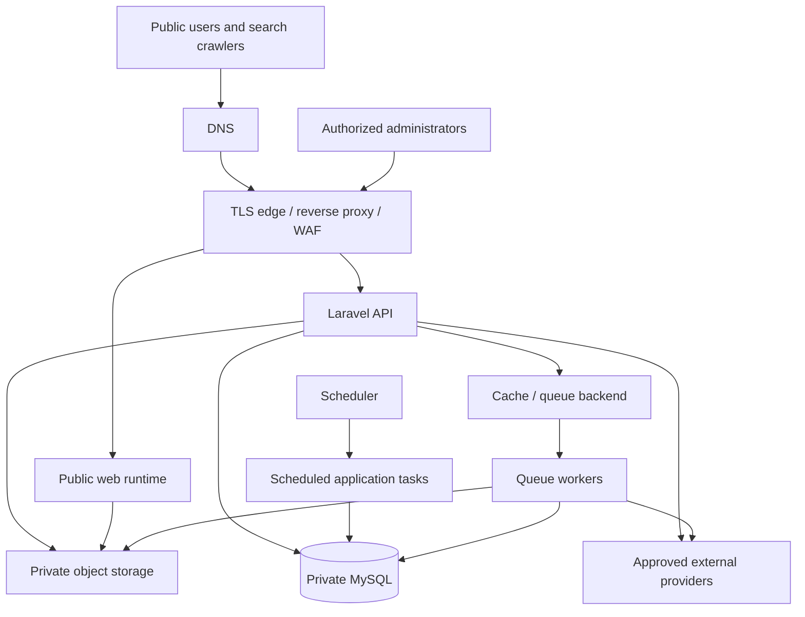

# 26. Infrastructure & Deployment

# Document Control

- **Project:** KHOJ BHET
- **Document:** 26. Infrastructure & Deployment
- **Owner:** KHOJ BHET Engineering
- **Parent:** 03. ENGINEERING & QUALITY
- **Previous:** 25. DevOps & CI/CD
- **Next:** 27. Monitoring, Logging & Backup
- **Document ID:** KB-ENG-026
- **Section:** 03. ENGINEERING & QUALITY
- **Status:** Active — Infrastructure & Deployment Architecture Baseline; provider-neutral, implementation decisions remain gated
- **Version:** 1.0
- **Last Reviewed:** 2026-10-15
- **Depends on:** 14. API Specification; 16. Backend Architecture; 17. Mobile Application Architecture; 18. Authentication & Authorization; 20. Media & File Storage; 21. Search Architecture; 22. Notification System; 23. SEO Architecture; 24. Testing & QA; 25. DevOps & CI/CD

# 1. Purpose

Define the infrastructure boundaries, environment model, deployment topology, network exposure, runtime dependencies, data persistence, operational safeguards, and deployment acceptance criteria for KHOJ BHET.

This document describes the target architecture and decision process. It does not claim that production infrastructure has already been provisioned, secured, load-tested, or approved.

# 2. Scope

This document covers:

- Public web delivery and search-engine access.
- Laravel API and Filament administration runtime.
- MySQL transactional persistence and schema migration.
- Object/media storage and delivery.
- Queue workers, scheduled jobs, cache, and supporting services.
- DNS, TLS, ingress, network segmentation, secrets, backups, monitoring, recovery, and deployment verification.
- Environment separation and production readiness.

CI workflow design belongs to **25. DevOps & CI/CD**. Application behavior and service contracts remain defined by their respective architecture documents.

# 3. Architecture Principles

1. **Security by default:** expose only required public endpoints; keep databases and internal services private.
2. **Durable data first:** application instances are replaceable; persistent data is not.
3. **Reproducibility:** infrastructure and deployment configuration must be version-controlled, reviewed, and repeatable.
4. **Environment parity:** development, staging, and production should share the same architectural assumptions, while using isolated resources and credentials.
5. **Least privilege:** separate runtime identities, deployment identities, database roles, and operator access.
6. **Observable operations:** deployments and background work must emit actionable logs, metrics, and alerts.
7. **Recoverability:** backup success is not sufficient; restoration must be tested.
8. **Explicit decisions:** hosting provider, region, topology, capacity, and service vendors are not assumed until recorded and approved.

# 4. Logical System Topology

The expected production request path is:

This is a logical view, not a commitment to one physical host, container platform, cloud vendor, or managed service. The public web runtime may be deployed separately from the API. Internal traffic must use private networking or equivalent access controls wherever supported.

# 5. Environments

## 5.1 Required environments

- **Local development:** developer-controlled, disposable services and synthetic/test data where possible.
- **CI/test:** isolated, short-lived resources; no production secrets or production customer data.
- **Staging:** production-like topology for release verification, integration tests, migration rehearsal, and operational checks.
- **Production:** customer-facing system with restricted access, durable storage, monitoring, backups, and documented recovery.

Each environment must have distinct credentials, database instances or equivalent isolation, storage namespaces/buckets, Firebase project/configuration where applicable, payment-provider credentials, and external integration settings. Staging must not be able to write to production resources.

## 5.2 Environment configuration

Configuration must be supplied through the deployment platform's environment/configuration mechanism or a secret manager. Do not commit secrets to source control, container images, mobile bundles, build logs, or documentation.

Maintain a documented inventory of required variables, their purpose, owner, environment, rotation procedure, and whether they are secret. Validate required configuration at startup and fail closed when a critical value is absent or invalid.

# 6. Runtime Components and Responsibilities

| Component | Responsibility | Deployment requirement |
| --- | --- | --- |
| Public web | Public listing pages, metadata, SEO routes, and web UX | HTTPS; caching rules must not leak private/user-specific content |
| Laravel API | Business rules, authorization, validation, transactions, integrations | Stateless request handling where feasible; health checks; controlled configuration |
| Filament admin | Restricted administrative operations | Strong authorization; ideally restricted through role/access policy and additional network controls where practical |
| MySQL | Authoritative transactional data | Private network; persistent storage; tested backups; least-privilege users |
| Object/media storage | Uploaded listing media and derived assets | Durable storage; private-by-default originals where needed; controlled public delivery |
| Queue workers | Notifications, media processing, integrations, and asynchronous work | Independently supervised; retry/backoff; idempotent job design |
| Scheduler | Periodic cleanup, expiry, notification, and maintenance tasks | Single logical scheduler per environment or duplicate-safe jobs |
| Cache/queue backend | Cache, locks, and queue transport where selected | Private access; persistence/eviction behavior explicitly configured |
| Edge layer | TLS termination, routing, request limits, optional WAF | Security headers, timeouts, body-size limits, access/error logs |
| Observability | Logs, metrics, traces, uptime and alerting | Restricted access; secrets and sensitive payloads redacted |

Already adopted elsewhere and not reopened here: Hostinger VPS hosting (Documents 09 and 10), Redis for cache, locks and queue transport (Document 10), local server storage behind the storage abstraction (ADR-005), and FCM for push (ADR-007). The selection of edge protection/WAF and monitoring tools remains an implementation decision.

# 7. Network and Access Architecture

- Publicly expose only required web/API entry points and explicitly approved verification or callback endpoints.
- Keep MySQL, cache/queue services, internal dashboards, worker control ports, and management interfaces off the public internet.
- Use TLS for all public traffic and authenticated service-to-service connections where supported.
- Apply ingress rules, outbound egress restrictions, request size/time limits, and rate limits appropriate to each endpoint.
- Restrict administrative access by identity, role, MFA where available, and network controls where feasible.
- Use separate deploy and runtime identities. Deployment credentials must not be available to normal application requests.
- Document DNS ownership, record purpose, TTL strategy, TLS certificate issuance/renewal, and expiration alerts.
- Do not assume a specific cloud firewall, private network, WAF, or load balancer until the provider is selected.

# 8. Identity, Authentication, and Authorization

- Public client identity is established using Firebase Authentication as defined by the authentication architecture.
- The Laravel API validates Firebase ID tokens and enforces application authorization; infrastructure must not replace application-level authorization.
- Filament access is restricted to explicitly authorized administrative users.
- Service accounts and integration credentials use minimum required permissions and separate environment-specific identities.
- Administrative and deployment access must be individually attributable and revocable.
- Do not place privileged service-account credentials or payment secrets in browser code or mobile application bundles.

# 9. Database Deployment and Migration

- MySQL is the authoritative transactional store.
- Application database connections must use a dedicated least-privilege runtime account; migration execution uses a separately controlled identity where practical.
- Database ports are private and firewall-restricted.
- Migrations must be reviewed, version-controlled, tested against a representative schema, and executed as a controlled release step.
- Prefer backward-compatible expand-and-contract changes when a rolling deployment or rollback may overlap old and new application versions.
- Never assume that rolling back application code automatically reverses a database migration.
- Before destructive or difficult-to-reverse changes, require a verified backup or recovery point and an explicit rollback/forward-fix plan.
- Define connection limits, query timeout policy, storage growth monitoring, and maintenance ownership.
- Use production-like migration rehearsal before releases that change schema, indexes, or data semantics.

# 10. Media and File Storage

- Store durable media outside ephemeral application containers or instances.
- Enforce upload validation, file-size limits, allowed media types, safe filenames/keys, authorization, and malware/scanning controls where available and justified.
- Separate private originals from public derivatives when access policy requires it.
- Use controlled URLs or signed URLs for private content; public media delivery must not bypass listing visibility or moderation policy.
- Define retention, deletion, orphan cleanup, backup, and lifecycle rules.
- Keep media storage credentials least-privileged and separate by environment.
- Follow **20. Media & File Storage** for media lifecycle, transformation, and access rules.

# 11. Queue Workers and Scheduled Jobs

- Run queue workers under a process supervisor or managed worker service with restart and health monitoring.
- Configure retries, backoff, timeout, failure handling, and a failed-job review/replay process.
- Jobs that may be retried must be idempotent or protected by deduplication/locking to prevent duplicate notifications, payments, or external side effects.
- Use durable queue semantics when job loss would affect user-visible or financial workflows.
- Schedule periodic jobs in a way that avoids accidental duplicate execution; use locks or duplicate-safe behavior where necessary.
- Alert on sustained queue backlog, repeated failures, stuck jobs, and missed scheduled work.
- Keep long-running workers compatible with release procedures and restart them when code/configuration changes require it.

# 12. External Integrations

External services may include Firebase Authentication, payment providers, push notification delivery, email/SMS services, media/CDN services, and other explicitly approved providers.

For each integration, document:

- Environment-specific endpoints and credentials.
- Network timeout, retry, backoff, and circuit-breaker behavior where appropriate.
- Webhook/callback verification, replay protection, and idempotency.
- Provider rate limits, quotas, error handling, and operational contact path.
- Data shared with the provider and retention implications.
- Test/sandbox mode and release verification procedure.

Payment state must be reconciled using verified provider responses and server-side business rules. A browser redirect or client assertion alone is not proof of successful payment.

# 13. Container and Host Requirements

Where containers are selected:

- Build immutable, versioned images from reviewed source.
- Pin production deployments to explicit image tags or digests; do not deploy mutable `latest` tags.
- Run as a non-root user when supported, minimize image contents, and avoid embedding secrets.
- Use explicit health checks, resource requests/limits where supported, and graceful shutdown.
- Mount persistent volumes only where needed and document ownership/permissions.
- Keep runtime configuration outside the image.
- Scan base images and dependencies and rebuild on relevant security updates.

Where virtual machines or bare-metal hosts are selected, apply equivalent controls for patching, process supervision, access control, resource monitoring, and repeatable provisioning.

# 14. Scaling and Availability

Capacity and high-availability requirements must be based on measured traffic, business criticality, budget, and operational capacity—not invented estimates.

- Keep API request handling stateless where practical so additional instances can be added.
- Scale workers independently from web/API traffic when the chosen platform supports it.
- Identify single points of failure in database, storage, DNS, edge, and background processing.
- Define connection pooling and concurrency limits before increasing API replicas.
- Use caching only where invalidation and authorization semantics are understood.
- Establish service-level objectives and acceptable downtime before selecting multi-zone or multi-region designs.
- Test performance under representative workload before committing to capacity targets.

# 15. Security Operations

- Apply operating-system, runtime, framework, dependency, and container security updates through a reviewed patch process.
- Use MFA for privileged infrastructure accounts where available.
- Restrict shell/console access and log privileged actions.
- Rotate credentials on a defined schedule and immediately after suspected exposure or personnel/access changes.
- Redact passwords, access tokens, Firebase tokens, payment secrets, and sensitive personal data from logs.
- Set secure headers, request limits, and appropriate cross-origin rules at the correct application/edge layer.
- Maintain an incident procedure covering triage, containment, credential rotation, evidence preservation, recovery, and communication.
- Do not rely on network controls as a substitute for application authorization and input validation.

# 16. Backup and Disaster Recovery

Define and approve Recovery Point Objective (RPO) and Recovery Time Objective (RTO) before production launch.

Back up, as applicable:

- MySQL data and required database configuration.
- User-uploaded media and associated metadata.
- Critical deployment/configuration definitions and infrastructure state.
- Essential operational records needed to restore service safely.

Backup controls:

- Encrypt backups in transit and at rest.
- Store copies separately from the primary failure domain and restrict deletion permissions.
- Set retention periods based on legal, operational, and storage requirements.
- Monitor backup completion and age.
- Document restore ordering and dependencies.
- Run scheduled restore tests and record evidence, elapsed time, data integrity checks, and unresolved gaps.

A backup is not considered validated until restoration has been tested. Infrastructure rebuild procedures must not delete persistent production data as a side effect.

# 17. Monitoring, Logging, and Alerting

Monitor the availability and health of public routes, API error rate/latency, database connectivity and capacity, storage usage, queue backlog/failures, scheduled job completion, certificate expiry, backup freshness, and external integration failures.

- Use structured logs with correlation/request identifiers.
- Keep logs access-controlled and define retention.
- Exclude credentials, raw authentication tokens, and unnecessary sensitive payloads.
- Create actionable alerts with severity, owner, runbook, and escalation path.
- Distinguish liveness checks from readiness checks; readiness must reflect whether an instance can safely receive traffic.
- Provide a minimal health endpoint without disclosing secrets, internal topology, or sensitive diagnostics.
- Review alerts during staging and production exercises to reduce both missed incidents and alert fatigue.

# 18. Deployment and Release Procedure

The exact pipeline mechanics are specified in **25. DevOps & CI/CD**. The infrastructure release procedure must support these gates:

1. Confirm the release artifact, version, configuration changes, and approved change record.
2. Confirm automated tests, security checks, and build validation passed.
3. Verify backup/recovery readiness for high-risk database or infrastructure changes.
4. Apply backward-compatible schema changes in the approved order.
5. Deploy the versioned artifact to the target environment.
6. Run health/readiness checks and targeted smoke tests.
7. Verify login/token validation, critical listing flows, media access, administrative authorization, payment integration sandbox/live-safe checks, and background processing as applicable.
8. Observe error rates, logs, queue behavior, and resource health during the release window.
9. Promote or complete the release only when acceptance checks pass.
10. If checks fail, execute the documented rollback or forward-fix plan and verify the service is healthy.

Production changes must be attributable, reviewable, and recorded. Avoid untracked manual changes that create configuration drift.

# 19. Rollback and Recovery Strategy

- Keep the last known-good application artifact and deployment configuration identifiable.
- Define rollback triggers and who may authorize a rollback.
- Prefer application rollback only when it remains compatible with the current database schema and persisted data.
- For irreversible schema/data changes, use a forward-fix or tested restoration plan rather than an unsafe automatic reversal.
- Document queue draining/restart behavior, scheduled task coordination, cache invalidation, and integration side effects.
- After recovery, verify critical user journeys, data integrity, and background processing.
- Record the cause, timeline, impact, and corrective actions after a failed deployment or incident.

# 20. Privacy and Data Lifecycle

- Store only data required for product, security, legal, and operational needs.
- Separate operational logs from business records and apply suitable retention/access policies.
- Restrict production data access to authorized personnel and approved support cases.
- Use synthetic or anonymized data for non-production testing where practical.
- Define deletion propagation for database records, media objects, caches, search indexes, and backups consistent with applicable retention obligations.
- Document data residency and provider processing implications after infrastructure vendors and hosting regions are selected.

# 21. Cost and Resource Governance

- Track compute, database, storage, backup, egress, logging, CDN, and third-party service costs.
- Set budget alerts and capacity thresholds where supported.
- Apply lifecycle/retention rules to disposable artifacts and non-production resources.
- Avoid premature multi-region or high-availability complexity without an agreed requirement.
- Review capacity and cost together; do not reduce security, backup, or reliability controls solely to meet an arbitrary low-cost target.

# 22. Production Readiness Checklist

- [ ]  Hosting provider, region, deployment topology, and service ownership are approved.
- [ ]  DNS, TLS issuance/renewal, ingress rules, and required public routes are verified.
- [ ]  Staging and production are isolated and use distinct credentials/resources.
- [ ]  Secrets are stored outside source control and rotate through a documented process.
- [ ]  MySQL is private, least-privilege access is configured, and migrations have been rehearsed.
- [ ]  Persistent media storage and delivery permissions are validated.
- [ ]  Queue workers and scheduled jobs are supervised and monitored.
- [ ]  Health/readiness checks and actionable alerts are active.
- [ ]  Backup jobs are monitored and a restore test has passed.
- [ ]  RPO/RTO and incident ownership are approved.
- [ ]  Deployment, smoke test, rollback, and forward-fix procedures are documented.
- [ ]  Critical flows pass in staging with the release candidate.
- [ ]  Security/dependency/container checks have passed according to policy.
- [ ]  Privacy, retention, and production-data access controls are reviewed.
- [ ]  Cost, capacity, and operational ownership are accepted.
- [ ]  Release evidence is stored and the production go/no-go decision is recorded.

# 23. Decisions Required Before Production

The following decisions are intentionally open until verified and approved:

- Production region, VPS plan and sizing (Hostinger VPS is the baseline per Documents 09 and 10; confirm plan, region and backup add-ons).
- Public web and Laravel API hosting model.
- Container platform versus managed/runtime or VM deployment.
- MySQL managed versus self-managed topology, backup/PITR capabilities, and high availability.
- Future object-storage and CDN/media delivery provider (V1 uses local storage behind the abstraction per ADR-005; a CDN is not required for V1).
- Redis sizing, persistence and eviction settings (Redis is the baseline per Document 10).
- Edge proxy/WAF and rate-limiting implementation.
- Monitoring, logging, error tracking, and alerting providers.
- Approved RPO, RTO, uptime targets, and support/incident coverage.
- Capacity targets, load-test thresholds, and cost budget.
- Production release approval and emergency-change authority.

Record each decision with owner, rationale, date, trade-offs, and follow-up work. Do not infer approval from an example or an implementation suggestion.

# 24. Ownership and Change Control

The engineering owner maintains this document and coordinates with backend, web, mobile, QA, security, and operations owners. Any change to public exposure, authentication boundaries, database topology, persistence, backup strategy, deployment promotion, or recovery expectations requires review against the relevant architecture documents.

# 25. Related Documents

- **14. API Specification** — public API contracts and error behavior.
- **16. Backend Architecture** — Laravel services and server-side responsibilities.
- **17. Mobile Application Architecture** — mobile client delivery and release boundaries.
- **18. Authentication & Authorization** — identity, token validation, and access rules.
- **20. Media & File Storage** — upload, storage, delivery, and lifecycle behavior.
- **21. Search Architecture** — search indexing and consistency expectations.
- **22. Notification System** — push/notification delivery and asynchronous workflows.
- **23. SEO Architecture** — public web indexing, metadata, and crawler requirements.
- **24. Testing & QA** — test strategy and release acceptance evidence.
- **25. DevOps & CI/CD** — pipeline, artifact promotion, and automated release gates.

# 26. Changelog

- **2026-10-15 — v1.0:** Created the provider-neutral infrastructure and deployment baseline. Explicitly separated target architecture from implemented infrastructure and listed decisions required before production.

## TV-09 Infrastructure Evidence Gate — 2026-10-18

This document is a provider-neutral target architecture, not proof of deployed infrastructure. Before production readiness, record the selected provider/region/topology, environment separation, DNS/TLS and renewal checks, trusted-proxy/IP rate-limit tests, network exposure review, runtime/deploy identity separation, capacity/health checks, queue and scheduled-job operation, and migration/recovery rehearsal. Approve RPO/RTO and verify recovery from backups covering database, media, and critical configuration. **TV-09 status: NOT VERIFIED; no deployed-environment evidence was supplied in this review.**